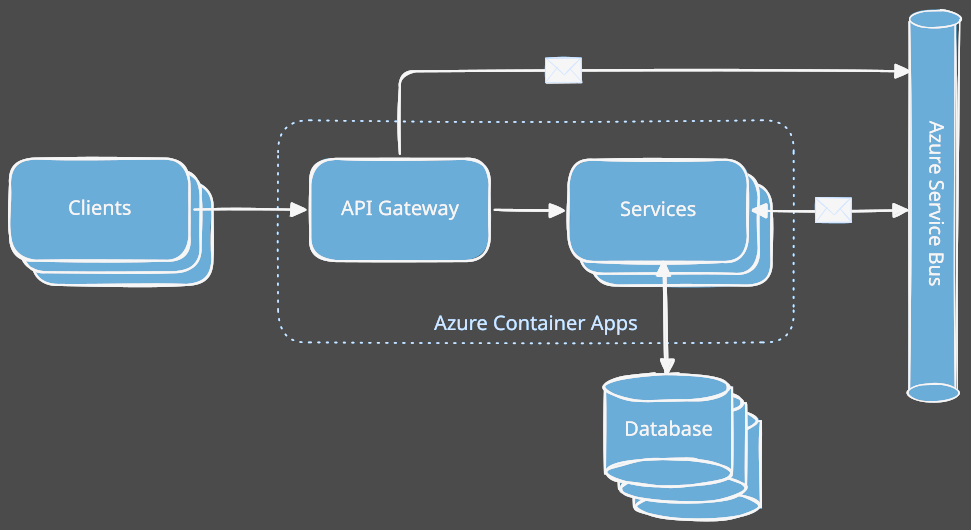
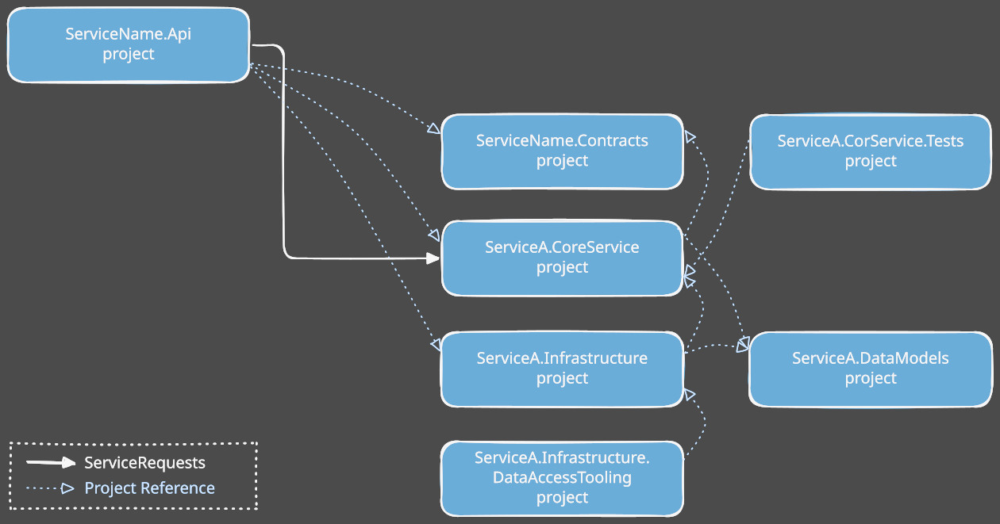

<!-- region start: Header-->
<!-- Header template: @.claude\skills\cat-internal-create-header\header.template.md, RootPath: . -->
<link href="./resources/styles/style.css" rel="stylesheet" />
<table>
    <tr>
        <td colspan='6' style='text-align: center; font-weight: bold; border: none; border-top: 1px dashed #494949; border-bottom: 1px dashed #494949;'>
             Clean Architecture Toolkit for .NET
        </td>
    </tr>
    <tr>
        <td colspan='5' style='padding: 0; vertical-align: middle; border: none;'>
            Clean Architecture Toolkit is a clean, modular architecture foundation for .NET applications. 
            It embraces SOLID principles and focuses on maintainability, testability, and scalability through clear boundaries and pluggable design.</td>
        <td style='padding: 0; border: none;' width='220'>
            
        </td>
    </tr>
    <tr>
        <td colspan='6' markdown='1' style='padding-left: 0; padding-right: 0; padding-top: 15px; padding-bottom: 0; border: none; border-top: 1px dashed #494949; border-bottom: 1px dashed #494949;'>

&#124;&nbsp;&nbsp;&nbsp;[HOME](./README.md)&nbsp;&nbsp;&nbsp;&#124;&nbsp;&nbsp;&nbsp;[REPO OVERVIEW](./README.md#repo-overview)&nbsp;&nbsp;&nbsp;&#124;&nbsp;&nbsp;&nbsp;[DEMO](./demo/README.md)&nbsp;&nbsp;&nbsp;&#124;

</td>
</tr>
</table>
<!-- region end: Header-->

<!-- region start: TemplateSkill-->
<!-- Use the cat-internal-create-readme skill to update this readme.-->
<!-- region end: TemplateSkill-->

# Clean Architecture Toolkit for .NET <!-- omit in toc -->  

## Table of contents <!-- omit in toc -->  
<!-- region start: TableOfContents-->
- [Getting Started](#getting-started)
- [About this project](#about-this-project)
- [Repo overview](#repo-overview)
- [Application Architecture](#application-architecture)
  - [Clients](#clients)
  - [API gateway](#api-gateway)
  - [Services](#services)
  - [Communication between services](#communication-between-services)
  - [Database](#database)
  - [How a request flows through the system](#how-a-request-flows-through-the-system)
  - [Design principles](#design-principles)
  - [How the modules fit in](#how-the-modules-fit-in)
- [Service Project structure](#service-project-structure)
  - [Overview](#overview)
  - [ServiceName.Api](#servicenameapi)
  - [Background workers](#background-workers)
  - [ServiceName.CoreService](#servicenamecoreservice)
  - [ServiceName.Infrastructure](#servicenameinfrastructure)
  - [ServiceName.Contracts](#servicenamecontracts)
  - [ServiceName.DataModels](#servicenamedatamodels)
  - [ServiceName.Infrastructure.DataAccessTooling](#servicenameinfrastructuredataaccesstooling)
  - [ServiceName.CoreService.Tests](#servicenamecoreservicetests)
  - [Reference rules](#reference-rules)
<!-- region end: TableOfContents-->

## Getting Started
<!-- region start: GettingStarted-->

 
  

The `Clean Architecture Toolkit for .NET` contains a set of modules.  
Most of the modules can be used independently.  
Some modules depend on other modules, in the documentation of each module you can find the list of the dependencies.  
<!-- region end: GettingStarted-->

## About this project
<!-- region start: AboutThisProject-->

> 
> 

>
> **A note from the author**  
> I build the Clean Architecture Toolkit in my free time.  
> Did you find an issue? Please [create an issue](https://github.com/gmarginet/CleanArchitectureToolkit/issues) on GitHub.  
> I will do my best to fix it as soon as possible, but I can not guarantee a due date.  
>
> **About me**  
> I'm Gert Marginet, a .NET software architect from Geraardsbergen, Belgium.  
> I have over twenty years of experience in software development, architecture and team leading.  
> I studied electronics and started out as a software engineer in 1997. Since then I have designed custom architectures and application frameworks for .NET.  
> Outside of work you find me hiking in nature or keeping ants, where I design and 3D-print their nests and outworlds myself.  
>
> [Project Website](https://gmarginet.github.io/CleanArchitectureToolkit/) &#124; [Personal Website](https://gert.marginet.be/) &#124; [LinkedIn](https://www.linkedin.com/in/gertmarginet/) &#124; [GitHub](https://github.com/gmarginet)
> 

<!-- region end: AboutThisProject-->

## Repo overview
<!-- region start: RepoOverview-->

> **New** means not started yet.  
> **Building** means building has started. Breaking changes are still possible.  
> **Stable** means fully built.  

| Name | Description | # |
|------|-------------|---|
| [Cat.Api.Client](./modules/Cat.Api.Client/README.md) |   Call another service through the API gateway with a typed client, and get the outcome back as a response. |  |
| [Cat.Api.Gateway](./modules/Cat.Api.Gateway/README.md) |   The single front door of an application. It routes the calls of clients and services to the right service, checks the token in one place and builds on YARP. |  |
| [Cat.Auditing](./plans/Cat.Auditing.md) |   Records who changed what and when. | 9 |
| [Cat.Authorization](./plans/Cat.Authorization.md) |   A decorator that checks permissions before a service request runs. | 13 |
| [Cat.Caching](./plans/Cat.Caching.md) |   A caching decorator for queries. | 12 |
| [Cat.Commands](./modules/Cat.Commands/README.md) |   Change state through one entry point. Describe a change as a command, write one handler for it, and let the processor find the handler. |  |
| [Cat.Dapper](./plans/Cat.Dapper.md) |   Base query and command handlers for Dapper, including bulk operations. | 11 |
| [Cat.Decorators](./modules/Cat.Decorators/README.md) |   Wrap handlers in decorators for cross-cutting work like logging, validation or tracing. | 16 |
| [Cat.EFCore](./modules/Cat.EFCore/README.md) |   Configure Entity Framework Core entities the same way every time, with base classes for regular, temporal and reference data. | 10 |
| [Cat.EventAggregators](./modules/Cat.EventAggregators/README.md) |   Let parts of your app talk to each other through in-process events, without direct dependencies. |  |
| [Cat.EventProcessor](./modules/Cat.EventProcessor/README.md) |   Worker support that turns incoming messages into service requests. | 4 |
| [Cat.Expressions](./modules/Cat.Expressions/README.md) |   Compile member access expressions once and reuse them, so repeated calls stay fast. |  |
| [Cat.Extensions](./modules/Cat.Extensions/README.md) |   Small extension method libraries for enumerables, expressions, objects, service collections and strings. |  |
| [Cat.FluentWorkflows](./modules/Cat.FluentWorkflows/README.md) |   Describe a business process as a list of steps in plain C#. | 7 |
| [Cat.Localizations](./modules/Cat.Localizations/README.md) |   Look up localized strings by key, without tying your app to one localization provider. | 1 |
| [Cat.Messaging](./modules/Cat.Messaging/README.md) |   Send messages to other services over Azure Service Bus, with an optional outbox so a message is never lost. | 3 |
| [Cat.Minimal.Api](./modules/Cat.Minimal.Api/README.md) |   Map service requests to minimal API endpoints that document the responses they return and share one error shape. |  |
| [Cat.Queries](./modules/Cat.Queries/README.md) |   Read data through one entry point. Describe a read as a query, write one handler for it, and let the processor find the handler. |  |
| [Cat.Resilience](./plans/Cat.Resilience.md) |   Retry and circuit breaker decorators for calls to other services and integrations. | 14 |
| [Cat.Responses](./modules/Cat.Responses/README.md) |   Return the outcome of an operation as a response, either succeeded with a value or failed with errors. |  |
| [Cat.Sagas](./plans/Cat.Sagas.md) |   Long running workflows that send a message, wait for the answer and carry on. | 8 |
| [Cat.Scheduling](./plans/Cat.Scheduling.md) |   Worker support that turns schedules into service requests. | 5 |
| [Cat.ServiceRequests](./modules/Cat.ServiceRequests/README.md) |   Run application use cases through one entry point, with validation, logging and tracing decorators. |  |
| [Cat.Sql.Cdc](./plans/Cat.Sql.Cdc.md) |   Turns SQL Server change data capture changes into service bus calls. | 17 |
| [Cat.Telemetry](./plans/Cat.Telemetry.md) |   Shared tracing and metrics setup for all services. | 15 |
| [Cat.UnitTesting](./plans/Cat.UnitTesting.md) |   Helpers for unit tests, like test doubles for processors and responses, in small projects you pick from. | 6 |
| [Cat.Validators](./modules/Cat.Validators/README.md) |   Check a model against fluent rules and get every problem back in one response. |  |
| [Cat.Demo](./demo/README.md) |   A small bookshop with a Catalog service and an Order service. Run it locally and read the code as a working example of the modules. | 2 |
| [Cat.Skills](./plans/Skills.md) |   Claude Code skills, shipped as a plugin, that teach Claude the CAT conventions in the projects of the developers who use the toolkit. | 18 |
| [Cat.Templates](./plans/Cat.Templates.md) |   `dotnet new` templates that create a new service with this project structure. | 19 |

<!-- region end: RepoOverview-->

## Application Architecture
<!-- region start: ApplicationArchitecture-->

The modules are built with a certain application architecture in mind.  
It is a set of small services behind one entry point, talking to each other through messages.  
Every service has a clear job, owns its data and keeps its business logic apart from the technology around it.  

You are not required to follow this architecture to use the modules!  
Take what fits your application and leave the rest.  

The diagram shows the building blocks and how they talk to each other.  
Everything runs as containers in Azure Container Apps.  

### Clients

Clients are the applications people use, like a web app, a mobile app or a desktop app.  
They know nothing about the services behind the gateway.  

- Clients only talk to the API gateway.  
- Clients never call a service directly.  
- Clients never touch the database.  

### API gateway

The API gateway is the single front door of the application.  
It receives every request from the clients, and every call between services, and forwards it to the right service.  

- Clients need to know one address, not one per service.  
- Cross-cutting concerns like authentication and routing live in one place.  
- The gateway holds no business logic. It only routes.  

### Services

A service is a small, independently deployable application with one clear responsibility.  
Services are where the business logic lives.  

- Each service is a container, so it can be built, deployed and scaled on its own.  
- Each service owns its data and decides how it is stored. No other service reads or writes it directly.  
- Services expose their functionality through an API.  
- Services handle use cases as service requests, and split reads (queries) from writes (commands).  

The [Service Project structure](#service-project-structure) chapter explains how the projects of a single service are organized.  

### Communication between services

Services talk to each other in two ways.  

**Synchronous**  
A service calls another service and waits for the answer.  
Use it when the caller needs the result to continue.  

- Services never call each other directly. The call always goes through the API gateway.  
- The gateway is the single front door for clients and for services alike.  
- A service only needs to know the gateway address, not where the other service runs.  

**Asynchronous**  
A service publishes a message on Azure Service Bus. Other services subscribe and react in their own time.  
Use it when the sender should not wait, or when more than one service is interested in what happened.  

- The sender does not know who receives the message.  
- A slow or unavailable service does not block the sender.  
- Messages are kept on the bus until a consumer handles them.  

Prefer messages when you can. They keep the services loosely coupled.  

### Database

Every service owns its data.  
The database is an implementation detail of the service, not a shared integration point.  

- Only the owning service accesses its data.  
- Other services get at the data through the API or through messages.  
- A change to the data model never breaks another service.  

### How a request flows through the system

1. A client sends a request to the API gateway.  
2. The gateway forwards it to the right service.  
3. The service turns the request into a service request and processes it.  
4. A query reads data from the database. A command changes it.  
5. If the service needs data or an action from another service, it sends a request to the API gateway. The gateway forwards it to that service, and the answer comes back the same way.  
6. The service returns a response to the client, through the gateway.  
7. When something important happened, the service also publishes a message on Azure Service Bus. Other services pick it up and do their own work.  

### Design principles

- **Clear boundaries:** Each part has one job and a well-defined contract.  
- **Loose coupling:** Services depend on APIs and messages, not on each other's internals.  
- **Separation of concerns:** Business logic does not depend on infrastructure like the database or the message bus.  
- **Independent deployment:** Each service can be changed, released and scaled without touching the others.  
- **Pluggable design:** Cross-cutting work like validation, logging and tracing is added through decorators, not mixed into the business logic.  

### How the modules fit in

The modules support the building blocks of a service.  

| Concern                              | Modules                                                          |
|--------------------------------------|------------------------------------------------------------------|
| Handling a use case                  | [Cat.ServiceRequests](./modules/Cat.ServiceRequests/README.md)   |
| Writing data                         | [Cat.Commands](./modules/Cat.Commands/README.md)                 |
| Reading data                         | [Cat.Queries](./modules/Cat.Queries/README.md)                   |
| Consistent outcomes and errors       | [Cat.Responses](./modules/Cat.Responses/README.md)               |
| Checking input                       | [Cat.Validators](./modules/Cat.Validators/README.md)             |
| Cross-cutting work                   | [Cat.Decorators](./modules/Cat.Decorators/README.md)             |
| Business processes as steps          | [Cat.FluentWorkflows](./modules/Cat.FluentWorkflows/README.md)   |
| In-process events                    | [Cat.EventAggregators](./modules/Cat.EventAggregators/README.md) |
<!-- region end: ApplicationArchitecture-->

## Service Project structure
<!-- region start: ServiceProjectStructure-->

Every service in the [application architecture](#application-architecture) is built from the same set of projects.  
Each project has one job, and the references between them keep the business logic free of technology.  

Again you are not obliged to follow this structure to use the modules!  
The `Cat.Demo.CatalogService` projects in the `demo` folder are a small working example of it.  

The diagram uses `ServiceName` as a placeholder for the name of your service.  

### Overview

| Project                                       | Purpose                                              | Required |
|-----------------------------------------------|------------------------------------------------------|----------|
| `ServiceName.Api`                             | Host that handles HTTP requests and runs the workers | Yes      |
| `ServiceName.Scheduler`                       | Background worker that runs time-based work          | Optional |
| `ServiceName.EventProcessor`                  | Background worker that handles incoming messages     | Optional |
| `ServiceName.CoreService`                     | Business logic                                       | Yes      |
| `ServiceName.Infrastructure`                  | Database and external integrations                   | Yes      |
| `ServiceName.Contracts`                       | Service requests, contract models and enums          | Yes      |
| `ServiceName.DataModels`                      | Entities and query result models                     | Yes      |
| `ServiceName.Infrastructure.DataAccessTooling`| Generates the entities from an existing database     | Optional |
| `ServiceName.CoreService.Tests`               | Unit tests of the business logic                     | Optional |

### ServiceName.Api

The API is the one and only host of the service.  
It is the executable that runs in the container, and every service has one.  

The API contains no business logic.  
It sets up the application, registers the modules in the DI container and passes the work on to the core.  

- Exposes the service over HTTP.  
- Maps each endpoint to a service request, for example with [Cat.Minimal.Api](./modules/Cat.Minimal.Api/README.md).  
- Receives its calls from the API gateway.  
- Runs the background workers, when the service has them.  
- Registers the `Infrastructure` project in the DI container at startup. That is the only reason it references it.  

The API references the `CoreService`, `Contracts` and `Infrastructure` projects, and the worker projects it runs.  

**Development endpoints**  
In debug mode the API has an extra development endpoint group.  
It lets you try out the service without the real triggers.  

- Only available in debug mode. They are never exposed in a release build.  
- Inside the development group, each background worker has its own endpoint group.  
- Those endpoints simulate a request from the scheduler or from the event processor.  
- Call one and the service handles it as if the worker triggered it.  

### Background workers

Not all work comes in over HTTP.  
Background workers handle work that starts on its own, like a timer or a message.  

A worker is not a host. It has no executable of its own.  
It lives in its own project and runs inside the API.  

Like the API, a worker contains no business logic.  
Every unit of work becomes a service request that the core handles.  

**ServiceName.Scheduler**  
- Runs work on a schedule, like a nightly cleanup or a periodic import.  
- Every run triggers a service request.  

**ServiceName.EventProcessor**  
- Listens to Azure Service Bus.  
- Every incoming message triggers a service request.  

Both are optional. Add them only when the service needs them.  

### ServiceName.CoreService

The core is the heart of the service. It holds the business logic.  

- Contains the service request handlers.  
- Contains the definitions of the queries and commands the handlers use.  
- Contains the validators of the service requests, built with the [Cat.Validators](./modules/Cat.Validators/README.md) module. They are server side, so clients that reference the contracts do not need the validation code.  
- Maps the entities and query result models to the contract models. We suggest the [Mapperly](https://mapperly.riok.app/) NuGet package for this. It is a good mapper, so CAT has no module for mapping.  
- Knows nothing about the database or any other technology. It only references the abstractions of the [Cat.Queries](./modules/Cat.Queries/README.md) and [Cat.Commands](./modules/Cat.Commands/README.md) modules, and the [Cat.Validators](./modules/Cat.Validators/README.md) module for the validators.  
- Is the only project the unit tests need to reference.  

A handler never talks to the database itself.  
It sends a query or a command to its processor, and the infrastructure does the rest.  

The core references the `Contracts` and `DataModels` projects.  

### ServiceName.Infrastructure

The infrastructure is everything the core should not know about.  

- Contains the query handlers and the command handlers.  
- Contains the data access code, like the database context.  
- Contains the extension method that registers all of this in the DI container.  
- Holds the migrations when the service uses a code first approach.  

External integrations, like an email provider or a storage account, live here too.  
Treat them like a database. The core never calls them directly. It sends a query or a command and a handler talks to the integration.  

The infrastructure references the `CoreService` and `DataModels` projects.  
That way the dependency points inwards. The core defines the queries and commands, the infrastructure implements the handlers.  

### ServiceName.Contracts

The contracts project holds the contract of the service, the way the outside world talks to it.  

- **ServiceRequests:** The requests that callers send to the service, and the responses they get back.  
- **Models:** The contract models that the requests and responses use. They are the public shape of your data, not the entities from the `DataModels` project.  
- **Enums:** Enumerations that the requests and the contract models use. Callers need them, so they live in the contract.  

It has almost no dependencies, so it is easy to share. Sharing it is a choice, not a rule.  

**Share it or not**  
A caller of the service, whether another service or a client, can use the contract in two ways.  

- **Reference the project.** The caller reuses the request, model and enum types. There is no duplicate code, and a breaking change shows up at compile time. The price is coupling. The caller depends on your types and on your release rhythm.  
- **Keep its own models.** The caller declares only what it needs, often generated from the OpenAPI document of the service. The services stay independent. The price is duplicate types, and a change only shows up at runtime.  

Both are fine. Decide per situation, and per caller. A .NET client and a service that change together can share. A client in another technology, or a service owned by another team, probably should not. You can mix both in one application.  

### ServiceName.DataModels

The data models project holds the data classes that come out of the database.  

- **Entities:** Classes that map to a table or another store. The infrastructure reads and writes them.  
- **Results:** Classes that hold the result of a query when that result does not match an entity, for example an overview that combines fields from several entities.  
- **Enums:** Enumerations used by the entities and the results. Keeping them here means the entities and the results share one definition.  

Both the `CoreService` and the `Infrastructure` project use them.  
They are internal to the service. Never hand them out through the API. Map them to a contract model first. We suggest the [Mapperly](https://mapperly.riok.app/) NuGet package for this.  

### ServiceName.Infrastructure.DataAccessTooling

This project is only needed when the service uses a database first approach.  
It generates the entities and the database context from an existing database, for example with the Entity Framework Core scaffold command.  

- The generated entities go to the `DataModels` project.  
- The generated database context goes to the `Infrastructure` project.  
- It references the `Infrastructure` project.  

Does the service use a code first approach? Then skip this project.  
The entities are written by hand in the `DataModels` project, and the migrations live in the `Infrastructure` project.  

### ServiceName.CoreService.Tests

This project holds the unit tests of the business logic.  

- Tests the service request handlers in the core.  
- Replaces the queries and commands with test doubles, so no database is needed.  
- References the `CoreService` project.  

### Reference rules

- Dependencies point inwards. The API, the workers and the infrastructure depend on the core. The core depends on neither of them.  
- The core only references the abstractions of the CAT modules.  
- The API is the only place where everything is wired together.  
- The `Contracts` project stays small and free of service internals.  
<!-- region end: ServiceProjectStructure-->
