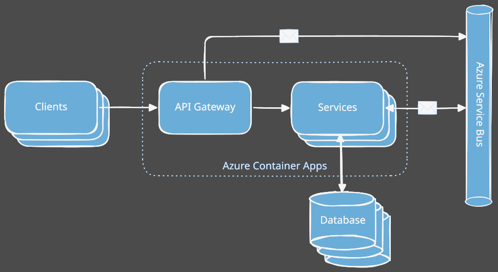
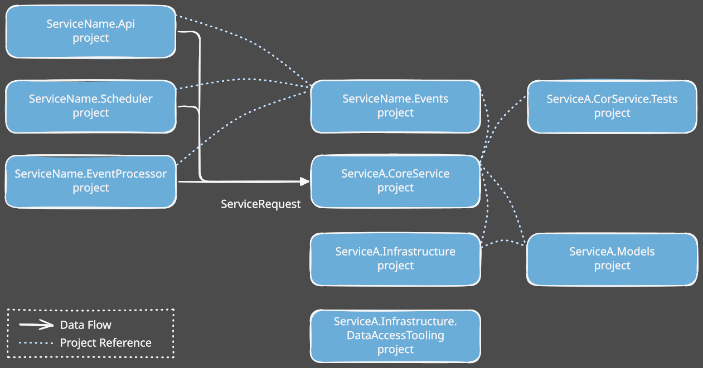

<link href="resources/styles/style.css" rel="stylesheet" />

# Clean Architecture Toolkit for .NET <!-- omit in toc -->  

<table>
    <tr>
        <td style='padding:0;'>
            Clean Architecture Toolkit is a clean, modular architecture foundation for .NET applications. 
            It embraces SOLID principles and focuses on maintainability, testability, and scalability through clear boundaries and pluggable design.</td>
        <td style='padding:0;' width='220'>
            
        </td>
    </tr>
</table>

[CAT](README.md 'Readme of the CAT project\.')  
[Module overview](README.md#module-overview 'List of all the CAT modules\.')  

# README <!-- omit in toc -->  

## Table of contents <!-- omit in toc -->  
- [Getting Started](#getting-started)
- [Application Architecture](#application-architecture)
- [Service Project structure](#service-project-structure)
- [Module overview](#module-overview)

## Getting Started

 
  

The `Clean Architecture Toolkit for .NET` contains a set of modules.  
Most of the modules can be used independently.  
Some modules depend on other modules, in the documentation of each module you can find the list of the dependencies.  

## Application Architecture

The modules are build with a certain application architecture in mind.  
But you are not required to follow this architecture to use the modules!  

[[TODO]]

## Service Project structure

The following diagram represents a diagram of the project structure of every service.  
Again you are not obliged to follow this structure to use the modules!  

[[TODO]]

## Module overview
<!-- Modules start-->
- [Cat.Commands](./modules/Cat.Commands/README.md)  
- [Cat.Decorators](./modules/Cat.Decorators/README.md)  
- [Cat.EventAggregators](./modules/Cat.EventAggregators/README.md)  
- [Cat.Expressions](./modules/Cat.Expressions/README.md)  
- [Cat.Extensions](./modules/Cat.Extensions/README.md)  
- [Cat.FluentWorkflows](./modules/Cat.FluentWorkflows/README.md)  
- Cat.Localizations `Still in Development`<!--[Cat.Localizations](./modules/Cat.Localizations/README.md)-->  
- Cat.Minimal.Api `Still in Development`<!--[Cat.Minimal.Api](./modules/Cat.Minimal.Api/README.md)-->  
- [Cat.Queries](./modules/Cat.Queries/README.md)  
- [Cat.Responses](./modules/Cat.Responses/README.md)  
- [Cat.ServiceRequests](./modules/Cat.ServiceRequests/README.md)  
- [Cat.Validators](./modules/Cat.Validators/README.md)  
<!-- Modules end-->
