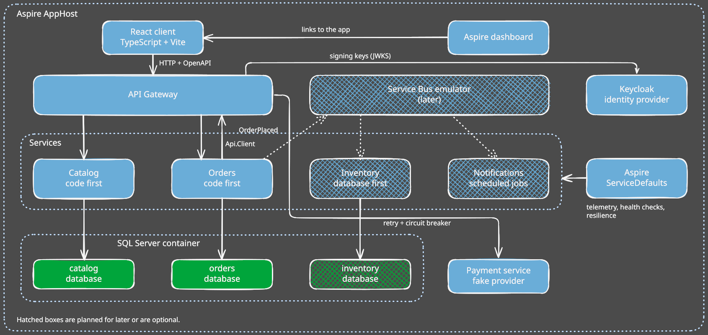
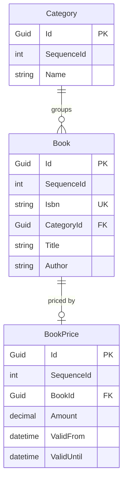
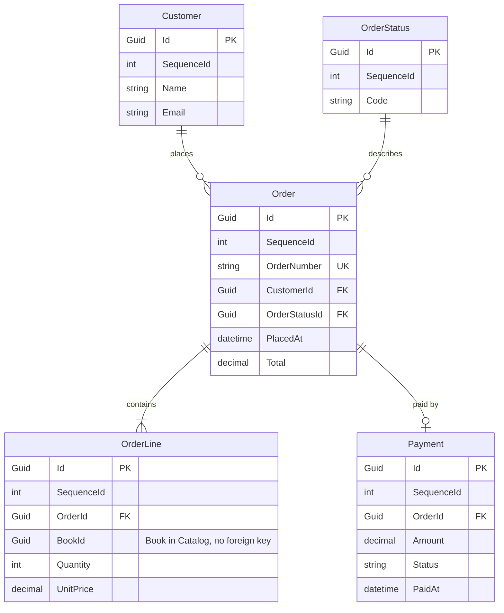
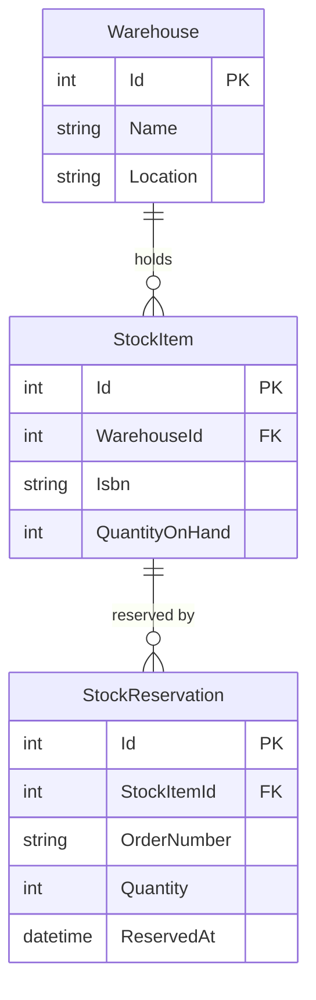

# Demo plan

This is the working plan for the demo application.  
It replaces the todo demo with a small bookshop.

## Contents

- [The idea](#the-idea)
- [Decisions and open questions](#decisions-and-open-questions)
- [Services](#services)
- [Architecture](#architecture)
- [Where each module fits](#where-each-module-fits)
- [Technology](#technology)
- [Data models](#data-models)
- [Next steps](#next-steps)
- [Interesting documentation](#interesting-documentation)

## The idea

A todo app is too limited to show every module.  
A bookshop is easy to understand, and it gives every current and future module a natural place.

Start small. Catalog plus a basic Orders service already covers most of the current modules.

## Decisions and open questions

### Decided

| Topic | Decision |
|---|---|
| Client | React with TypeScript, built with Vite. |
| Hosting | Aspire runs everything: the services, the React app, SQL Server in a container and later the Service Bus emulator. |
| Database | SQL Server in a container, started by the Aspire AppHost. One database per service. |
| Messaging | The Azure Service Bus emulator, started by the AppHost. |
| ServiceDefaults | The demo uses the Aspire ServiceDefaults project. |
| Code first or database first | Catalog and Orders are code first. Inventory is database first. |
| Inventory schema | A folder with SQL scripts, applied by the AppHost. |
| Book and order references | Orders owns its database, so `OrderLine` uses `BookId`. Inventory does not own its database, so it identifies a book by `Isbn` and an order by `OrderNumber`. |
| Order number | Unique, created when the order is placed, in the format `YYYYMMDD-0000`. The counter restarts at `0001` every day. |
| Currency | One currency, euro, to keep the demo simple. |
| API gateway | It is the API gateway from the Application Architecture chapter of the root readme. How it looks is clear once it is built. It could become a new module. |
| Notifications storage | Decided once the Scheduling module is designed. |
| Todo demo | `Cat.Demo.TodoService` is removed. Catalog is the first service of this plan. |
| First service | Catalog is built first, then Orders. |

### Open

- **How does Orders hand out the daily order number counter without duplicates?** Suggestion: a counter row per day, increased in the same transaction as the order. The unique key on `OrderNumber` stays as the safety net.
- **Where do customers come from?** Orders has a `Customer` table, but there is no login or user service yet. Suggestion: keep a simple `Customer` in Orders until the Authorization module arrives.

## Services

| Service | Job | Built |
|---|---|---|
| Catalog | Books, categories and prices. Mostly reads, with a bit of admin. | Code first |
| Orders | Customers place and track orders. This is the main service. | Code first |
| Inventory | Tracks stock and reserves it when an order comes in. | Database first |
| Notifications | Sends the order confirmed and order shipped messages. Runs the scheduled jobs. | Not decided yet |

## Architecture

- Clients only talk to the API gateway. The gateway is planned for later.
- Services call each other through the gateway, and publish messages on the Service Bus.
- Every service has its own database in the SQL Server container.
- Aspire ServiceDefaults gives every service telemetry, health checks and resilience.
- Hatched boxes in the drawing are planned for later or are optional.

## Where each module fits

### Current modules

| Module | Demonstrated by |
|---|---|
| Commands, Queries, ServiceRequests | `PlaceOrder`, `CancelOrder`, `GetOrder`, `BookSearch` |
| Responses, Validators | Validating an order. Stock and payment failures come back as error responses. |
| Decorators | Logging, validation and tracing on every request. Catalog does not use the tracing decorator yet. |
| Minimal.Api | The endpoints of each service. |
| FluentWorkflows | The place order process: validate, reserve stock, take payment, confirm. It has an `if` for out of stock and a `foreach` over the order lines. |
| EventAggregators | In-process events inside Orders, such as `OrderConfirmed` triggering a status update. |
| EFCore | Books, categories and orders as regular entities, price history as temporal data in Catalog. Every service has its own database, so the reference entity for tables of another service is not demonstrated. |
| Localizations | Categories, order statuses and email texts in a few languages. Catalog does not use it yet, so category names are plain text. |
| Expressions, Extensions | Used inside the services. |

### Future modules

| Module | Demonstrated by |
|---|---|
| Messaging, EventProcessor | Orders publishes `OrderPlaced`. Inventory and Notifications consume it. |
| Scheduling | Cancel unpaid orders after 24 hours. A nightly low stock report. |
| Api.Client | Orders asks Catalog for current prices through the gateway. |
| Dapper | Fast read-only order overview queries, next to EF Core for writes. |
| Caching | Cached catalog queries. |
| Transactions | Saving an order and its lines in one go. |
| Auditing | Who changed a price or cancelled an order. |
| Authorization | Customers see their own orders. Admins edit the catalog. |
| Resilience | Retry and circuit breaker on the payment call, which uses a fake provider. |
| Telemetry, Testing | Tracing one order across all services. The unit tests. |

## Technology

### Client

React with TypeScript, built with Vite.

- Keeps the demo client-agnostic. The services expose a normal HTTP API.
- Most widely known option.
- No shared contracts with the services. The client comes from the OpenAPI documentation that `Cat.Minimal.Api` produces.
- Keep it thin: a book list, a basket and an order overview.

Blazor WebAssembly was the alternative. It would share the `Contracts` projects, but it makes the demo look .NET only.

### Aspire and the database

SQL Server runs in a container, started by the Aspire AppHost. Every service still reads its database from a connection string, so LocalDB or an existing instance also work.

`Cat.EFCore` configures temporal tables, and only SQL Server supports them. So SQLite and PostgreSQL are out.

Aspire and Docker are also a good way for the owner to learn both.

#### What the AppHost does

One `AppHost` project in `demo/` describes the whole system:

- A SQL Server container with a volume, so data survives restarts.
- One database per service: `catalog`, `orders` and `inventory`.
- The .NET services.
- The React app.
- Later, the gateway and the Service Bus emulator.

Aspire passes connection strings and service URLs to each project. Nobody edits config files.

#### What a user does after cloning

1. Install the .NET SDK, Node and Docker Desktop.
2. Run `dotnet run --project demo/Demo.AppHost`.
3. Open the Aspire dashboard, which links to the React app.

#### Schema and seed data

- Each code first service applies its EF Core migrations at startup, in `Development` only.
- Inventory gets its schema from the SQL scripts, which the AppHost runs on startup.
- A small seeder fills in books, categories and stock when the tables are empty.
- Reset is `docker volume rm`, or a reset command on the AppHost.

#### Keeping the memory under control

Docker Desktop on Windows runs on WSL2. The VM can take up to half of the RAM by default and keeps it while it is running.

- Limit the VM in `C:\Users\<you>\.wslconfig`, for example `memory=4GB`. The limit covers the whole VM, including all containers.
- Limit SQL Server itself with `MSSQL_MEMORY_LIMIT_MB`.
- Only start Docker Desktop when running the demo. Afterwards quit it and run `wsl --shutdown`. That gives all the memory back to Windows.
- The readme of the demo explains these steps.

#### Lighter alternatives

- Point the connection strings to LocalDB or an existing SQL Server instance. LocalDB is the real SQL Server engine, so temporal tables work. It needs no VM and stops by itself when idle. The services and the React app then start with `dotnet run` and `npm run dev`.
- A plain `docker-compose.yml` with only SQL Server is for people who want a container but no Aspire.

### Messaging

The Azure Service Bus emulator runs in Docker, so it fits the Aspire setup.  
When `Cat.Messaging` arrives, the AppHost starts the emulator next to SQL Server.

### Aspire ServiceDefaults

The demo uses the Aspire ServiceDefaults project.

It sets up telemetry, health checks and resilience, which overlaps with the future `Cat.Telemetry` and `Cat.Resilience` modules. That is fine, because CAT is a toolbox.

- Use only what you need. The more modules you use, the more dependencies you get.
- The future `Cat.Telemetry` and `Cat.Resilience` modules must work in projects that do not use Aspire.
- The modules must not depend on Aspire or on ServiceDefaults.
- Both can live side by side. In the demo, ServiceDefaults covers the basics and the CAT modules add what it does not cover, such as the decorators on service requests.

## Data models

First sketches of the three databases. Names and columns are not final.

Rules that hold for all of them:

- Services own their data. A reference to another service has no foreign key.
- All amounts are in euro.
- Code first entities inherit `CatEntityBase`, so each has a `Guid` `Id` and an `int` `SequenceId`. The `Id` is a non-clustered primary key. The database generates `SequenceId` as an identity column, and it holds the clustered index.

### Catalog

`Category` and `Book` are regular entities. `BookPrice` inherits `CatTemporalEntityBase`, so SQL Server keeps every old price in a history table. `ValidFrom` and `ValidUntil` are the period columns of the temporal table. The class gets properties for them after the release of EF Core 11.

### Orders

All tables are regular entities. `OrderNumber` is unique. The service creates it when the order is placed, in the format `YYYYMMDD-0000`: the year, month and day, then a four digit counter. The counter restarts at `0001` every day, so there is room for 9999 orders a day. Two orders placed at the same moment must never get the same number, and the unique key on `OrderNumber` is the safety net.

Orders owns its database, so `OrderLine` refers to a book with `BookId`. There is no foreign key, because the book lives in the Catalog database.

### Inventory

Inventory is the database first service. A stock database often already exists, owned by a warehouse team or a DBA, with its own tables, views and maybe stored procedures. That makes it a natural fit.

The entities do not inherit `CatEntityBase` and have no `SequenceId`. Keys and column names come from the existing database. Inventory does not own the database, so it identifies a book by `Isbn` and an order by `OrderNumber`. There is no foreign key between services.

#### How the database first approach works

- **The database is the source of truth.** A folder with SQL scripts defines the schema and the seed data. People change the database, not C# classes.
- **Aspire applies it.** The AppHost creates the `inventory` database in the SQL Server container and runs the scripts on startup.
- **The model is scaffolded.** `dotnet ef dbcontext scaffold` generates the entities and the `DbContext` into `Inventory.Infrastructure`. Nobody edits the generated files. They are regenerated after a database change. Custom behavior goes in partial classes.
- **The rest of the service stays the same.** Api, CoreService and Contracts follow the normal service structure. Only the data access differs. The business logic does not care how the model was made.
- **Dapper fits well.** Views and stored procedures suit the future `Cat.Dapper` module, so Inventory can read through Dapper next to the scaffolded EF Core model.

#### How it fits with the toolkit

`Cat.EFCore` is built for code first entities, with base classes for regular, temporal and reference data. Scaffolded entities do not inherit from those, and that is fine.  
Inventory uses commands, queries, responses and decorators, but not the entity base classes. It shows that you use only the modules you need.

#### Cost

- A small SQL scripts folder and one extra step in the AppHost.
- A readme section on how to scaffold again after a database change.

## Next steps

Done:

- Catalog service built, with tests for the core service.
- `Cat.Demo.TodoService` removed.
- Readme of the demo added.

To do:

1. Close the open questions above.
2. Build Orders.
3. Handle the known gaps of Catalog below.

### Known gaps in Catalog

- **Tracing.** Add the `Cat.ServiceRequests.Decorators.ActivitySource` decorator to the Catalog requests.
- **Localizations.** Show category names in several languages with `Cat.Localizations`.
- **OpenAPI price type.** The nullable `decimal? Price` is documented as `null`, `number` or `string`, with a regex pattern. That is awkward for the generated React client. Change the OpenAPI or JSON options so `price` is a plain nullable number.
- **Duplicate ISBN race.** Two saves with the same new ISBN at the same moment can both pass the validator. The second one hits the unique index and returns a 500. Catch that database error and return the same `CAT-CTL-1000` response.

## Interesting documentation

- [.NET Aspire for beginners](https://learn.microsoft.com/nl-nl/shows/dotnet-aspire-for-beginners/)
