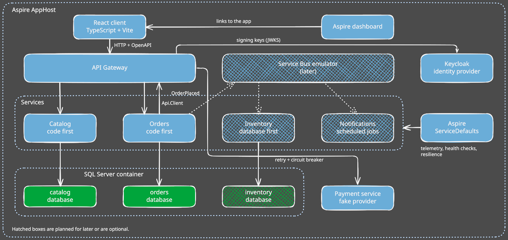
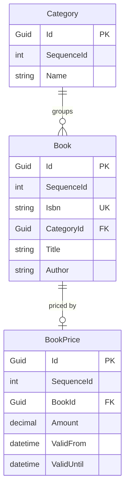
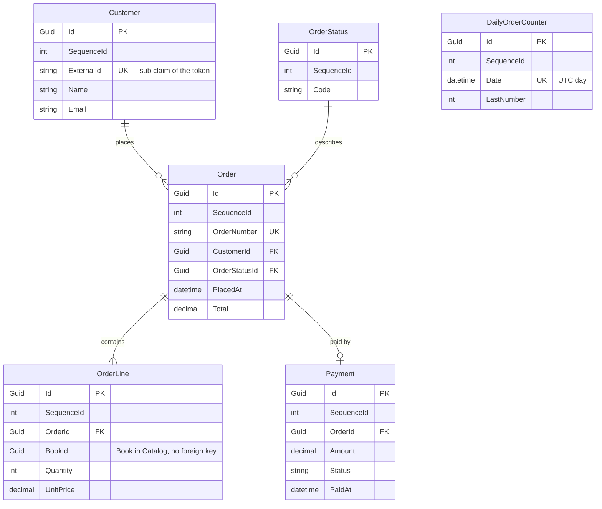
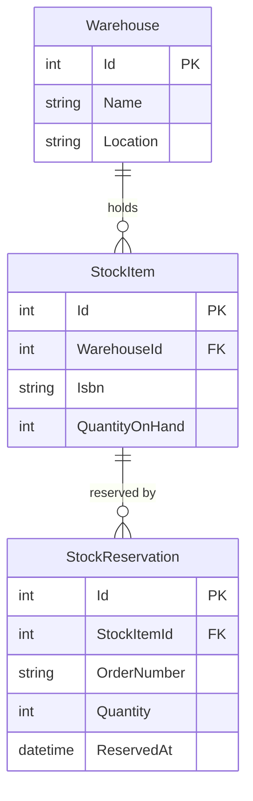

<link href="../resources/styles/style.css" rel="stylesheet" />
<table>
    <tr>
        <td colspan='6' style='text-align: center; font-weight: bold; border: none; border-top: 1px dashed #494949; border-bottom: 1px dashed #494949;'>
             Clean Architecture Toolkit for .NET
        </td>
    </tr>
    <tr>
        <td colspan='5' style='padding: 0; vertical-align: middle; border: none;'>
            Clean Architecture Toolkit is a clean, modular architecture foundation for .NET applications.<br>
            It embraces SOLID principles and focuses on maintainability, testability, and scalability through clear boundaries and pluggable design.</td>
        <td style='padding: 0; border: none;' width='220'>
            
        </td>
    </tr>
    <tr>
        <td colspan='6' markdown='1' style='padding-left: 0; padding-right: 0; padding-top: 15px; padding-bottom: 0; border: none; border-top: 1px dashed #494949; border-bottom: 1px dashed #494949;'>

&#124;&nbsp;&nbsp;&nbsp;[HOME](../README.md)&nbsp;&nbsp;&nbsp;&#124;&nbsp;&nbsp;&nbsp;[MODULE OVERVIEW](../README.md#module-overview)&nbsp;&nbsp;&nbsp;&#124;&nbsp;&nbsp;&nbsp;[DEMO](../demo/README.md)&nbsp;&nbsp;&nbsp;&#124;

</td>
</tr>
</table>

# CAT Bookshop Demo <!-- omit in toc -->  

A small bookshop that shows how the Clean Architecture Toolkit modules work together.  
The full plan is in [Demo.md](../plans/Demo.md).

## Table of contents <!-- omit in toc -->  

- [What the bookshop does](#what-the-bookshop-does)
- [Architecture](#architecture)
- [How to run](#how-to-run)
- [Building blocks](#building-blocks)
  - [React client](#react-client)
  - [Aspire AppHost and dashboard](#aspire-apphost-and-dashboard)
  - [API Gateway](#api-gateway)
  - [Service Bus emulator](#service-bus-emulator)
  - [Catalog service](#catalog-service)
  - [Orders service](#orders-service)
  - [Inventory service](#inventory-service)
  - [Notifications service](#notifications-service)
  - [Aspire ServiceDefaults](#aspire-servicedefaults)
  - [Fake payment provider](#fake-payment-provider)

## What the bookshop does

The demo is an online bookshop. Customers look at books and place orders. An admin keeps the catalog up to date.

What you can do today:

- **Browse the catalog.** See the categories and the books in them. Search for a book. Open a book to see its details.
- **See prices.** Every book has a current price in euro. The shop keeps the older prices as well.
- **Manage the catalog.** An admin can add a book or change one.
- **Place an order.** Pick books and quantities. The shop looks up the prices, checks that the books are in stock, takes the payment and confirms the order.
- **Get an order number.** Every order gets a number like `20261105-0001`. The date is the day of the order. The counter starts again every day.
- **Follow your orders.** See a list of your orders and open one to see its lines, its total and its status.
- **Cancel an order.** Change your mind after ordering and cancel it.
- **Stay private.** A customer only sees their own orders. An admin sees all of them.

What the shop does when something goes wrong:

- A book that is not in stock stops the order. The order is cancelled and the customer is told which book is the problem.
- A payment that is declined stops the order in the same way.

For now stock and payment are pretend. Any line of more than 50 copies is out of stock. Any total above 500 euro is declined. When you start the shop with Aspire, the order asks the catalog for the real price of every book.

What comes later:

- A real stock service that keeps the stock levels.
- Emails when an order is confirmed or shipped.
- A web shop to click through, with a login.
- Nightly jobs, such as cancelling orders that are not paid.

## Architecture

The demo is a small system of services, each with its own database. The services are built the same way, with the project structure from the root [README](../README.md#service-project-structure). A client talks to them through an API gateway. Services tell each other about events through a message bus.



Hatched boxes are not built yet. Solid boxes are. The drawing and the status of every block are kept in sync with the code.

### How the pieces fit

- **Clients** only talk to the API gateway. The gateway is planned. Until then you call the services directly.
- **Services** own their data. A service never reads the database of another service. Where one needs data of another, it asks through an interface. Orders asks Catalog for prices over HTTP when you run through Aspire. Stock and payment are still fakes.
- **Contracts.** Sharing the contracts of a service is a choice per connection. The React client and the price call from Orders to Catalog keep their own models. A later service to service call will share contracts, so the demo shows both. See [Sharing contracts](../plans/Demo.md#sharing-contracts).
- **Events** between services will travel over the Service Bus. Inside a service, events stay in memory.
- **Databases.** Every service has its own SQL Server database.
- **Aspire** starts everything with one command: the services, SQL Server in a container and the dashboard. You can still start a service on its own.

### How a request flows through a service

1. An endpoint receives the HTTP request and turns it into a service request.
2. The service request processor runs the decorators: logging, tracing and validation.
3. A handler runs the use case. It reads through queries and changes data through commands.
4. The result comes back as a response, either a value or a list of errors.
5. The endpoint turns the response into an HTTP status code and a body.

### Where the CAT modules sit

| Layer | Modules |
|---|---|
| API | `Cat.Minimal.Api` |
| Core service | `Cat.ServiceRequests`, `Cat.Queries`, `Cat.Commands`, `Cat.Validators`, `Cat.Responses`, and in Orders also `Cat.FluentWorkflows` and `Cat.EventAggregators` |
| Infrastructure | `Cat.EFCore` |
| Everywhere | `Cat.Expressions` |

The [building blocks](#building-blocks) explain where each module is used and why.

## How to run

The main route is the Aspire AppHost. One command starts Catalog, Orders and SQL Server, and opens the dashboard. You can also start one service on its own, see [Run one service](#run-one-service).

### Prerequisites

- The .NET SDK that `global.json` asks for.
- **Docker Desktop** for the default route. SQL Server runs in a container.
- Or a SQL Server you already have, and no Docker. Temporal tables need SQL Server, so SQLite and PostgreSQL do not work.

### Run with Aspire

1. Clone the repository and open a terminal in its root folder.
2. Start the AppHost:
   ```
   dotnet run --project demo/Cat.Demo.AppHost/Cat.Demo.AppHost --launch-profile http
   ```
3. Wait until the dashboard shows `catalog` and `orders` as running. The first start pulls the SQL Server image, about 1.5 GB, so it takes a few minutes.
4. Open the dashboard at `http://localhost:15101`. It needs no login. It shows the logs, traces, metrics and health checks of both services.
5. Try the endpoints. Catalog runs on `http://localhost:5101` and Orders on `http://localhost:5102`. Open these files in Visual Studio or Rider and run the requests from top to bottom. Later requests use ids from earlier responses.
   - `demo/Cat.Demo.CatalogService/Cat.Demo.CatalogService.Api/CatalogRequests.http`
   - `demo/Cat.Demo.OrderService/Cat.Demo.OrderService.Api/OrderRequests.http`
6. Place an order and open its trace in the dashboard. It shows the call from Orders to Catalog for the prices.
7. Press Ctrl+C to stop. The database lives in the Docker volume `cat-demo-sql-data`, so the data is still there at the next start.

To start again with empty databases, stop the AppHost and remove the volume:

```
docker volume rm cat-demo-sql-data
```

### SQL Server modes

The setting `Sql:Mode` of the AppHost picks where the databases live.

| Mode | What happens | Needs |
|---|---|---|
| `Container` (default) | The AppHost starts a SQL Server container with the data volume and creates the databases `catalog` and `orders`. The password is generated and kept in the user secrets. | Docker |
| `Existing` | The AppHost passes the connection strings `ConnectionStrings:catalog` and `ConnectionStrings:orders` to the services. The defaults point to the local default instance. | A SQL Server you can reach |

To use `Existing`, set the mode in the user secrets of the AppHost:

```
dotnet user-secrets set "Sql:Mode" "Existing" --project demo/Cat.Demo.AppHost/Cat.Demo.AppHost
```

To point it at another server, set `ConnectionStrings:catalog` and `ConnectionStrings:orders` in the same way. The defaults use Windows authentication, which works for a local process only.

### Docker memory

Docker Desktop on Windows runs on WSL2. By default the WSL2 virtual machine can take half of your RAM and keeps it while it runs.

- **Limit WSL2.** Create `%UserProfile%\.wslconfig`, then run `wsl --shutdown` and restart Docker Desktop. This is an example for a machine with 32 GB:
  ```
  [wsl2]
  memory=8GB
  processors=4
  swap=2GB

  [experimental]
  autoMemoryReclaim=gradual
  sparseVhd=true
  ```
- **Use the WSL 2 backend** in Docker Desktop, and turn off start at sign-in.
- **SQL Server is capped.** The AppHost sets `MSSQL_MEMORY_LIMIT_MB` to 2048 on the container. An idle container uses about 620 MiB.
- **Give the memory back.** When you are done, quit Docker Desktop and run `wsl --shutdown`.

### Run one service

Every service still starts on its own, with its own `appsettings`. It needs a SQL Server that you start yourself, and no Docker is involved. Without the AppHost, Orders uses a fake for prices.

1. Start the Catalog service. First check the connection string in `demo/Cat.Demo.CatalogService/Cat.Demo.CatalogService.Api/appsettings.Development.json`. The default points to the local default instance:
   ```
   Server=.;Database=catalog;Trusted_Connection=True;TrustServerCertificate=True
   ```
   Then run:
   ```
   dotnet run --project demo/Cat.Demo.CatalogService/Cat.Demo.CatalogService.Api
   ```
   Open `http://localhost:5101`. The OpenAPI document is at `http://localhost:5101/openapi/v1.json`.
2. Start the Order service in a second terminal. It needs its own database. The Catalog service does not have to run. Check `demo/Cat.Demo.OrderService/Cat.Demo.OrderService.Api/appsettings.Development.json`:
   ```
   Server=.;Database=orders;Trusted_Connection=True;TrustServerCertificate=True
   ```
   Then run:
   ```
   dotnet run --project demo/Cat.Demo.OrderService/Cat.Demo.OrderService.Api
   ```
   Open `http://localhost:5102`.
3. Use the `.http` files from the Aspire steps.

In `Development` both services apply their EF Core migrations at startup. Catalog adds 4 categories and 7 books when its tables are empty. Orders adds the three order statuses.
### Things to know

- **No login yet.** The `X-Demo-User` header picks the user: `alice` (the default), `bob` or `admin`. Alice and Bob only see their own orders.
- **Fakes for the other services.** Stock and payment are fakes, because the real services are not built yet.
  - Prices are real under the AppHost, because Orders asks Catalog. Without the AppHost the price of a book is made from its id, between 5.95 and 44.95 euro.
  - A line of more than 50 copies is out of stock.
  - A total above 500 euro is declined.
- **Order numbers** look like `20261105-0001`. The counter restarts every UTC day. The development endpoint `POST /development/scheduler/clean-up-order-counters` removes the counters of earlier days. The scheduler will do that every night.

### Health checks

Both services answer `/health` (ready) and `/alive` (running) in every environment, with a plain `Healthy` or `Unhealthy`. The AppHost watches `/health` of both.

### Things to know about the dashboard

The dashboard may say "No trusted development certificate was found". That is harmless for now, because the AppHost, the dashboard and the services all run on HTTP. Anyone on your machine can open the dashboard on localhost, which is fine for a local demo.

### Run the tests

Run all tests of the repository, including the demo tests:

```
dotnet cake --target=Test
```

## Building blocks

One chapter for every box in the drawing. A database sits in the chapter of the service that owns it.

| Block | Status | What it is |
|---|---|---|
| [React client](#react-client) | Planned | The web shop. |
| [Aspire AppHost and dashboard](#aspire-apphost-and-dashboard) | Built | Starts the whole system and shows how it runs. |
| [API Gateway](#api-gateway) | Planned | The one door for clients. |
| [Service Bus emulator](#service-bus-emulator) | Planned | Messages between services. |
| [Catalog service](#catalog-service) | Built | Books, categories and prices. |
| [Orders service](#orders-service) | Built | Placing and following orders. |
| [Inventory service](#inventory-service) | Planned | Stock levels and reservations. |
| [Notifications service](#notifications-service) | Planned | Messages to customers and scheduled jobs. |
| [Aspire ServiceDefaults](#aspire-servicedefaults) | Built | Shared telemetry, health checks and resilience. |
| [Fake payment provider](#fake-payment-provider) | Planned | A separate pretend payment service that can fail on purpose. |

### React client

**Status:** Planned

**What it is.** A thin web client with a book list, a basket and an order overview. It uses React with TypeScript, built with Vite.

**How it will work.**
- It only talks to the API gateway.
- It logs in with OpenID Connect and sends the token with every call.
- It has no shared code with the services. The client comes from the OpenAPI documents of the services.

**CAT modules.**

| Module | Where | Why |
|---|---|---|
| `Cat.Minimal.Api` | Produces the OpenAPI documents the client is built from | One description of every endpoint and every possible response. |

**Pros.**
- The client stays independent of .NET. The services expose a normal HTTP API.
- React is the most widely known option.

**Cons.**
- No shared contracts, so a change in a service needs a refresh of the generated client.
- Blazor WebAssembly would share the contracts, but it makes the demo look .NET only.

**More.** [Client section of the plan](../plans/Demo.md#client).

### Aspire AppHost and dashboard

**Status:** Built

**What it is.** One project that describes the system: Catalog, Orders and SQL Server. The Aspire dashboard shows logs, traces, metrics and health checks. The React app, Keycloak and the Service Bus emulator join later.

**How it works.**
- `demo/Cat.Demo.AppHost/Cat.Demo.AppHost` adds the Api project of each service. The services keep their ports, 5101 and 5102, with no Aspire proxy. The dashboard runs on 15101.
- The setting `Sql:Mode` picks `Container` (the default) or `Existing`. See [SQL Server modes](#sql-server-modes).
- In `Container` mode the AppHost adds a SQL Server container with a named data volume and the databases `catalog` and `orders`. The services wait for their database, and Orders waits for Catalog.
- The services read `GetConnectionString("catalog")` and `GetConnectionString("orders")` in both modes. They do not know which mode runs.
- Orders gets the address of Catalog through service discovery. That switches on `CatalogPriceProvider`.
- Every service still starts on its own with `dotnet run`. The AppHost is a convenience, not a requirement.

**CAT modules.** None. The AppHost is demo infrastructure. The modules never depend on Aspire.

**Pros.**
- One command to start everything.
- Traces across services in one place.
- A fresh clone needs no connection strings.

**Cons.**
- Docker Desktop eats memory. See [Docker memory](#docker-memory) for the limits.
- The first start pulls a SQL Server image of about 1.5 GB.
- It is one more thing to learn.

**More.** `demo/Cat.Demo.AppHost`. [DemoAspire.md](../plans/DemoAspire.md).
### API Gateway

**Status:** Planned

**What it is.** The one door for clients. It validates the token and forwards calls to the services.

**CAT modules.** Planned: `Cat.Api.Gateway`, a new module. See [its plan](../plans/Cat.Api.Gateway.md).

**Pros.**
- Clients know one address.
- Security checks sit in one place.

**Cons.**
- One more hop, and one more thing to run.

**More.** [Decisions in the plan](../plans/Demo.md#decided).

### Service Bus emulator

**Status:** Planned

**What it is.** The Azure Service Bus emulator, started by the AppHost. Services publish events such as `OrderPlaced` on it, and other services listen.

**CAT modules.** All planned.

| Module | Where | Why |
|---|---|---|
| `Cat.Messaging` (future) | Publishing and consuming | Same handler style as the other modules. |
| `Cat.EventProcessor` (future) | Inventory and Notifications | Turns incoming messages into service requests. |
| `Cat.Sagas` (future) | Orders | A workflow that waits for a message. |

**Pros.**
- Services do not need to know each other.
- A slow service does not block an order.

**Cons.**
- It runs in Docker.
- Failures are harder to follow than a direct call.

**More.** [Messaging in the plan](../plans/Demo.md#messaging), [Cat.Sagas](../plans/Cat.Sagas.md).

### Catalog service

**Status:** Built

**What it is.** Books, categories and prices. Mostly reads, with a small admin part. It is the first service of the demo and is built code first.

**How it works.**
- Endpoints, all under `/catalog`:
  - `GET /books` searches books.
  - `GET /books/{bookId}` returns one book.
  - `GET /books/prices` returns the price list, which Orders uses under the AppHost.
  - `POST /books` adds or changes a book.
  - `GET /categories` lists the categories.
- Each endpoint maps to a service request such as `BookSearchRequest`. A handler turns it into queries and commands.
- Entities are `Category`, `Book` and `BookPrice`. `BookPrice` is a temporal table, so every old price stays in the history.
- Saving a book checks that the ISBN is unique.
- The folder is `demo/Cat.Demo.CatalogService`, with the projects of the service project structure.

**Database.** The `catalog` database is built. It is a SQL Server database that only Catalog reads. In `Development` the service applies its EF Core migrations at startup and adds 4 categories and 7 books when the tables are empty. Every entity inherits `CatEntityBase`, so each has a `Guid` `Id` as non-clustered primary key and an identity `SequenceId` that holds the clustered index. `BookPrice` inherits `CatTemporalEntityBase`. SQL Server keeps every old price in a history table, and `ValidFrom` and `ValidUntil` are the period columns. Names and columns are not final.



**CAT modules.**

| Module | Where | Why |
|---|---|---|
| `Cat.ServiceRequests` and its logging, tracing and validation decorators | Core service, wired in the Api | One entry point per use case, with cross cutting work done once. |
| `Cat.Queries`, `Cat.Commands` and their logging decorators | Core service and Infrastructure | Reads and writes are separate handlers that are easy to test. |
| `Cat.Validators` | Core service | Rules for a book and for the price list request, with every problem returned at once. |
| `Cat.Responses` | Everywhere | A result is either a value or a list of errors. No exceptions for business failures. |
| `Cat.Minimal.Api` | Api | Maps service requests to endpoints and documents the responses. |
| `Cat.EFCore` | DataModels and Infrastructure | Entity base classes, and the temporal price table. |
| `Cat.Expressions` | Api | Compiled member access that is reused. |

**Pros.**
- Every use case has the same shape, so a new one is easy to add.
- The core service has no web or database code, so it is easy to unit test.
- Price history costs one base class.

**Cons.**
- Many small types for a small service: a request, a handler, a query, a query handler and a validator.
- Temporal tables tie the demo to SQL Server.
- Category names are plain text. `Cat.Localizations` is not used yet.

**More.** Code in `demo/Cat.Demo.CatalogService`. Requests in `CatalogRequests.http`. [Data model](../plans/Demo.md#catalog).

### Orders service

**Status:** Built

**What it is.** The main service. Customers place and track orders. Built code first.

**How it works.**
- Endpoints, all under `/orders`:
  - `POST /` places an order.
  - `GET /` lists the orders of the user.
  - `GET /{orderId}` returns one order.
  - `POST /{orderId}/cancel` cancels an order.
- The place order process is a workflow, in `PlaceOrderWorkflow`:
  1. Find or create the customer from the current user.
  2. Look up the price of every line and add up the total.
  3. Create the order. It gets its number and the status `Pending` in one transaction.
  4. Reserve the stock. If a book is out of stock, cancel the order and stop.
  5. Take the payment and save it. If it is declined, cancel the order and stop.
  6. Confirm the order.
- Confirmed and cancelled are events. Subscribers set the status, write an audit record and release the stock.
- Stock, price and payment sit behind interfaces: `IStockReservation`, `IPriceProvider` and `IPaymentProvider`. Fakes answer for stock and payment. For prices, `CatalogPriceProvider` calls `GET /catalog/books/prices` over HTTP when the host gives Orders an address for Catalog, as the AppHost does. Without it, `FakePriceProvider` answers.
- `ICurrentUser` tells the core service who is calling. A development stub reads the `X-Demo-User` header. Orders of other users come back as not found.
- Order numbers come from a `DailyOrderCounter` table, increased in one atomic statement in the same transaction that saves the order.

**Database.** The `orders` database is built. It is a SQL Server database that only Orders reads. In `Development` the service applies its EF Core migrations at startup and adds the three order statuses. All tables are regular entities that inherit `CatEntityBase`. `OrderNumber` is unique. `OrderLine` refers to a book with `BookId` and has no foreign key, because the book lives in the Catalog database. `DailyOrderCounter` has no relationship with the other tables. Names and columns are not final.



**CAT modules.**

| Module | Where | Why |
|---|---|---|
| `Cat.FluentWorkflows` and its command step | Core service | The place order process reads as a list of steps, with an `if` for out of stock and a `foreach` over the lines. |
| `Cat.EventAggregators` | Core service | In-process events. The workflow publishes, subscribers react, and neither knows the other. |
| `Cat.ServiceRequests`, `Cat.Queries`, `Cat.Commands`, `Cat.Validators`, `Cat.Responses` | Core service | The same use case shape as Catalog. |
| `Cat.Minimal.Api` | Api | Endpoints and OpenAPI. |
| `Cat.EFCore` | DataModels and Infrastructure | Entities with `Guid` ids and sequence ids. |
| `Cat.Expressions` | Api | Compiled member access. |

**Pros.**
- The business process is one readable class.
- Events keep the status update, audit and cleanup out of the workflow.
- Interfaces with fakes let the demo run without the other services.

**Cons.**
- Events cannot drive the process. They return no answer, and a failing subscriber throws. Calls that decide the next step go through interfaces instead.
- Subscribers live as long as the app, because the aggregator holds them with weak references. A subscriber that needs the `DbContext` opens its own scope.
- A cancelled order keeps its approved payment, because there is no refund step yet.
- The state lives in the order status. A payment over messages needs `Cat.Sagas`.

**More.** Code in `demo/Cat.Demo.OrderService`. Requests in `OrderRequests.http`. [Data model](../plans/Demo.md#orders), [events and interfaces](../plans/Demo.md#events-and-interfaces), [known gaps](../plans/Demo.md#known-gaps-in-orders).

### Inventory service

**Status:** Planned

**What it is.** Tracks stock and reserves it when an order comes in. It is built database first, with SQL scripts that the AppHost runs.

**How it will work.**
- It identifies a book by `Isbn` and an order by `OrderNumber`, because it does not share a database with the other services.
- It replaces `FakeStockReservation`.
- It listens to `OrderPlaced`.

**Database.** The `inventory` database is planned. Inventory is the database first service. A stock database often exists already, owned by a warehouse team, so the schema comes from SQL scripts and not from C# classes. The AppHost creates the database and runs the scripts on startup. The entities are scaffolded with `dotnet ef dbcontext scaffold`, and nobody edits the generated files. They do not inherit `CatEntityBase` and have no `SequenceId`. Names and columns are not final.



**CAT modules.** Planned: `Cat.Messaging` and `Cat.EventProcessor` to listen, and the usual service request modules. The plan describes how the database first approach fits the toolkit.

**Pros.** Shows that CAT also works when the database comes first.

**Cons.** Two ways to build a service means two ways to explain.

**More.** [Inventory data model](../plans/Demo.md#inventory).

### Notifications service

**Status:** Planned

**What it is.** Sends the order confirmed and order shipped messages. It also runs scheduled jobs, such as the nightly clean up of order counters and cancelling unpaid orders.

**CAT modules.** Planned: `Cat.Scheduling`, `Cat.EventProcessor` and `Cat.Localizations` for texts in several languages.

**Pros.** A natural place for scheduled work and for the localization module.

**Cons.** Not decided yet where it stores its data.

**More.** [Services in the plan](../plans/Demo.md#services).

### Aspire ServiceDefaults

**Status:** Built

**What it is.** A shared project with the defaults every service uses. Only the demo uses it. The CAT modules never reference it.

**How it works.** `AddServiceDefaults()` in the `Program.cs` of a service sets up:
- Logs, metrics and traces with OpenTelemetry. The wildcard source `Cat.*` covers the CAT decorators and workflows. Data leaves the process only when `OTEL_EXPORTER_OTLP_ENDPOINT` is set, which the AppHost does.
- A readiness check at `/health` and a liveness check at `/alive`.
- Service discovery and the standard resilience handler on every `HttpClient`: retries, timeouts and a circuit breaker.

**CAT modules.** None are referenced. It works next to them: the tracing decorator of `Cat.ServiceRequests` shows up in the traces.

**Pros.**
- Every service gets the same setup in one line.
- It shows that CAT sits next to the standard .NET tools.

**Cons.**
- The demo uses Aspire, so it does not use the future `Cat.Telemetry` and `Cat.Resilience` modules.
- The health checks only say that the process runs. They check no database yet.

**More.** [Plan](../plans/Demo.md#aspire-servicedefaults).

### Fake payment provider

**Status:** Planned

**What it is.** A small separate service, `Cat.Demo.PaymentService`, that pretends to be a payment provider. Orders calls it over HTTP. It has no database.

**Today.** `FakePaymentProvider` runs inside the Orders service behind `IPaymentProvider`. It approves every amount up to 500 euro and declines the rest. An approved payment gets a fake reference. The `TakePaymentStep` of the place order workflow calls it. This is why the box is hatched: a call inside the process never times out or fails, so there is nothing for retry and circuit breaker to do.

**How it will work.**
- The service takes payments by the same rules as the fake of today.
- A setting of the service can make it fail on purpose, for example slow or not answering. Which failures are possible is still open.
- Orders gets a client for it behind the same `IPaymentProvider`. Without the AppHost, `FakePaymentProvider` keeps answering, the way `FakePriceProvider` does for prices.
- The AppHost starts the service.

**CAT modules.**

| Module | Where | Why |
|---|---|---|
| `Cat.FluentWorkflows` | The step that calls it | The workflow only knows the interface. |
| `Cat.Resilience` (future) | Around the client in Orders | Retry and circuit breaker on a call that can really fail. |

**Pros.**
- Retry and circuit breaker have a real call to protect, and you can switch the failures on in a demo.
- The demo shows a call to a service that does not behave.

**Cons.**
- One more project to build and run.
- A retried payment call may charge twice, so the call needs an idempotency key.
- The service is still pretend. It proves nothing about a real provider.

**More.** Code of today: `demo/Cat.Demo.OrderService/Cat.Demo.OrderService.Infrastructure/Fakes/FakePaymentProvider.cs`. [Payment provider decision and open questions](../plans/Demo.md#decided), [Cat.Resilience](../plans/Cat.Resilience.md).