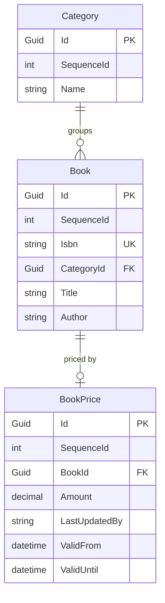
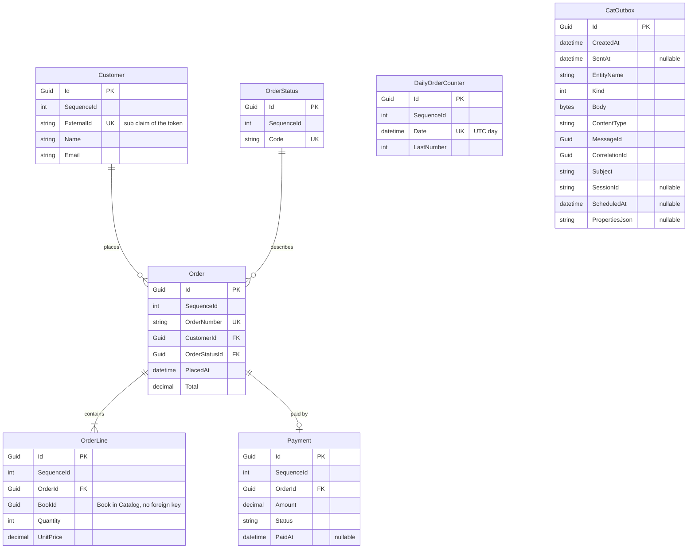
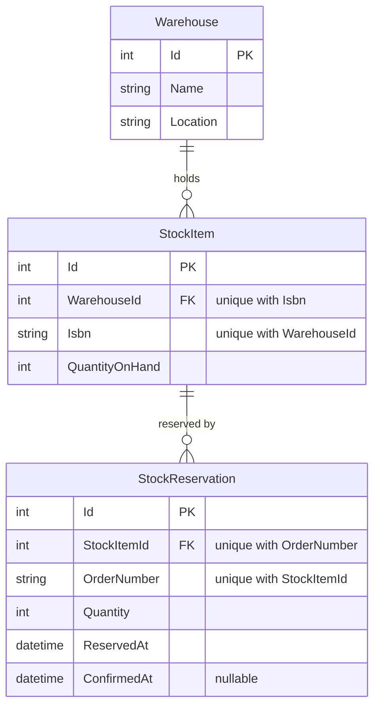

<!-- region start: Header-->
<!-- Header template: @.claude\skills\cat-internal-create-header\header.template.md, RootPath: .. -->
<link href="../resources/styles/style.css" rel="stylesheet" />
<table>
    <tr>
        <td colspan='6' style='text-align: center; font-weight: bold; border: none; border-top: 1px dashed #494949; border-bottom: 1px dashed #494949;'>
             Clean Architecture Toolkit for .NET
        </td>
    </tr>
    <tr>
        <td colspan='5' style='padding: 0; vertical-align: middle; border: none;'>
            Clean Architecture Toolkit is a clean, modular architecture foundation for .NET applications.<br>
            It embraces SOLID principles and focuses on maintainability, testability, and scalability through clear boundaries and pluggable design.</td>
        <td style='padding: 0; border: none;' width='220'>
            
        </td>
    </tr>
    <tr>
        <td colspan='6' markdown='1' style='padding-left: 0; padding-right: 0; padding-top: 15px; padding-bottom: 0; border: none; border-top: 1px dashed #494949; border-bottom: 1px dashed #494949;'>

&#124;&nbsp;&nbsp;&nbsp;[HOME](../README.md)&nbsp;&nbsp;&nbsp;&#124;&nbsp;&nbsp;&nbsp;[REPO OVERVIEW](../README.md#repo-overview)&nbsp;&nbsp;&nbsp;&#124;&nbsp;&nbsp;&nbsp;[DEMO](../demo/README.md)&nbsp;&nbsp;&nbsp;&#124;

</td>
</tr>
</table>
<!-- region end: Header-->

<!-- region start: TemplateSkill-->
<!-- Use the cat-internal-create-demo-readme skill to update this readme.-->
<!-- region end: TemplateSkill-->


# CAT Bookshop Demo <!-- omit in toc -->  

<!-- region start: Intro-->
A small bookshop that shows how the Clean Architecture Toolkit modules work together.  
<!-- region end: Intro-->

## Table of contents <!-- omit in toc -->  
<!-- region start: TableOfContents-->

- [What the bookshop does](#what-the-bookshop-does)
- [Architecture](#architecture)
- [How to run](#how-to-run)
- [Building blocks](#building-blocks)
  - [React client](#react-client)
  - [Aspire AppHost and dashboard](#aspire-apphost-and-dashboard)
  - [API Gateway](#api-gateway)
  - [Keycloak](#keycloak)
  - [Catalog service](#catalog-service)
  - [Orders service](#orders-service)
  - [Inventory service](#inventory-service)
  - [Aspire ServiceDefaults](#aspire-servicedefaults)
  - [Payment service](#payment-service)
  - [Service Bus emulator](#service-bus-emulator)
<!-- region end: TableOfContents-->

## What the bookshop does
<!-- region start: WhatTheBookshopDoes-->

The demo is an online bookshop. Customers look at books and place orders. An admin keeps the catalog up to date.

What you can do today:

- **Browse the catalog.** See the categories and the books in them. Search for a book. Open a book to see its details.
- **See prices.** Every book has a current price in euro. The shop keeps the older prices as well.
- **Manage the catalog.** An admin can add a book or change one.
- **Place an order.** Pick books and quantities. The shop looks up the prices, checks that the books are in stock, takes the payment and confirms the order.
- **Get an order number.** Every order gets a number like `20261105-0001`. The date is the day of the order. The counter starts again every day.
- **Follow your orders.** See a list of your orders and open one to see its lines, its total and its status.
- **Cancel an order.** Change your mind after ordering and cancel it.
- **Log in.** Alice, Bob and the admin each have an account. You need to be logged in to place or follow orders. Anyone can browse the catalog without a login.
- **Stay private.** A customer only sees their own orders. An admin sees all of them. Only an admin can add or change a book.
- **Use the web shop.** Open the shop in the browser, search the books by text or category, open a book and log in. Put books in a basket and place an order. Follow your orders in the browser, and cancel one. An admin can add a book and change a book.

What the shop does when something goes wrong:

- A book that is not in stock stops the order. The order is cancelled and the customer is told which book is the problem.
- A payment that is declined stops the order in the same way.
- A payment service that is down or too slow stops the order too. The order is cancelled, the customer is told to try again later and is not charged. A short hiccup is retried once, so most customers never notice it. The shop gives up after 12 seconds.
- A stock service that is down or too slow stops the order in the same way. The order is cancelled and the customer is told to try again later.
- A shop that gives up waiting while the order is placed does not leave a half finished order behind. The order is cancelled.

When you start the shop with Aspire, the order asks the catalog for the real price of every book. A separate stock service keeps the stock levels and reserves the books of an order, all or nothing, so the last copy never sells twice. A separate payment service takes the payment. That service declines any total above 500 euro. It never charges an order twice.

Without Aspire stock is pretend. Any line of more than 50 copies is out of stock.

<!-- region end: WhatTheBookshopDoes-->

## Architecture
<!-- region start: Architecture-->

The demo is a small system of services, each with its own database. The services are built the same way, with the project structure from the [readme](../README.md#service-project-structure). A client talks to them through an API gateway, which checks the login. Services call each other through the gateway.


Hatched boxes are not built yet. Solid boxes are. The drawing is kept in sync with the code.

### How the pieces fit
<!-- region start: HowThePiecesFit-->

- **Clients** only talk to the API gateway. It checks the token, lets the public catalog reads through and forwards the call with the token unchanged. Orders asks Catalog for prices, Inventory for stock and the payment service for payments through the gateway as well, with clients generated by `Cat.Api.Client`.
- **Login.** Keycloak runs as a container and holds the users. The gateway and each service check the token. A service does not trust the network. See [Things to know](#things-to-know).
- **Services** own their data. A service never reads the database of another service. Where one needs data of another, it asks through an interface. Orders asks Catalog for prices, Inventory for stock and the payment service for payments, all through the gateway when you run through Aspire.
- **Contracts.** Sharing the contracts of a service is a choice per connection. The React client and the price call from Orders to Catalog keep their own models. The stock call from Orders to Inventory shares the `Contracts` project of Inventory, so the demo shows both. See [Sharing contracts](#sharing-contracts).
- **Events** stay in memory inside a service. A service tells another one about a fact with a message on Azure Service Bus. Orders publishes `OrderConfirmed` through its outbox, and Inventory receives it. See [Events and interfaces](#events-and-interfaces).
- **Databases.** Every service has its own SQL Server database.
- **Aspire** starts everything with one command: the gateway, the services, Keycloak, SQL Server and the Service Bus emulator in containers, and the dashboard. You can still start a service on its own.
<!-- region end: HowThePiecesFit-->

### How a request flows through a service
<!-- region start: HowARequestFlowsThroughAService-->

1. An endpoint receives the HTTP request and turns it into a service request.
2. The service request processor runs the decorators: logging, tracing and validation.
3. A handler runs the use case. It reads through queries and changes data through commands.
4. The result comes back as a response, either a value or a list of errors.
5. The endpoint turns the response into an HTTP status code and a body.
<!-- region end: HowARequestFlowsThroughAService-->

### Sharing contracts
<!-- region start: SharingContracts-->

The readme says that sharing the `Contracts` project of a service is a choice of the developer. The demo makes a choice per connection and shows both options.

| Connection | Choice | Why |
|---|---|---|
| React client to gateway | Not shared | The client is TypeScript, so there is nothing to reference. It also keeps the demo client-agnostic. The client comes from the OpenAPI documents. |
| Orders to Catalog (prices) | Not shared | Orders needs a price per book and nothing else. The generated Catalog client has models of its own, so Orders does not depend on the Catalog contract. |
| Orders to Inventory (stock) | Shared | To show the other option. Orders references the `Contracts` project of Inventory and reuses its types. |
| Orders to the payment service | Not shared | The payment service stands in for something outside the toolkit. Orders uses a generated client with models of its own. |

What it costs:

- Not shared: duplicate types, and a change in the other service only shows up at runtime.
- Shared: coupling to the types and the release rhythm of the other service.

The choice is made per connection. Another application can choose differently.
<!-- region end: SharingContracts-->

### Login and tokens
<!-- region start: LoginAndTokens-->

A clone must start with one command, and the demo must still show the proper way. Keycloak runs as a container with an imported realm, so no signup and no external account are needed. See [Keycloak](#keycloak).

How a call travels:

1. The React app logs in with authorization code and PKCE and gets an access token.
2. It calls the gateway with `Authorization: Bearer <token>`. Catalog reads need no token. Orders endpoints do.
3. The gateway validates the token and forwards it unchanged.
4. The inner service validates the JWT itself. It does not trust the network.
5. The service authorizes on the claims. Alice only loads her own orders, and the orders of Bob come back as not found. An admin edits the catalog through a role claim.

Calls from one service to another forward the same token.

In the code:

- The business logic asks for `ICatUser` of [Cat.Users](../modules/Cat.Users/README.md) and never sees `HttpContext`. It has `UserId`, `Name`, `IsAuthenticated` and `IsInRole`. The `CoreService` project of Orders only references `Cat.Users.Abstractions`.
- `IsAdmin` is a small extension method over `IsInRole("admin")`. `Email` is not part of `ICatUser`, so Orders has its own small `IUserEmail` that the Api project fills from the `email` claim.
- `AddDemoJwtAuthentication` in `ServiceDefaults` registers `Cat.Users` and `Cat.Users.JwtBearer`. `ICatUser` then comes from the claims of the token, with the flat `roles` claim that Keycloak emits. `MapInboundClaims` is false, so `sub` keeps its name.
- A stub reads the `X-Demo-User` header when the service runs without a login. It is `ICatUser` and `IUserEmail` in one.
- Ownership is a filter in the query. The queries get the external id of the customer, or none for an admin, so the orders of others come back as not found and nothing leaks.

Other ways were rejected. Entra ID or Auth0 would make every person who clones the repository create a tenant. An own token service is a lot of code that is not about CAT. `dotnet user-jwts` has no login flow for the client.
<!-- region end: LoginAndTokens-->

### Events and interfaces
<!-- region start: EventsAndInterfaces-->

Orders uses two ways to stay loosely coupled. They are for different jobs.

| Kind of interaction | Decoupled by | Needs an answer? |
|---|---|---|
| Reserve stock, take payment | An interface (`IStockReservation`, `IPaymentProvider`), called from a workflow step | Yes |
| Order confirmed, order cancelled | An event on `ICatEventAggregator` | No |
| Order confirmed, told to another service | A message on Azure Service Bus (`OrderConfirmed`) | No |

- The workflow publishes `OrderConfirmed` and `OrderCancelled`. It knows only the aggregator, not the subscribers.
- Subscribers: a status updater, an audit logger and the stock release.
- The in-process event `OrderConfirmedEvent` and the message `OrderConfirmed` are two different types. The status updater sets the status through a command, and that command also publishes the message. See [Orders service](#orders-service).
- The message is a service request as well. Inventory writes a handler for it, like for any other request, and `Cat.EventProcessor` runs it. See [Inventory service](#inventory-service).
- Events cannot drive the process. `PublishAsync` returns no answer and rethrows the exception of a failing handler.
- Calls whose answer decides the next step go through an interface. A fake sits behind it when there is no host address.
- Subscribers are long lived singletons, because the aggregator holds them with weak references. A subscriber that needs a scoped service such as the `DbContext` opens its own scope.
<!-- region end: EventsAndInterfaces-->

### Where the CAT modules sit
<!-- region start: WhereTheCatModulesSit-->

| Layer | Modules |
|---|---|
| API | `Cat.Minimal.Api` |
| Core service | `Cat.ServiceRequests`, `Cat.Queries`, `Cat.Commands`, `Cat.Validators`, `Cat.Responses`, and in Orders also `Cat.FluentWorkflows` and `Cat.EventAggregators` |
| Infrastructure | `Cat.EFCore`, and in Orders `Cat.Messaging` with the outbox |
| EventProcessor | `Cat.EventProcessor` (Inventory) |
| Users | `Cat.Users.Abstractions` in the core service and the infrastructure, `Cat.Users` and `Cat.Users.JwtBearer` in the host |
| Everywhere | `Cat.Expressions` |

The [building blocks](#building-blocks) explain where each module is used and why.
<!-- region end: WhereTheCatModulesSit-->
<!-- region end: Architecture-->

## How to run
<!-- region start: HowToRun-->

The main route is the Aspire AppHost. One command starts the gateway, Catalog, Orders, the payment service, Keycloak, SQL Server and the React client, and opens the dashboard. You can also start one service on its own, see [Run one service](#run-one-service).

### Prerequisites
<!-- region start: Prerequisites-->

- The .NET SDK that `global.json` asks for.
- **Node.js 24 or newer** for the React client. The AppHost runs `npm install` and `npm run dev` for you, so you only need Node and npm on the path.
- **Docker Desktop** for the default route. SQL Server, Keycloak and the Service Bus emulator run in containers. The emulator needs Docker in every mode, because the AppHost always starts it.
- Or a SQL Server you already have, for the databases. Temporal tables need SQL Server, so SQLite and PostgreSQL do not work.
<!-- region end: Prerequisites-->

### Run with Aspire
<!-- region start: RunWithAspire-->

1. Clone the repository and open a terminal in its root folder.
2. Start the AppHost:
   ```
   dotnet run --project demo/Cat.Demo.AppHost/Cat.Demo.AppHost --launch-profile http
   ```
3. Wait until the dashboard shows `gateway`, `catalog`, `orders`, `payment`, `inventory` and `web` as running. The first start pulls the SQL Server, Keycloak and Service Bus emulator images, so it takes a few minutes. Keycloak needs a moment to import the realm.
4. Open the dashboard at `http://localhost:15101`. It needs no login. It shows the logs, traces, metrics and health checks of the services.
5. Try the endpoints. The gateway runs on `http://localhost:5100` and is the door for every call. Keycloak runs on `http://localhost:8180`. Open these files in Visual Studio or Rider and run the requests from top to bottom. Run the login requests at the top first. Later requests use ids from earlier responses.
   - `demo/Cat.Demo.CatalogService/Cat.Demo.CatalogService.Api/CatalogRequests.http`
   - `demo/Cat.Demo.OrderService/Cat.Demo.OrderService.Api/OrderRequests.http`
   - `demo/Cat.Demo.InventoryService/Cat.Demo.InventoryService.Api/InventoryRequests.http`
   - The web shop runs on `http://localhost:5104`. You can browse the books, log in as `alice` with the password `alice`, fill the basket and place an order. See [React client](#react-client).
6. Place an order and open its trace in the dashboard. It shows the call from Orders to Catalog for the prices. A moment after the order is confirmed, the log of `inventory` shows the SQL command `UPDATE dbo.StockReservation SET ConfirmedAt`, which is the handler of the message `OrderConfirmed` at work.
7. Press Ctrl+C to stop. The database lives in the Docker volume `cat-demo-sql-data`, so the data is still there at the next start.

To start again with empty databases, stop the AppHost and remove the volume:

```
docker volume rm cat-demo-sql-data
```
<!-- region end: RunWithAspire-->

### SQL Server modes
<!-- region start: SqlServerModes-->

The setting `Sql:Mode` of the AppHost picks where the databases live.

| Mode | What happens | Needs |
|---|---|---|
| `Container` (default) | The AppHost starts a SQL Server container with the data volume and creates the databases `catalog`, `orders` and `inventory`. It runs the SQL scripts of Inventory in the `inventory` database. The password is generated and kept in the user secrets. | Docker |
| `Existing` | The AppHost passes the connection strings `ConnectionStrings:catalog`, `ConnectionStrings:orders` and `ConnectionStrings:inventory` to the services. The defaults point to the local default instance. It does not run the SQL scripts, because the owner of an existing database owns its schema. | A SQL Server you can reach |

To use `Existing`, set the mode in the user secrets of the AppHost:

```
dotnet user-secrets set "Sql:Mode" "Existing" --project demo/Cat.Demo.AppHost/Cat.Demo.AppHost
```

To point it at another server, set `ConnectionStrings:catalog`, `ConnectionStrings:orders` and `ConnectionStrings:inventory` in the same way. The defaults use Windows authentication, which works for a local process only.

Two lighter ways exist. LocalDB is the real SQL Server engine, so temporal tables work. It needs no virtual machine and stops by itself when idle. Point the connection strings at it. A plain `docker-compose.yml` with only SQL Server suits people who want a container but no Aspire. Temporal tables tie the demo to SQL Server, so SQLite and PostgreSQL do not work.
<!-- region end: SqlServerModes-->

### Docker memory
<!-- region start: DockerMemory-->

Docker Desktop on Windows runs on WSL2. By default the WSL2 virtual machine can take half of your RAM and keeps it while it runs.

- **Limit WSL2.** Create `%UserProfile%\.wslconfig`, then run `wsl --shutdown` and restart Docker Desktop. This is an example for a machine with 32 GB:
  ```
  [wsl2]
  memory=8GB
  processors=4
  swap=2GB

  [experimental]
  autoMemoryReclaim=gradual
  sparseVhd=true
  ```
- **Use the WSL 2 backend** in Docker Desktop, and turn off start at sign-in.
- **SQL Server is capped.** The AppHost sets `MSSQL_MEMORY_LIMIT_MB` to 2048 on the container. An idle container uses about 620 MiB.
- **Give the memory back.** When you are done, quit Docker Desktop and run `wsl --shutdown`.
<!-- region end: DockerMemory-->

### Run one service
<!-- region start: RunOneService-->

Every service still starts on its own, with its own `appsettings`. It needs a SQL Server that you start yourself, and no Docker is involved. Without the AppHost, Orders uses a fake for prices, and there is no gateway and no login.

1. Start the Catalog service. First check the connection string in `demo/Cat.Demo.CatalogService/Cat.Demo.CatalogService.Api/appsettings.Development.json`. The default points to the local default instance:
   ```
   Server=.;Database=catalog;Trusted_Connection=True;TrustServerCertificate=True
   ```
   Then run:
   ```
   dotnet run --project demo/Cat.Demo.CatalogService/Cat.Demo.CatalogService.Api
   ```
   Open `http://localhost:5101`. The OpenAPI document is at `http://localhost:5101/openapi/v1.json`.
2. Start the Order service in a second terminal. It needs its own database. The Catalog service does not have to run. Check `demo/Cat.Demo.OrderService/Cat.Demo.OrderService.Api/appsettings.Development.json`:
   ```
   Server=.;Database=orders;Trusted_Connection=True;TrustServerCertificate=True
   ```
   Then run:
   ```
   dotnet run --project demo/Cat.Demo.OrderService/Cat.Demo.OrderService.Api
   ```
   Open `http://localhost:5102`.
3. Call the services directly on ports 5101 and 5102. The requests in the `.http` files that go through the gateway need the AppHost. Change their host to the service port and remove the `Authorization` line to use them here.

In `Development` both services apply their EF Core migrations at startup. Catalog adds 4 categories and 7 books when its tables are empty. Orders adds the three order statuses.
<!-- region end: RunOneService-->

### Things to know
<!-- region start: ThingsToKnow-->

- **Users.** Keycloak holds three users: `alice`, `bob` and `admin`. The password is the same as the name. Alice and Bob only see their own orders. The admin sees all orders and may save books. The Keycloak admin console at `http://localhost:8180` uses `admin` and `admin`. Use these settings in the demo only.
- **Tokens.** The `.http` files get a token from Keycloak with the password grant of the client `cat-demo-cli`. The gateway needs a valid token for everything except reading books and categories. The services check the token again, so a call straight to port 5101 or 5102 without a token gets a 401 too.
- **Run without the AppHost.** Without the setting `Authentication:Authority` a service has no login. Orders then reads the `X-Demo-User` header (`alice` by default, `bob` or `admin`).
- **Fakes for the other services.** Prices, stock, payment and the message bus are fakes only without the AppHost. Without a bus, Orders only logs the `OrderConfirmed` message, and Inventory does not listen.
  - Prices are real under the AppHost, because Orders asks Catalog. Without the AppHost the price of a book is made from its id, between 5.95 and 44.95 euro, with a made up ISBN.
  - Stock is real under the AppHost, because Orders asks Inventory. Every book starts with 50 copies. Without the AppHost a line of more than 50 copies is out of stock.
  - A total above 500 euro is declined, by the payment service under the AppHost and by a fake without it.
- **Payment failures.** The payment service can fail on purpose, to show the retries and the circuit breaker. See [Payment service](#payment-service) for the settings.
- **Currency.** All amounts are in euro.
- **Order numbers** look like `20261105-0001`. The counter restarts every UTC day. The development endpoint `POST /development/scheduler/clean-up-order-counters` removes the counters of earlier days.
<!-- region end: ThingsToKnow-->

### Health checks
<!-- region start: HealthChecks-->

The gateway and every service answer `/health` (ready) and `/alive` (running) in every environment, with a plain `Healthy` or `Unhealthy`, and no token is needed. The AppHost watches `/health` of all of them. The gateway also calls `/health` of its services and stops sending calls to an instance that fails.
<!-- region end: HealthChecks-->

### Things to know about the dashboard
<!-- region start: ThingsToKnowAboutTheDashboard-->

The dashboard may say "No trusted development certificate was found". That is harmless for now, because the AppHost, the dashboard and the services all run on HTTP. Anyone on your machine can open the dashboard on localhost, which is fine for a local demo.
<!-- region end: ThingsToKnowAboutTheDashboard-->

### Run the tests
<!-- region start: RunTheTests-->

Run all tests of the repository, including the demo tests:

```
dotnet cake --target=Test
```
<!-- region end: RunTheTests-->
<!-- region end: HowToRun-->

## Building blocks
<!-- region start: BlockOverview-->

One chapter for every block that is built. A database sits in the chapter of the service that owns it.

| Block | What it is |
|---|---|
| [React client](#react-client) | The web shop. It shows the books, has a login, takes orders and shows them, and lets an admin edit books. |
| [Aspire AppHost and dashboard](#aspire-apphost-and-dashboard) | Starts the whole system and shows how it runs. |
| [API Gateway](#api-gateway) | The one door for clients. |
| [Keycloak](#keycloak) | The identity provider that holds the users and signs the tokens. |
| [Catalog service](#catalog-service) | Books, categories and prices. |
| [Orders service](#orders-service) | Placing and following orders. |
| [Inventory service](#inventory-service) | Stock levels and reservations. |
| [Aspire ServiceDefaults](#aspire-servicedefaults) | Shared telemetry, health checks and resilience. |
| [Payment service](#payment-service) | A separate pretend payment service that can fail on purpose. |
| [Service Bus emulator](#service-bus-emulator) | The message bus that carries `OrderConfirmed` from Orders to Inventory. |
<!-- region end: BlockOverview-->

### React client
<!-- region start: ReactClient-->

**What it is.** A thin web client with a book list, a basket, an order overview and an admin screen for books. It uses React with TypeScript, built with Vite.

**Where it stands.** The app is in `demo/Cat.Demo.WebClient/Cat.Demo.WebClient.App`, a Vite, React and TypeScript project. The AppHost starts it as `web` on the fixed port 5104, and the gateway lists `http://localhost:5104` as an allowed CORS origin. It has six screens: the book list, the book detail, the basket, the order overview, the order detail and the book form for admins. It also has a login. The book list has a search box and a category filter, and keeps them in the address. One error component shows the message, the code and the trace id of every failed call.

**Work on the client.** Run these in the app folder. Node 24 or newer is needed.

| Command | What it does |
|---|---|
| `npm run dev` | Starts Vite on port 5104. It needs the gateway on port 5100, which the AppHost starts. |
| `npm test` | Runs the Vitest tests. The Cake build does not run them. |
| `npm run build` | Checks the types and builds the app. |
| `npm run api:refresh` | Saves the OpenAPI documents of Catalog and Orders from a running AppHost into `api/`. Commit the change. |

**Types.** `npm run api:generate` makes the TypeScript types from `api/catalog.openapi.json`. It runs before `dev`, `build` and `test`. The generated file is not committed. The saved copy of the document is, so a fresh clone builds without a running service. TypeScript is pinned to 5.x, because `openapi-typescript` does not support 7 yet.

**How it works.**
- It only talks to the API gateway.
- The Log in button sends the browser to Keycloak. The login uses authorization code with PKCE (`react-oidc-context`). After the login the person is back on the page they came from, and the top bar shows their name.
- The access token lives in memory only. A page refresh loses it, so the app asks Keycloak for a new token without showing the login page. This works while the Keycloak session lasts. A tab flag, kept in session storage, says that the person was logged in. It holds no token.
- Every call to the gateway carries the token when a person is logged in. Catalog reads need none.
- The basket lives in the local storage of the browser, so a refresh or the trip to the login does not empty it. A line holds the book, the title, the price of the list and the quantity from 1 to 50. A book without a price cannot be added.
- Place order sends only the book and the quantity. The shop decides price, stock and payment. A visitor who is not logged in is sent to the login first and returns to the basket. After a success the screen shows the order number, status and total, and the basket is emptied. A failed order is never retried by the client, so nobody is charged twice by a retry.
- The order overview lists the orders of the person, newest first. The order detail shows the lines with the book titles, which come from the catalog, and a Cancel button that is always shown. The client holds no list of the statuses that allow a cancel. A refused cancel shows the message of the service, such as `DEM-ORD-1004`. Another person's order comes back as not found.
- The admin screens `/admin/books/new` and `/admin/books/:id` hold a form for ISBN, title, author, category and price. The links to them show only when the ID token has the `admin` role in its `roles` claim. That only decides what the screen shows. The catalog checks the role again on every save, so a non admin who opens the address gets the 403 of the service. A duplicate ISBN shows `DEM-CTL-1000`.
- A failed call shows its CAT errors: the code and the message with the arguments filled in, and the trace id. The validators put the field name in front of the arguments, and the client skips it. The basket stays, so the person can try again.
- Log out ends the Keycloak session as well.
- It has no shared code with the services. The types come from a saved copy of the OpenAPI documents of the services.

**CAT modules.**

| Module | Where | Why |
|---|---|---|
| `Cat.Minimal.Api` | Produces the OpenAPI documents the client is built from | One description of every endpoint and every possible response. |

**Pros.**
- The client stays independent of .NET. The services expose a normal HTTP API.
- React is the most widely known option.

**Cons.**
- No shared contracts, so a change in a service needs `npm run api:refresh` and a commit of the saved document.
- Blazor WebAssembly would share the contracts, but it makes the demo look .NET only.

**More.** `demo/Cat.Demo.WebClient`. [Sharing contracts](#sharing-contracts) explains why the client has no shared code.
<!-- region end: ReactClient-->

### Aspire AppHost and dashboard
<!-- region start: AspireAppHostAndDashboard-->

**What it is.** One project that describes the system: the gateway, Catalog, Orders, Inventory, the payment service, Keycloak, SQL Server, the Service Bus emulator and the React client. The Aspire dashboard shows logs, traces, metrics and health checks.

**How it works.**
- `demo/Cat.Demo.AppHost/Cat.Demo.AppHost` adds the Api project of each service. The services keep their fixed ports with no Aspire proxy: gateway 5100, Catalog 5101, Orders 5102, payment 5103, web client 5104 and Inventory 5105. The dashboard runs on 15101.
- The setting `Sql:Mode` picks `Container` (the default) or `Existing`. See [SQL Server modes](#sql-server-modes).
- In `Container` mode the AppHost adds a SQL Server container with a named data volume and the databases `catalog`, `orders` and `inventory`. The services wait for their database. The `inventory` database also gets its SQL scripts, see [Inventory service](#inventory-service).
- The services read `GetConnectionString("catalog")`, `GetConnectionString("orders")` and `GetConnectionString("inventory")` in both modes. They do not know which mode runs.
- Orders gets the address of the gateway through service discovery. That switches on `CatalogPriceProvider`, `PaymentServiceProvider` and `InventoryStockReservation`, which call Catalog, the payment service and Inventory through the gateway.
- The Azure Service Bus emulator runs next to them, see [Service Bus emulator](#service-bus-emulator). Orders and Inventory get its connection string as `messaging`, and Inventory waits for Orders.
- Keycloak is a plain container on port 8180. The realm file `keycloak/cat-demo-realm.json` is mounted and imported at the start. The official Aspire Keycloak package is only a preview, so the demo does not use it.
- The gateway runs on port 5100. It finds Catalog, Orders, the payment service and Inventory through service discovery. The AppHost gives the gateway and every service the address of the Keycloak realm.
- The React client runs with Vite on the fixed port 5104, because the gateway lists that port as an allowed CORS origin.
- The AppHost passes the settings `Payment:Latency`, `Payment:ErrorPercentage` and `Payment:Outage` to the payment service. See [Payment service](#payment-service).
- Every service still starts on its own with `dotnet run`. The AppHost is a convenience, not a requirement.

**CAT modules.** None. The AppHost is demo infrastructure. The modules never depend on Aspire.

**Pros.**
- One command to start everything.
- Traces across services in one place.
- A fresh clone needs no connection strings.

**Cons.**
- Docker Desktop eats memory. See [Docker memory](#docker-memory) for the limits.
- The first start pulls a SQL Server image of about 1.5 GB, and the Keycloak image.
- It is one more thing to learn.

**More.** `demo/Cat.Demo.AppHost`.
<!-- region end: AspireAppHostAndDashboard-->

### API Gateway
<!-- region start: ApiGateway-->

**What it is.** The one door for clients. It checks the token and forwards calls to Catalog, Orders, the payment service and Inventory. It holds no business logic. The block is a small host project on top of the `Cat.Api.Gateway` module.

**How it works.**
- `demo/Cat.Demo.Api.Gateway/Cat.Demo.Api.Gateway` is a web project of about twenty lines. It calls `AddCatApiGateway`, adds the Aspire service discovery for YARP, and calls `UseCatApiGateway` and `MapCatApiGateway`.
- The `CatGateway` section of `appsettings.json` names the services `catalog`, `orders`, `payment` and `inventory`. The path of a service is its name, so `/catalog/**` goes to Catalog, `/orders/**` to Orders, `/payment/**` to the payment service and `/inventory/**` to Inventory. The services already use that prefix, so `StripPrefix` is off.
- The AppHost sets the addresses to `http://catalog`, `http://orders`, `http://payment` and `http://inventory`, which service discovery resolves. Without the AppHost the defaults point to the ports 5101, 5102, 5103 and 5105.
- Catalog lists `GET /books/**` and `GET /categories/**` as public. Everything else needs a token, also the payment and the inventory routes. Saving a book needs a token, and the Catalog service wants the `admin` role on top.
- The gateway checks that the token comes from the Keycloak realm and has the audience `cat-gateway`. It does not look at roles. It forwards the token unchanged, and the service checks it again.
- Identity headers a caller sends, such as `X-Demo-User`, never reach a service.
- The `/health` and `/alive` endpoints of the gateway are mapped with `AllowAnonymous`, because the gateway is closed by default.

**CAT modules.**

| Module | Where | Why |
|---|---|---|
| `Cat.Api.Gateway` | The gateway project | Routes, token check, header cleaning and rate limits from configuration. |

The gateway only option of the module is not used in the demo. The services check the token themselves.

**Pros.**
- Clients know one address.
- Adding a service is a few lines of configuration.
- The token check sits in one place and the services stay safe on their own.

**Cons.**
- One more hop and one more process to run.
- The demo keeps its Keycloak settings in plain text. That is fine for a demo and wrong for production.

**More.** `demo/Cat.Demo.Api.Gateway`. [Login and tokens](#login-and-tokens).
<!-- region end: ApiGateway-->

### Keycloak
<!-- region start: Keycloak-->

**What it is.** The identity provider of the demo. It holds the users, checks passwords and signs the access tokens. Any OpenID Connect provider would do. Keycloak is only the demo choice.

**How it works.**
- The AppHost starts it as a plain container on port 8180. There is no data volume, so every start imports the realm again.
- The realm file `demo/Cat.Demo.AppHost/Cat.Demo.AppHost/keycloak/cat-demo-realm.json` holds the realm `cat-demo`, the role `admin` and the users `alice`, `bob` and `admin`. The user ids equal the user names, so the `sub` claim of a token matches the seeded data.
- Two public clients exist. `cat-demo-web` is for the React app. It uses the authorization code flow with PKCE. Its web origin is `http://localhost:5104`, so the browser may call the token endpoint of Keycloak. `cat-demo-cli` allows the password grant, for the `.http` files only.
- Both clients add the audience `cat-gateway` and a flat `roles` claim to the access token. The web client adds the `roles` claim to the ID token too, so the React app can show the admin links.
- The gateway and the services read the signing keys from the realm and check every token themselves. See [API Gateway](#api-gateway).

**CAT modules.** None. The toolkit works with any OpenID Connect provider, so Keycloak is no dependency of a module.

**Pros.**
- Real tokens and a real login flow, with no account or tenant to create.
- The realm is a file in the repository, so every clone gets the same users.

**Cons.**
- Another container to start and a few hundred MB of memory.
- The passwords and the admin console login are public and simple. That is fine for a demo and wrong for production.

**More.** `demo/Cat.Demo.AppHost/Cat.Demo.AppHost/keycloak`. [Login and tokens](#login-and-tokens).
<!-- region end: Keycloak-->

### Catalog service
<!-- region start: CatalogService-->

**What it is.** Books, categories and prices. Mostly reads, with a small admin part. It is the first service of the demo and is built code first.

**How it works.**
- Endpoints, all under `/catalog`:
  - `GET /books` searches books.
  - `GET /books/{bookId}` returns one book.
  - `GET /books/prices` returns the price list with the ISBN of every book. Orders uses it under the AppHost, and Inventory knows a book by its ISBN.
  - `POST /books` adds or changes a book.
  - `GET /categories` lists the categories.
- Each endpoint maps to a service request such as `BookSearchRequest`. A handler turns it into queries and commands.
- Entities are `Category`, `Book` and `BookPrice`. `BookPrice` is a temporal table, so every old price stays in the history.
- `BookPrice` has a `LastUpdatedBy` column, so the history also shows who set each price. The command handler of the save fills it with the `UserId` of `ICatUser`, the id and not the name or the email. The seed prices belong to the named system user `catalog`.
- Saving a book checks that the ISBN is unique.
- Saving a book needs the `admin` role. A test starts the real endpoint mapping and the real `admin` policy on a local server, and checks that a call without a login gets a 401 and a user who is not an admin gets a 403. In both cases the command does not run.
- The folder is `demo/Cat.Demo.CatalogService`, with the projects of the service project structure.

**Error codes.** `CatalogErrorDefinitions` defines them with the prefix `DEM-CTL`:

| Code | Name | Message |
|------|------|---------|
| `DEM-CTL-1000` | `IsbnAlreadyExists` | `A book with ISBN {Isbn} already exists.` |
| `DEM-CTL-1001` | `BookPriceNotFound` | `Book {BookId} does not exist or has no price.` |

**Database.** The `catalog` database is built. It is a SQL Server database that only Catalog reads. In `Development` the service applies its EF Core migrations at startup and adds 4 categories and 7 books when the tables are empty. Every entity inherits `CatEntityBase`, so each has a `Guid` `Id` as non-clustered primary key and an identity `SequenceId` that holds the clustered index. `BookPrice` inherits `CatTemporalEntityBase`. SQL Server keeps every old price in a history table, and `ValidFrom` and `ValidUntil` are the period columns. The class does not map them yet. `LastUpdatedBy` holds the `UserId` of the user who set the price, so the history shows who changed it. The seed prices hold the system user `catalog`. Names and columns are not final.



**CAT modules.**

| Module | Where | Why |
|---|---|---|
| `Cat.ServiceRequests` and its logging, tracing and validation decorators | Core service, wired in the Api | One entry point per use case, with cross cutting work done once. |
| `Cat.Queries`, `Cat.Commands` and their logging decorators | Core service and Infrastructure | Reads and writes are separate handlers that are easy to test. |
| `Cat.Validators` | Core service | Rules for a book and for the price list request, with every problem returned at once. |
| `Cat.Responses` | Everywhere | A result is either a value or a list of errors. No exceptions for business failures. |
| `Cat.Minimal.Api` | Api | Maps service requests to endpoints and documents the responses. |
| `Cat.EFCore` | DataModels and Infrastructure | Entity base classes, and the temporal price table. |
| `Cat.Users` | Infrastructure (`Cat.Users.Abstractions`) and the host | The save handler asks `ICatUser` for the id that goes into `LastUpdatedBy`. The `admin` policy on the endpoint is the role check. |
| `Cat.Expressions` | Api | Compiled member access that is reused. |

**Pros.**
- Every use case has the same shape, so a new one is easy to add.
- The core service has no web or database code, so it is easy to unit test.
- Price history costs one base class.

**Cons.**
- Many small types for a small service: a request, a handler, a query, a query handler and a validator.
- Temporal tables tie the demo to SQL Server.
- Category names are plain text.

**More.** Code in `demo/Cat.Demo.CatalogService`. Requests in `CatalogRequests.http`.
<!-- region end: CatalogService-->

### Orders service
<!-- region start: OrdersService-->

**What it is.** The main service. Customers place and track orders. Built code first.

**How it works.**
- Endpoints, all under `/orders`:
  - `POST /` places an order.
  - `GET /` lists the orders of the user.
  - `GET /{orderId}` returns one order.
  - `POST /{orderId}/cancel` cancels an order.
- The place order process is a workflow, in `PlaceOrderWorkflow`:
  1. Find or create the customer from the current user.
  2. Look up the price of every line and add up the total.
  3. Create the order. It gets its number and the status `Pending` in one transaction. The workflow supplies the order ID and the time before the command runs. `OrderCreateCommand` is a typed command, and it returns an `OrderCreated` with the ID and the order number, which only the database can hand out.
  4. Reserve the stock. If a book is out of stock, cancel the order and stop.
  5. Take the payment and save it. If it is declined, cancel the order and stop. If the payment service cannot answer, cancel the order with `DEM-ORD-1006` and stop. Nothing is saved then.
  6. Confirm the order.
- Confirmed and cancelled are events. Subscribers set the status, write an audit record and release the stock.
- `PlaceOrderRequestHandler` catches a cancelled request token once the order exists, for example when the gateway gives up on a slow first call. It publishes the cancelled event with the reason `RequestCancelled` and its own 10 second token, then rethrows. Without it the order would stay Pending for good. A crash of the service in the middle of the workflow is not covered.
- Confirming an order also tells the other services. `OrderSetStatusCommandHandler` sets the status, and when the new status is confirmed it publishes the message `OrderConfirmed` with `ICatMessageSender`. The message type lives in the `Contracts` project of Orders, in `Messages`. The outbox is on, so the sender does not send at once. It adds a row to the `CatOutbox` table in the same `OrderDbContext`, and the one `SaveChanges` of the handler saves the status and the message together. A background service of `Cat.Messaging.Outbox` sends the rows to the bus and marks them as sent, so a crash between the save and the send loses nothing. A message can be sent twice after such a crash, and the receiver handles that.
- At startup, in `Development`, Orders creates the topic `OrderConfirmed` on the bus. Without the connection string `messaging`, a fake transport logs the message and sends nothing.
- Stock, price and payment sit behind interfaces: `IStockReservation`, `IPriceProvider` and `IPaymentProvider`. For stock, `InventoryStockReservation` uses the generated `IInventoryClient` of `Cat.Demo.InventoryService.Api.Client`, which shares the `Contracts` project of Inventory. It reserves all lines with `POST /inventory/reservations`, with the ISBN of each book, and releases with `DELETE /inventory/reservations/{orderNumber}`. A 409 or a 404 means out of stock. Any other failure or a timeout means unavailable, and the workflow cancels the order with `DEM-ORD-1007`. A failed release is logged and not thrown, and a cancel because Inventory did not answer skips the release. `FakeStockReservation` answers without a gateway address. For prices, `CatalogPriceProvider` uses the generated `ICatalogClient` of `Cat.Demo.CatalogService.Api.Client`. It calls `GET /catalog/books/prices` through the gateway when the host gives Orders the address of the gateway, as the AppHost does. Without it, `FakePriceProvider` answers. For payments, `PaymentServiceProvider` uses the generated `IPaymentClient` of `Cat.Demo.PaymentService.Api.Client` in the same way, through the gateway, and `FakePaymentProvider` answers without an address. The payment route is not anonymous, so `ForwardBearerTokenHandler` passes the token of the user on to the call. A call without a request, such as a background job, has no token and gets a 401, which counts as unavailable. Run `Refresh-PaymentClient.ps1` in the client project after the payment service changes, and `Refresh-InventoryClient.ps1` after the inventory service changes.
- `CatalogPriceProvider` wraps the call in `CatApiCall.ExecuteAsync`, so a failure arrives as an `ICatResponse`. A 200 gives the prices and a 404 becomes `PriceUnavailable`. Any other status, a network error or a timeout becomes an error response, because Orders never trusts a half answer. The resilience handler adds retries and a circuit breaker. Catalog reads are public, so the call sends no token. The unit tests use a fake `HttpMessageHandler` under the generated client, so they need no database and no running service. Run `Refresh-CatalogClient.ps1` in the client project to regenerate the client after Catalog changes. Catalog must run on port 5101 for it.
- `ICatUser` tells the core service who is calling. With a login `Cat.Users` reads the claims of the token (`sub`, `name` and the `admin` role), and `IUserEmail` reads the `email` claim. Without a login, a development stub reads the `X-Demo-User` header. Orders of other users come back as not found.
- Order numbers come from a `DailyOrderCounter` table, increased in one atomic statement in the same transaction that saves the order. The part **Order numbers** below explains it.

**Order numbers.** A number looks like `YYYYMMDD-0000`: the UTC year, month and day, a dash and a four digit counter. The counter restarts at `0001` every UTC day, so there is room for 9999 orders a day. Two orders at the same moment never get the same number. The unique key on `OrderNumber` is the safety net.

`DailyOrderCounter` has one row per UTC day. `LastNumber` is the last counter handed out that day. When an order is placed, one database transaction does this:

1. Increase today's row in a single SQL statement and read the new value back: `UPDATE DailyOrderCounter SET LastNumber = LastNumber + 1 OUTPUT INSERTED.LastNumber WHERE Date = @today`.
2. If no row was updated, insert today's row with `LastNumber = 1`.
3. Build the number: the date as `yyyyMMdd`, a dash and the counter padded to four digits.
4. Save the order, its lines and the payment.
5. Commit.

Why it never hands out a duplicate:

- The `UPDATE` locks the row. A second order at the same moment waits for the first commit, then reads the increased value.
- Increase and read are one statement, so nothing can slip in between.
- The increase is in the same transaction as the order. If saving fails, the counter rolls back too.
- It needs raw SQL through EF Core. A normal tracked update would read, add one and write back, which is the race the demo avoids.

Edge cases:

- **First order of the day.** Two first orders can both try the insert. The unique key on `Date` stops one of them, and that one retries the `UPDATE`. The cleanup below creates the row of today ahead of time, which makes this rare.
- **Past 9999.** The request fails with `DEM-ORD-1000`. It never produces `10000`.
- **Cancelled orders.** They keep their number. Numbers are never reused.

**Counter cleanup.** The table grows by one row per day, and only today's row matters. The `CleanUpOrderCounters` service request deletes every row before today (UTC) and creates today's row with `LastNumber = 0` when it is missing. It lives in `Orders.Contracts` and `Orders.CoreService`, like every other request, and a second run changes nothing. A development endpoint triggers it: `POST /development/scheduler/clean-up-order-counters`. It exists in `Development` only. The development endpoints have a group per background worker. This one is the `scheduler` group.

**Error codes.** `OrderErrorDefinitions` defines them with the prefix `DEM-ORD`:

| Code | Name | Message |
|------|------|---------|
| `DEM-ORD-1000` | `DailyLimitReached` | `No more orders can be placed today. The limit is {Limit} orders a day.` |
| `DEM-ORD-1001` | `PriceUnavailable` | `The price of book {BookId} is not available.` |
| `DEM-ORD-1002` | `OutOfStock` | `Book {BookId} is out of stock. Order {OrderNumber} was cancelled.` |
| `DEM-ORD-1003` | `PaymentDeclined` | `The payment of order {OrderNumber} was declined. The order was cancelled.` |
| `DEM-ORD-1004` | `CannotCancel` | `Order {OrderNumber} has status {Status} and cannot be cancelled.` |
| `DEM-ORD-1005` | `NotAuthenticated` | `You must be logged in to do this.` |
| `DEM-ORD-1006` | `PaymentUnavailable` | `The payment service is not available. Order {OrderNumber} was cancelled. Try again later.` |
| `DEM-ORD-1007` | `StockUnavailable` | `The inventory service is not available. Order {OrderNumber} was cancelled. Try again later.` |

**Database.** The `orders` database is built. It is a SQL Server database that only Orders reads. In `Development` the service applies its EF Core migrations at startup and adds the three order statuses. All tables are regular entities that inherit `CatEntityBase`. `OrderNumber` is unique. `OrderLine` refers to a book with `BookId` and has no foreign key, because the book lives in the Catalog database. `DailyOrderCounter` has no relationship with the other tables. `CatOutbox` comes from `Cat.Messaging.Outbox.EFCore`, and has none either. Only `Payment.PaidAt` and four columns of the outbox (`SentAt`, `SessionId`, `ScheduledAt` and `PropertiesJson`) can be empty, and the diagram marks them. Names and columns are not final.



**CAT modules.**

| Module | Where | Why |
|---|---|---|
| `Cat.FluentWorkflows` and its command step | Core service | The place order process reads as a list of steps, with an `if` for out of stock and a `foreach` over the lines. |
| `Cat.EventAggregators` | Core service | In-process events. The workflow publishes, subscribers react, and neither knows the other. |
| `Cat.ServiceRequests`, `Cat.Queries`, `Cat.Commands`, `Cat.Validators`, `Cat.Responses` | Core service | The same use case shape as Catalog. |
| `Cat.Minimal.Api` | Api | Endpoints and OpenAPI. |
| `Cat.EFCore` | DataModels and Infrastructure | Entities with `Guid` ids and sequence ids. |
| `Cat.Users` | Core service (`Cat.Users.Abstractions`) and the host | The handlers ask `ICatUser` who is calling. Customers see their own orders and an admin sees all of them. |
| `Cat.Messaging`, `Cat.Messaging.AzureServiceBus`, `Cat.Messaging.Outbox` and `Cat.Messaging.Outbox.EFCore` | Contracts (the message), Infrastructure and Api | Publishes `OrderConfirmed` to the bus, and keeps the message in the outbox until it is sent. |
| `Cat.Expressions` | Api | Compiled member access. |

**Pros.**
- The business process is one readable class.
- The status and the message are saved in one `SaveChanges`, so an order never confirms without telling the others.
- Events keep the status update, audit and cleanup out of the workflow.
- Interfaces with fakes let the demo run without the other services.

**Cons.**
- Events cannot drive the process. They return no answer, and a failing subscriber throws. Calls that decide the next step go through interfaces instead.
- Subscribers live as long as the app, because the aggregator holds them with weak references. A subscriber that needs the `DbContext` opens its own scope.
- A cancelled order keeps its approved payment, because there is no refund step.
- A stock reservation can leak. A release that fails is logged and not retried, and a cancel because Inventory did not answer skips the release.
- The state lives in the order status.
- The message goes out only when the status command runs. If that command fails, the order stays pending and no message is sent.
- A command handler in Infrastructure knows about messaging.
- The outbox adds a table, a migration and a background service to Orders.

**More.** Code in `demo/Cat.Demo.OrderService`. Requests in `OrderRequests.http`. [Events and interfaces](#events-and-interfaces).
<!-- region end: OrdersService-->

### Inventory service
<!-- region start: InventoryService-->

**What it is.** Tracks stock and reserves it when an order comes in. It is built database first, with SQL scripts that the AppHost runs.

**How it works.**
- It identifies a book by `Isbn` and an order by `OrderNumber`, because it does not share a database with the other services. Orders gets the ISBN from the price endpoint of Catalog.
- `POST /inventory/reservations` reserves all lines of an order or none. `DELETE /inventory/reservations/{orderNumber}` gives the stock back. The gateway has a restricted route, so a call needs a valid token. The service checks the token again.
- `StockReserveCommandHandler` and `StockReleaseCommandHandler` in `Cat.Demo.InventoryService.Infrastructure` hold the SQL. A reservation is one conditional `UPDATE ... WHERE QuantityOnHand >= @quantity` per line, inside one transaction. The database decides who gets the last copy, so parallel orders never oversell. A check constraint keeps the stock at zero or more as well.
- The order number is the idempotency key. A second reserve call for the same order does nothing, and the retries of the resilience handler are safe. A release locks the rows, so a double release gives the stock back once.
- Not enough stock gives a 409 with `DEM-INV-1000`. An unknown ISBN gives a 404 with `DEM-INV-1001`.
- The generated client in `Cat.Demo.InventoryService.Api.Client` shares the `Contracts` project, so Orders and Inventory use the same request models. Run `Refresh-InventoryClient.ps1` in that project after the service changes, with the AppHost running.
- Inventory also listens to the bus. The project `Cat.Demo.InventoryService.EventProcessor` declares the messages it receives, with `AddCatEventProcessor`. It receives `OrderConfirmed` from Orders, so the `CoreService` project references the `Contracts` project of Orders. The listener reads the subscription `inventory` on the topic `OrderConfirmed`.
- `OrderConfirmedHandler` is the service request handler of the message. It runs `StockReservationConfirmCommand`, and the command handler sets `ConfirmedAt` on the reservations of the order that have none. A repeated message finds nothing to update and succeeds, so no inbox is needed. An order number without a reservation gives a not found response with `DEM-INV-1002`, and the failure table of `Cat.EventProcessor` dead letters the message.
- At startup, in `Development`, Inventory creates its subscription. Orders creates the topic first, so Inventory waits for Orders in the AppHost. In `Development` the API has the endpoint `POST /dev/event-processor/OrderConfirmed`, which runs a message through the same pipeline without a bus. Without the connection string `messaging` Inventory does not listen.

**Error codes.** `InventoryErrorDefinitions` defines them with the prefix `DEM-INV`:

| Code | Name | Message |
|------|------|---------|
| `DEM-INV-1000` | `OutOfStock` | `Book {Isbn} is out of stock. Order {OrderNumber} got no stock.` |
| `DEM-INV-1001` | `UnknownBook` | `Book {Isbn} is not in the warehouse. Order {OrderNumber} got no stock.` |
| `DEM-INV-1002` | `UnknownOrder` | `Order {OrderNumber} has no reservation.` |

**Database.** The `inventory` database comes from the SQL scripts in `Cat.Demo.InventoryService.Database`. A stock database often exists already, owned by a warehouse team, so the schema comes from SQL scripts and not from C# classes. In `Container` mode the AppHost creates the database and runs the scripts with `WithCreationScript`. The scripts can run again. In `Existing` mode it does nothing, because the owner of the database owns its schema, and the connection string `ConnectionStrings:inventory` points at it. The seed gives one warehouse and 50 copies of each of the 7 seed books. The entities are scaffolded with `dotnet ef dbcontext scaffold` into the Infrastructure project, and nobody edits the generated files. Run `Scaffold-InventoryModel.ps1` after a schema change. The entities do not inherit `CatEntityBase` and have no `SequenceId`. Two unique constraints span two columns: `(WarehouseId, Isbn)` on `StockItem` and `(StockItemId, OrderNumber)` on `StockReservation`. The diagram marks both columns of each. The second one makes a repeated reserve call safe. The script `003-reservation-confirmed.sql` adds the column `ConfirmedAt`, which is empty until the message `OrderConfirmed` arrives. The diagram marks it as nullable. The scaffolded entity has the column. The confirm handler still sets it with one SQL command, so one statement updates all reservations of the order with the clock of the database.



**CAT modules.**

| Module | Where it is used | Why |
|---|---|---|
| `Cat.Commands` and `Cat.ServiceRequests` | Core service | The reserve and release requests end in commands. |
| `Cat.Validators` | Core service | The order number, the lines, the ISBN and the quantity are checked before the command runs. |
| `Cat.Responses` | Core service | Out of stock and unknown ISBN are error definitions, not exceptions. |
| `Cat.Minimal.Api` | Api | Maps the two endpoints with the response types they may return. |
| `Cat.Api.Client` | Api.Client and Orders | The generated client and `CatApiCall` turn an HTTP answer back into a response. |
| `Cat.EventProcessor`, `Cat.EventProcessor.AzureServiceBus` and `Cat.EventProcessor.Minimal.Api` | EventProcessor project and Api | Receives `OrderConfirmed` from the bus as a service request, settles the message from the response, and adds the development endpoint and the health check. |
| `Cat.Messaging` and `Cat.Messaging.AzureServiceBus` | EventProcessor project | The connection to the bus and the name of the topic. |

The service uses no entity base classes. It shows that you use only the modules you need.

**Pros.** Shows that CAT also works when the database comes first. The atomic update stays plain SQL, and the commands and responses stay the same as in the other services.

**Cons.** Two ways to build a service means two ways to explain. The scaffolded entities and the hand written SQL both need care after a schema change. Sharing the contracts ties Orders to the models of Inventory.

**More.** Code in `demo/Cat.Demo.InventoryService`. Requests in `InventoryRequests.http`.
<!-- region end: InventoryService-->

### Aspire ServiceDefaults
<!-- region start: AspireServiceDefaults-->

**What it is.** A shared project with the defaults every service uses. Only the demo uses it. The CAT modules never reference it.

**How it works.** `AddServiceDefaults()` in the `Program.cs` of a service sets up:
- Logs, metrics and traces with OpenTelemetry. The wildcard source `Cat.*` covers the CAT decorators and workflows. Data leaves the process only when `OTEL_EXPORTER_OTLP_ENDPOINT` is set, which the AppHost does.
- A readiness check at `/health` and a liveness check at `/alive`.
- The token check of the services. `AddDemoJwtAuthentication` turns on JWT validation when `Authentication:Authority` is set. It also registers `Cat.Users` and `Cat.Users.JwtBearer`, so `ICatUser` comes from the token and the role policies read the same `roles` claim. `AddDemoAuthorization` holds the `admin` policy.
- Service discovery and the standard resilience handler on every `HttpClient`: retries, timeouts and a circuit breaker. The pipeline is chosen per service address, so a failing service opens its own circuit and not the circuit of the others.

**CAT modules.** Only for the token setup: it references `Cat.Users` and `Cat.Users.JwtBearer`. Nothing else is referenced. The rest works next to the modules: the tracing decorator of `Cat.ServiceRequests` shows up in the traces.

**Pros.**
- Every service gets the same setup in one line.
- It shows that CAT sits next to the standard .NET tools.

**Cons.**
- The health checks only say that the process runs. They check no database.

**More.** `demo/Cat.Demo.ServiceDefaults`.
<!-- region end: AspireServiceDefaults-->

### Payment service
<!-- region start: PaymentService-->

**What it is.** A small separate service, `Cat.Demo.PaymentService`, that pretends to be a payment provider. Orders calls it over HTTP through the gateway, so retry and circuit breaker have a real call to protect. It has no database. Under the AppHost it checks the token like the other services.

**How it works.**
- `POST /payment/payments` takes an order number and an amount. It answers 200 with `approved` and a `reference`. An amount up to 500 euro is approved. A higher amount is declined, which is an answer and not an error. Bad input gets a 400.
- The order number is the idempotency key. The service remembers the answer per order number in memory. A retried call gets the same answer and nothing is charged twice.
- The service runs on port 5103. The AppHost starts it and gives the gateway its address. The gateway has a restricted route for it, so a call needs a valid token. Orders reaches it through the gateway, `services:gateway:*`, like Catalog.
- In Orders, `PaymentServiceProvider` implements `IPaymentProvider` with the generated client and `CatApiCall`. The resilience handler gives the client one retry, a timeout and a circuit breaker. The Orders clients for payment and Inventory replace the default handler with a shorter one: 5 seconds per try and 12 in total, so a stopped service gets an answer well before the gateway gives up at 30. When no answer comes, the provider says the payment is unavailable. The place order workflow then cancels the order with `DEM-ORD-1006`, saves no payment and releases the stock.
- Without the AppHost, `FakePaymentProvider` answers in the process, the way `FakePriceProvider` does for prices.
- The `Cat.Demo.PaymentService.CoreService` project holds the rules and the failure switches. The `Api` project is one endpoint.
- The service defines no CAT error codes. Bad input gets a plain 400, and the failure switch gives a 503.

**Failures on purpose.** The settings of the service switch them on. A call cannot ask for a failure. All are off by default.

| Setting | What it does |
|---|---|
| `PaymentFailures:Latency` | Waits this long before every answer, for example `00:00:05`. A long delay shows the timeout. |
| `PaymentFailures:ErrorPercentage` | The share of calls, 0 to 100, that fail with a 503 after the payment is taken. The retry shows that nothing is charged twice. |
| `PaymentFailures:Outage` | `true` makes every call fail at once, and nothing is taken. The retries run out, and after a burst of failing calls the circuit opens and orders end at once. |

Under the AppHost, set `Payment:Latency`, `Payment:ErrorPercentage` or `Payment:Outage` in the configuration of the AppHost and start it again. For example:

```
dotnet user-secrets set "Payment:Outage" "true" --project demo/Cat.Demo.AppHost/Cat.Demo.AppHost
```

Remove the secret to switch the failure off again. When you run the service on its own, change `PaymentFailures` in its `appsettings.json` or set `PaymentFailures__Outage=true`. A running service reads a changed setting again. Place an order and open the trace in the dashboard to see the retries. In the web shop the order ends with `DEM-ORD-1006` and the text "Try again later" after 6 to 10 seconds, the time of the retries, and the basket stays. The circuit only opens under a burst of calls. A person who clicks Place order now and then does not open it.

**CAT modules.** The service uses none on purpose. It is a plain stand-in for something outside the toolkit.

| Module | Where | Why |
|---|---|---|
| `Cat.FluentWorkflows` | The step in Orders that calls it | The workflow only knows the interface. |

**Pros.**
- Retry and circuit breaker have a real call to protect, and you can switch the failures on in a demo.
- The demo shows a call to a service that does not behave, and how the order ends when it fails.

**Cons.**
- One more project to build and run.
- The service forgets its answers when it restarts. It is a fake, so it stays simple on purpose.
- The service is still pretend. It proves nothing about a real provider.

**More.** `demo/Cat.Demo.PaymentService`, `PaymentServiceProvider` in `demo/Cat.Demo.OrderService/Cat.Demo.OrderService.Infrastructure/PaymentServices`.
<!-- region end: PaymentService-->

### Service Bus emulator
<!-- region start: ServiceBusEmulator-->

**What it is.** The Azure Service Bus emulator, started by the AppHost. It carries the message `OrderConfirmed` from Orders to Inventory. It runs in Docker with its own SQL Server container, so no Azure subscription is needed.

**How it works.**
- The AppHost adds it with `AddAzureServiceBus("messaging").RunAsEmulator()`. The message port is fixed to 5672 and the management port to 5300. Orders and Inventory get the connection string `messaging` and, as `Messaging:AdministrationConnectionString`, a second string for the management port.
- The AppHost declares no queues or topics. The emulator forgets its entities at every restart, so the services create what they need at startup, in `Development`. Orders creates the topic `OrderConfirmed` with `ICatServiceBusTopology.EnsureTopologyAsync`. Inventory creates its subscription `inventory` with `ICatEventProcessorTopology.EnsureSubscriptionsAsync`. Creating them takes the administration client, which talks to the management port.
- Messages and entities are gone after a restart of the container. The limits of the emulator apply: no partitioned entities, AMQP over TCP only, and at most 50 queues and topics.
- The password of the development key is fixed and public. Do not use these settings outside the demo.

**CAT modules.**

| Module | Where | Why |
|---|---|---|
| `Cat.Messaging.AzureServiceBus` | Orders and Inventory | The transport and the creation of the topic. The administration connection string comes from the setting `Messaging:AdministrationConnectionString`. |

**Pros.**
- A real bus on your machine, with no cloud account.
- The services create their own entities, so nobody keeps a configuration file of the emulator up to date.

**Cons.**
- Another container and a second SQL Server for the emulator, which takes memory.
- Everything is gone after a restart, so a message that is not handled yet is lost with it.
- The emulator is not the real service. It reports 0 for every message count, so the dead letter metric of `Cat.Messaging` shows 0 against it. Dead letters, sessions, scheduled messages and duplicate detection work, see the module readme of `Cat.Messaging`.

**More.** `demo/Cat.Demo.AppHost/Cat.Demo.AppHost/Program.cs`. [Orders service](#orders-service) and [Inventory service](#inventory-service).
<!-- region end: ServiceBusEmulator-->
