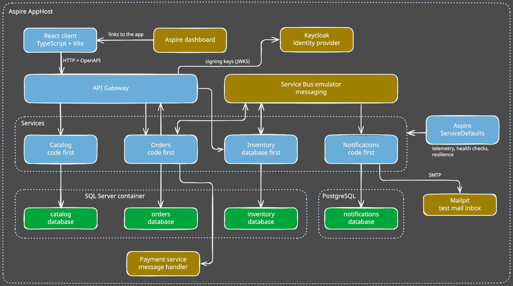
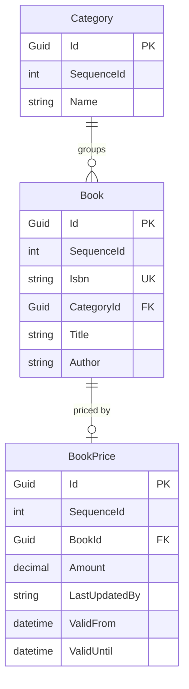
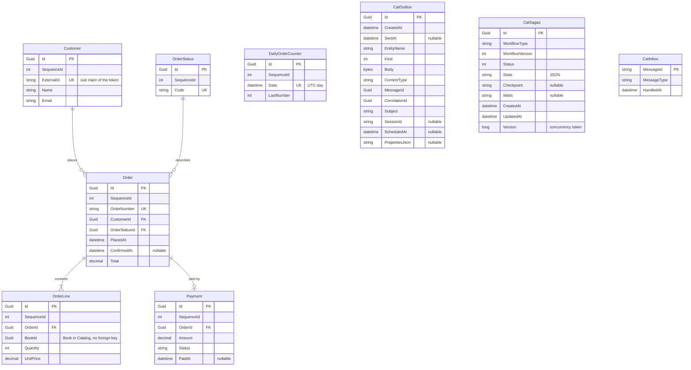
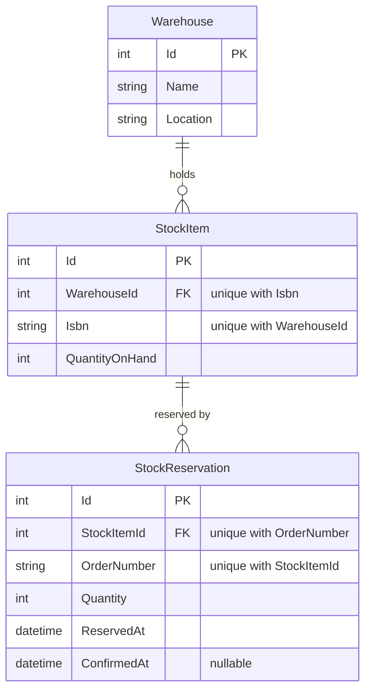
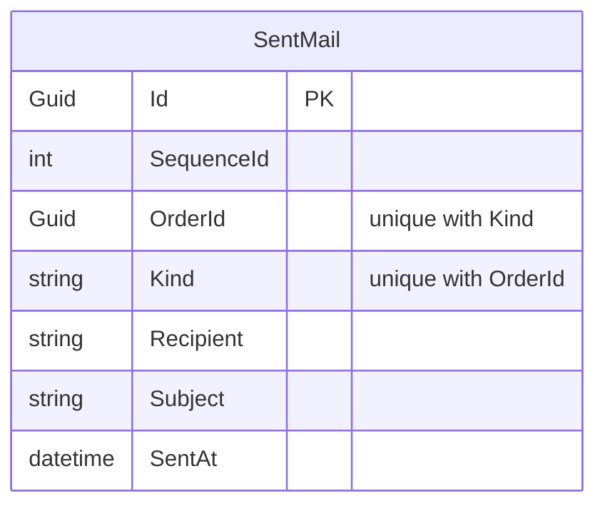

<!-- region start: Header-->
<!-- Header template: @.claude\skills\cat-internal-create-header\header.template.md, RootPath: .. -->
<link href="../resources/styles/style.css" rel="stylesheet" />
<table>
    <tr>
        <td colspan='6' style='text-align: center; font-weight: bold; border: none; border-top: 1px dashed #494949; border-bottom: 1px dashed #494949;'>
             Clean Architecture Toolkit for .NET
        </td>
    </tr>
    <tr>
        <td colspan='5' style='padding: 0; vertical-align: middle; border: none;'>
            Clean Architecture Toolkit is a clean, modular architecture foundation for .NET applications.<br>
            It embraces SOLID principles and focuses on maintainability, testability, and scalability through clear boundaries and pluggable design.</td>
        <td style='padding: 0; border: none;' width='220'>
            
        </td>
    </tr>
    <tr>
        <td colspan='6' markdown='1' style='padding-left: 0; padding-right: 0; padding-top: 15px; padding-bottom: 0; border: none; border-top: 1px dashed #494949; border-bottom: 1px dashed #494949;'>

&#124;&nbsp;&nbsp;&nbsp;[HOME](../README.md)&nbsp;&nbsp;&nbsp;&#124;&nbsp;&nbsp;&nbsp;[REPO OVERVIEW](../README.md#repo-overview)&nbsp;&nbsp;&nbsp;&#124;&nbsp;&nbsp;&nbsp;[DEMO](../demo/README.md)&nbsp;&nbsp;&nbsp;&#124;

</td>
</tr>
</table>
<!-- region end: Header-->

<!-- region start: TemplateSkill-->
<!-- Use the cat-internal-create-demo-readme skill to update this readme.-->
<!-- region end: TemplateSkill-->

# CAT Bookshop Demo <!-- omit in toc -->

A small bookshop that shows how the Clean Architecture Toolkit modules work together.

This readme tells the story of the demo in the order a team meets it. First comes what the shop does. Then comes the architecture that carries it. Then comes how to run it. Then comes the choice of CAT modules. At every step you read what was decided, why, and what it costs. The facts of every block are at the end, in the [building blocks](#building-blocks).

## Table of contents <!-- omit in toc -->

- [The idea](#the-idea)
  - [What the bookshop does](#what-the-bookshop-does)
- [The architecture](#the-architecture)
  - [How the pieces fit](#how-the-pieces-fit)
  - [How a request flows through a service](#how-a-request-flows-through-a-service)
  - [Sharing contracts](#sharing-contracts)
  - [Login and tokens](#login-and-tokens)
  - [Events and interfaces](#events-and-interfaces)
  - [Databases](#databases)
- [Running it](#running-it)
  - [Prerequisites](#prerequisites)
  - [Run with Aspire](#run-with-aspire)
  - [Docker memory](#docker-memory)
  - [Things to know](#things-to-know)
  - [Health checks](#health-checks)
  - [Things to know about the dashboard](#things-to-know-about-the-dashboard)
  - [Run the tests](#run-the-tests)
- [Choosing the CAT modules](#choosing-the-cat-modules)
  - [Where the CAT modules sit](#where-the-cat-modules-sit)
  - [Why each service picked its modules](#why-each-service-picked-its-modules)
- [Building blocks](#building-blocks)
  - [React client](#react-client)
  - [Aspire AppHost and dashboard](#aspire-apphost-and-dashboard)
  - [API Gateway](#api-gateway)
  - [Keycloak](#keycloak)
  - [Catalog service](#catalog-service)
  - [Orders service](#orders-service)
  - [Inventory service](#inventory-service)
  - [Notification service](#notification-service)
  - [Aspire ServiceDefaults](#aspire-servicedefaults)
  - [Payment service](#payment-service)
  - [Service Bus emulator](#service-bus-emulator)

## The idea

A team that starts a new project first talks about what the application must do. The demo starts there too.

An online bookshop fits the job. Everybody knows how a shop works, so you can follow the code without a lesson in the domain. It still has the hard parts of a real system: a price that changes over time, a stock that two customers want at once, a payment that takes time and can fail, and a mail that must go out once.

These choices shaped the functions below:

- **Ordering is not instant.** The shop answers at once that the order is pending, and the payment decides the end result a few seconds later. The screen follows the status by itself. The gain is a process that waits, which shows what the modules do. The cost is that the client has to ask again for the end result.
- **Stock and mail are services of their own, and payment is an outside provider.** Each one shows another way to work with CAT. The cost is more projects to run.
- **The partners are pretend.** The payment provider is a fake that can fail on purpose, and the mails go to a test inbox. Failures are easy to show, and nothing leaves your machine. The cost is that the demo proves nothing about a real provider.
- **Failures are part of the story.** An order can stop at stock, at payment or at a timeout, and the shop always ends in a clear state. The list of what the shop does when something goes wrong is as important as the list of what it does when all is well.

### What the bookshop does

The demo is an online bookshop. Customers look at books and place orders. An admin keeps the catalog up to date.

What you can do today:

- **Browse the catalog.** See the categories and the books in them. Search for a book. Open a book to see its details.
- **See prices.** Every book has a current price in euro. The shop keeps the older prices as well.
- **Manage the catalog.** An admin can add a book or change one.
- **Place an order.** Pick books and quantities. The shop looks up the prices and checks that the books are in stock. It then answers at once that the order is pending, and asks the payment provider to take the payment. The order confirms when the provider answers, usually within a few seconds. The screen shows the status and updates by itself.
- **Get an order number.** Every order gets a number like `20261105-0001`. The date is the day of the order. The counter starts again every day.
- **Follow your orders.** See a list of your orders and open one to see its lines, its total and its status.
- **Cancel an order.** Change your mind after ordering and cancel it, as long as the order is not shipped yet. When the order was paid, the shop gives the money back.
- **Get your order shipped.** A confirmed order ships 5 minutes after the confirmation. A shipped order can no longer be cancelled.
- **Get a confirmation mail.** When an order is confirmed, the customer gets a mail with the order number and the total. The mails are in English. The demo keeps them in a test inbox, so nothing leaves your machine.
- **Log in or register.** Alice, Bob and the admin each have an account. A new user can register on the login page and is logged in at once. You need to be logged in to place or follow orders. Anyone can browse the catalog without a login.
- **Stay private.** A customer only sees their own orders. An admin sees all of them. Only an admin can add or change a book.
- **Use the web shop.** Open the shop in the browser, search the books by text or category, open a book and log in on the login page. A new user registers there first. Put books in a basket and place an order. Follow your orders in the browser, and cancel one. An admin can add a book and change a book.

What the shop does when something goes wrong:

- A book that is not in stock stops the order. The order is cancelled and the customer is told which book is the problem.
- A payment that is declined stops the order in the same way. The order shows as cancelled.
- A payment provider that is down or too slow stops the order too. The order waits for the answer for 2 minutes, a setting. After that it is cancelled and shows as cancelled. The request waits in a queue of the shop, and the shop asks the provider again until it answers. If the answer comes after the order was cancelled, the shop refunds the payment at once, so the money does not stay taken.
- A shop that restarts while an order waits for the payment does not lose the order. The wait is saved in the database, and the answer carries on where the order stopped.
- Without the message bus the request for the payment never reaches the provider. The order stays pending until the job for stuck orders cancels it.
- A stock service that is down or too slow stops the order in the same way. The order is cancelled and the customer is told to try again later.
- A shop that gives up waiting while the order is placed does not leave a half finished order behind. The order is cancelled.
- An order that stays unpaid for more than 15 minutes, for example after a crash of the shop, is cancelled by a job that runs every 5 minutes. The stock goes back.
- A cancel of a shipped order is refused. The order has left the shop, and it stays shipped.
- A cancel of a paid order asks the payment provider for the money back. The order is cancelled at once, and the payment shows as refund pending until the provider answers. An order that was cancelled before it was paid, or after a decline, has nothing to refund.

When you start the shop with Aspire, the order asks the catalog for the real price of every book. A separate stock service keeps the stock levels and reserves the books of an order, all or nothing, so the last copy never sells twice. A pretend payment provider takes the payment. It is a plain REST API that the shop calls with an API key, and it is outside the shop like a real provider would be. It declines any total above 500 euro. It never charges an order twice, also when the shop sends the request twice, because every call carries an idempotency key.

A separate notification service sends the confirmation mail. A mail for the same order goes out once, also when the message arrives twice.

Every night a job in the stock service looks for books with fewer than 10 copies left. When it finds any, the notification service mails the list to the admin. Nothing is sent when all stock is fine. The limit and the address of the admin are settings.

The admin also gets a mail at the moment a book drops below the limit, a few seconds after the stock changes. This happens for every change of the stock table, also one made by a person or a script in the database. The stock service has no code that sends it. Only the drop from the limit or more to below the limit sends a mail, so a book that stays low does not send a mail on every order.

## The architecture

With the functions known, the team asks which technical shape carries them. The demo makes these decisions:

- **Separate services that own their data.** Catalog, Orders, Inventory and Notifications each have their own database, and Notifications runs on PostgreSQL while the others run on SQL Server. Where one needs data of another, it asks. The cost shows in the details. Inventory knows a book by its ISBN and not by its id, and an order line holds a book id with no foreign key.
- **One door for clients.** An API gateway checks the login. Clients know one address, and the token check sits in one place. The cost is one more hop and one more process.
- **The same structure in every service.** Every use case has the same shape, so a new one is easy to add. The cost is many small types for a small service.
- **Keycloak for the login.** Real tokens and a real login flow, with no account to create.
- **A choice per connection for the contracts.** Sharing the types of a service is not a rule. The demo shows both options.
- **Interfaces, events, messages and sagas for different jobs.** Each way to stay loosely coupled fits one kind of question.

The next parts explain each decision.

The demo is a small system of services, each with its own database. The services are built the same way, with the project structure from the [readme](../README.md#service-project-structure). A client talks to them through an API gateway, which checks the login. Services call each other through the gateway.



Hatched boxes are not built yet. Solid boxes are. The drawing is kept in sync with the code.

### How the pieces fit

- **Clients** only talk to the API gateway. It checks the token, lets the public catalog reads through and forwards the call with the token unchanged. Orders asks Catalog for prices and Inventory for stock through the gateway as well, with clients generated by `Cat.Api.Client`. The payment provider is the exception. It is outside the shop, so Orders calls it directly from its infrastructure with an API key, and not through the gateway.
- **Login.** Keycloak runs as a container and holds the users. The gateway and each service check the token. A service does not trust the network. See [Things to know](#things-to-know).
- **Services** own their data. A service never reads the database of another service. Where one needs data of another, it asks through an interface. Orders asks Catalog for prices and Inventory for stock through the gateway when you run through Aspire, and calls the payment provider directly.
- **Contracts.** Sharing the contracts of a service is a choice per connection. The React client and the price call from Orders to Catalog keep their own models. The stock call from Orders to Inventory shares the `Contracts` project of Inventory, so the demo shows both. See [Sharing contracts](#sharing-contracts).
- **Events** stay in memory inside a service. A service tells another one about a fact with a message on Azure Service Bus. Orders publishes `OrderConfirmed` through its outbox, and Inventory and Notifications receive it. Orders also sends `TakePayment` to a queue of its own, and a handler calls the payment provider and publishes `PaymentProcessed`. A refund goes the same way with `RefundPayment` and `PaymentRefunded`. These are the places where a message is a question with an answer. See [Events and interfaces](#events-and-interfaces).
- **Databases.** Every service has its own SQL Server database.
- **Aspire** starts everything with one command: the gateway, the services, Keycloak, SQL Server and the Service Bus emulator in containers, and the dashboard.

### How a request flows through a service

Inside a service every use case follows the same path. The decorators do the cross cutting work once, and the handlers only hold what is special about the use case. That is why a new use case is easy to add. It is also why a small service has many small types: a request, a handler, a query, a query handler and a validator. The core service has no web or database code, so it is easy to unit test.


1. An endpoint receives the HTTP request and turns it into a service request.
2. The service request processor runs the decorators: logging, tracing and validation.
3. A handler runs the use case. It reads through queries and changes data through commands.
4. The result comes back as a response, either a value or a list of errors.
5. The endpoint turns the response into an HTTP status code and a body.

### Sharing contracts

The readme says that sharing the `Contracts` project of a service is a choice of the developer. The demo makes a choice per connection and shows both options.

| Connection | Choice | Why |
|---|---|---|
| React client to gateway | Not shared | The client is TypeScript, so there is nothing to reference. It also keeps the demo client-agnostic. The client comes from the OpenAPI documents. |
| Orders to Catalog (prices) | Not shared | Orders needs a price per book and nothing else. The generated Catalog client has models of its own, so Orders does not depend on the Catalog contract. |
| Orders to Inventory (stock) | Shared | To show the other option. Orders references the `Contracts` project of Inventory and reuses its types. |
| Orders to the payment provider | Own copy | The four messages `TakePayment`, `PaymentProcessed`, `RefundPayment` and `PaymentRefunded` live in the core of Orders and never leave it. The provider is outside, so it ships no contracts. Orders keeps a copy of its OpenAPI document and generates a client from it, with its own types. |

What it costs:

- Not shared: duplicate types, and a change in the other service only shows up at runtime.
- Shared: coupling to the types and the release rhythm of the other service.

The choice is made per connection. Another application can choose differently.

### Login and tokens

A clone must start with one command, and the demo must still show the proper way. Keycloak runs as a container with an imported realm, so no signup and no external account are needed. See [Keycloak](#keycloak).

How a call travels:

1. The React app logs in with authorization code and PKCE and gets an access token.
2. It calls the gateway with `Authorization: Bearer <token>`. Catalog reads need no token. Orders endpoints do.
3. The gateway validates the token and forwards it unchanged.
4. The inner service validates the JWT itself. It does not trust the network.
5. The service authorizes on the claims. Alice only loads her own orders, and the orders of Bob come back as not found. An admin edits the catalog through a role claim.

Calls from one service to another forward the same token.

A message carries a token too, because a message arrives without a request. The sender puts it in the message. The receiver checks it before it runs the handler:

- A message that Orders sends while a user places an order carries the token of that user. Without a user request, such as the timeout of a saga, Orders asks Keycloak for a client credentials token of the client `cat-demo-orders`.
- The payment provider has no login. Orders sends an API key in the `Authorization` header of the call, and the key is a secret parameter of the AppHost.
- Inventory sends its messages, such as the nightly low stock report, with a token of its own, from the client `cat-demo-inventory`.
- Orders, Inventory and Notifications accept a message only from a logged in caller, with `Cat.EventProcessor.Authorization`. The receiver skips the lifetime check for a scheduled message, because the token of a scheduled message is made when it is sent and is expired when the bus delivers it.
- The token sits in the queue and in the outbox table for as long as the message does. The demo uses short lived tokens.

In the code:

- The business logic asks for `ICatUser` of [Cat.Users](../modules/Cat.Users/README.md) and never sees `HttpContext`. It has `UserId`, `Name`, `IsAuthenticated` and `IsInRole`. The `CoreService` project of Orders only references `Cat.Users.Abstractions`.
- `IsAdmin` is a small extension method over `IsInRole("admin")`. `Email` is not part of `ICatUser`, so Orders has its own small `IUserEmail` that the Api project fills from the `email` claim.
- `AddDemoJwtAuthentication` in `ServiceDefaults` registers `Cat.Users` and `Cat.Users.JwtBearer`. `ICatUser` then comes from the claims of the token, with the flat `roles` claim that Keycloak emits. `MapInboundClaims` is false, so `sub` keeps its name.
- Ownership is a filter in the query. The queries get the external id of the customer, or none for an admin, so the orders of others come back as not found and nothing leaks.

Other ways were rejected. Entra ID or Auth0 would make every person who clones the repository create a tenant. An own token service is a lot of code that is not about CAT. `dotnet user-jwts` has no login flow for the client.

### Events and interfaces

Orders uses two ways to stay loosely coupled. They are for different jobs.

| Kind of interaction | Decoupled by | Needs an answer? |
|---|---|---|
| Reserve stock | An interface (`IStockReservation`), called from a workflow step | Yes |
| Take payment | A message to a queue of Orders (`TakePayment`), sent and awaited by a saga step. A handler of Orders calls the payment provider and publishes `PaymentProcessed` | Yes, later. The workflow stops and carries on when the answer arrives |
| Refund a payment | A message to a queue of Orders (`RefundPayment`), sent by a subscriber of the cancelled event. A handler of Orders calls the provider and publishes `PaymentRefunded` to a plain receiver | Yes, later. Nobody waits. The payment shows `RefundPending` until the answer arrives |
| Order confirmed, order cancelled | An event on `ICatEventAggregator` | No |
| Order confirmed, told to another service | A message on Azure Service Bus (`OrderConfirmed`) | No |
| Low stock, told to Notifications | A message on Azure Service Bus (`LowStockReport`), published by a scheduled job of Inventory | No |
| Stock changed, told to Notifications | A message on Azure Service Bus (`StockChanged`), sent by `Cat.Sql.Cdc` from the change table of the stock table, without Inventory code that publishes it | No |

- The workflow publishes `OrderConfirmed` and `OrderCancelled`. It knows only the aggregator, not the subscribers.
- Subscribers: a status updater, an audit logger, the stock release and the payment refund.
- The in-process event `OrderConfirmedEvent` and the message `OrderConfirmed` are two different types. The status updater sets the status through a command, and that command also publishes the message. See [Orders service](#orders-service).
- The message is a service request as well. Inventory writes a handler for it, like for any other request, and `Cat.EventProcessor` runs it. See [Inventory service](#inventory-service).
- Events cannot drive the process. `PublishAsync` returns no answer and rethrows the exception of a failing handler.
- Calls whose answer decides the next step and arrives at once go through an interface. The tests put a fake behind it.
- A question that takes time goes through a saga. The place order workflow sends `TakePayment`, saves its state and stops. `PaymentProcessed` finds the saved instance by its correlation id and runs the rest of the workflow. See [Orders service](#orders-service).
- A question that takes time but that nobody waits for needs no saga. The refund runs after the order process has ended, so a subscriber of the cancelled event sends `RefundPayment`, and a plain handler receives `PaymentRefunded`. See [Orders service](#orders-service).
- Subscribers are long lived singletons, because the aggregator holds them with weak references. A subscriber that needs a scoped service such as the `DbContext` opens its own scope.

### Databases

Every service has its own SQL Server database, and the demo builds them in two ways to show that CAT works with both.

- **Code first.** Catalog, Orders and Notifications describe the tables in C# and apply EF Core migrations. Every entity inherits a base class from `Cat.EFCore`. Catalog uses a temporal table for the book price, so every old price stays in the history. The cost is that temporal tables tie Catalog to SQL Server, so SQLite and PostgreSQL do not work there. Notifications shows the other side, the same base entity and `ConfigureCatEntity` on PostgreSQL, with no temporal table.
- **Database first.** A stock database often exists already, owned by a warehouse team. So Inventory takes its schema from SQL scripts, and the entities are scaffolded from the database. The atomic update that reserves stock stays plain SQL, and the commands and responses stay the same as in the other services. The cost is two ways to build a service, which means two ways to explain, and both need care after a schema change.
- **Plain SQL for one read.** The order overview of Orders reads with Dapper and a `.sql` file, because it is a read only query that needs only the columns it shows. The cost is that the SQL knows the table and column names of the EF Core model, so a rename in the model breaks the query at run time and no test of the demo catches it.

The tables and columns of every database are in the chapters of the services: [Catalog service](#catalog-service), [Orders service](#orders-service), [Inventory service](#inventory-service) and [Notification service](#notification-service). The payment provider has no database.

## Running it

Next the team asks how the application runs. The demo must start with one command on a fresh clone, and it needs a database, an identity provider, a message bus and a mail server.

The decision is the Aspire AppHost. One project describes the whole system, and one command starts the gateway, the services, the React client and the containers. The dashboard shows the logs, the traces, the metrics and the health checks.

What it gives:

- One command to start everything.
- Traces across services in one place.
- A fresh clone needs no connection strings.

What it costs:

- Docker Desktop eats memory. See [Docker memory](#docker-memory) for the limits.
- The first start pulls a SQL Server image of about 1.5 GB, and the Keycloak image.
- It is one more thing to learn.

Two rules keep Aspire from taking over the demo:

- **The modules never depend on Aspire.** Only the demo uses the shared `ServiceDefaults` project.
- **The parts that need a container come with the AppHost.** SQL Server, Keycloak, the Service Bus emulator and Mailpit each have a reason:
  - SQL Server in a container. Temporal tables need SQL Server, so SQLite and PostgreSQL do not work.
  - Keycloak gives real tokens with no account to create. The realm is a file in the repository, so every clone gets the same users. The official Aspire Keycloak package is only a preview, so the demo uses a plain container.
  - The Service Bus emulator gives a real bus on your machine with no cloud account. Everything is gone after a restart, and the services create their own topics and queues at startup.
  - Mailpit is a test mail server. No mail leaves your machine.

The demo is made for a local machine. Several settings, such as the plain text secrets of Keycloak, are fine for a demo and wrong for production.

The main route is the Aspire AppHost. One command starts the gateway, Catalog, Orders, the payment provider, Keycloak, SQL Server and the React client, and opens the dashboard.

### Prerequisites

- The .NET SDK that `global.json` asks for.
- **Node.js 24 or newer** for the React client. The AppHost runs `npm install` and `npm run dev` for you, so you only need Node and npm on the path.
- **Docker Desktop** for the default route. SQL Server, Keycloak, the Service Bus emulator and Mailpit run in containers.

### Run with Aspire

1. Clone the repository and open a terminal in its root folder.
2. Start the AppHost:
   ```
   dotnet run --project demo/Cat.Demo.AppHost/Cat.Demo.AppHost --launch-profile http
   ```
3. Wait until the dashboard shows `gateway`, `catalog`, `orders`, `payment`, `inventory` and `web` as running. The first start pulls the SQL Server, Keycloak and Service Bus emulator images, so it takes a few minutes. Keycloak needs a moment to import the realm.
4. The launch profile opens the dashboard in your browser and logs you in. If you open the dashboard yourself, go to `http://localhost:15101/login?t=dev`, or enter the token `dev` on the login page. It shows the logs, traces, metrics and health checks of the services. The dashboard may show the notification "No trusted development certificate was found". See [Things to know about the dashboard](#things-to-know-about-the-dashboard).
5. Try the endpoints. The gateway runs on `http://localhost:5100` and is the door for every call. Keycloak runs on `http://localhost:8180`. Open these files in Visual Studio or Rider and run the requests from top to bottom. Run the login requests at the top first. Later requests use ids from earlier responses.
   - `demo/Cat.Demo.CatalogService/Cat.Demo.CatalogService.Api/CatalogRequests.http`
   - `demo/Cat.Demo.OrderService/Cat.Demo.OrderService.Api/OrderRequests.http`
   - `demo/Cat.Demo.InventoryService/Cat.Demo.InventoryService.Api/InventoryRequests.http`
   - `demo/Cat.Demo.NotificationService/Cat.Demo.NotificationService.Api/NotificationRequests.http`
   - The web shop runs on `http://localhost:5104`. You can browse the books, log in as `alice` with the password `alice`, fill the basket and place an order. See [React client](#react-client).
6. Place an order and open its trace in the dashboard. It shows the call from Orders to Catalog for the prices. A moment after the order is confirmed, the log of `inventory` shows the SQL command `UPDATE dbo.StockReservation SET ConfirmedAt`, which is the handler of the message `OrderConfirmed` at work.
7. Press Ctrl+C to stop. The database lives in the Docker volume `cat-demo-sql-data`, so the data is still there at the next start.

To start again with empty databases, stop the AppHost and remove the volume:

```
docker volume rm cat-demo-sql-data
```

### Docker memory

Docker Desktop on Windows runs on WSL2. By default the WSL2 virtual machine can take half of your RAM and keeps it while it runs.

- **Limit WSL2.** Create `%UserProfile%\.wslconfig`, then run `wsl --shutdown` and restart Docker Desktop. This is an example for a machine with 32 GB:
  ```
  [wsl2]
  memory=8GB
  processors=4
  swap=2GB

  [experimental]
  autoMemoryReclaim=gradual
  sparseVhd=true
  ```
- **Use the WSL 2 backend** in Docker Desktop, and turn off start at sign-in.
- **SQL Server is capped.** The AppHost sets `MSSQL_MEMORY_LIMIT_MB` to 2048 on the container. An idle container uses about 620 MiB.
- **Give the memory back.** When you are done, quit Docker Desktop and run `wsl --shutdown`.

### Things to know

- **Users.** Keycloak holds three users: `alice`, `bob` and `admin`. The password is the same as the name. Alice and Bob only see their own orders. The admin sees all orders and may save books. The Keycloak admin console at `http://localhost:8180` uses `admin` and `admin`. Use these settings in the demo only. A person who registers on the login page becomes a normal user, with no admin role. Keycloak does not check the email address, because the demo has no mail server for it.
- **Tokens.** The `.http` files get a token from Keycloak with the password grant of the client `cat-demo-cli`. The gateway needs a valid token for everything except reading books and categories. The services check the token again, so a call straight to port 5101 or 5102 without a token gets a 401 too.
- **Mails.** The confirmation mails go to Mailpit, a test mail server in a container. Open `http://localhost:8025` to read them. Alice and the others have `@example.com` addresses, and no mail leaves your machine.
- **Payment failures.** The payment provider can fail on purpose, to show the wait, the retries and the timeout of an order. See [Payment service](#payment-service) for the settings. `Orders:PaymentTimeoutSeconds` sets how long an order waits for the payment, 120 seconds by default.
- **An order is asynchronous.** `POST /orders` answers 202 with the order in status `Pending` and a `Location` header. The status changes when the payment answers. Follow it with `GET /orders/{id}`. The React client does this every 2 seconds while the status is `Pending`, and every 10 seconds while it is `Confirmed`, until the order is shipped.
- **Currency.** All amounts are in euro.
- **Order numbers** look like `20261105-0001`. The counter restarts every UTC day. The Scheduler removes the counters of earlier days every night. The development endpoint `POST /development/scheduler/clean-up-order-counters` does the same at once.
- **Scheduled jobs.** Orders runs `clean-up-order-counters`, `clean-up-inbox` and `clean-up-outbox` every night and `cancel-stuck-orders` every 5 minutes. Inventory runs `low-stock-report` every night at 02:00 UTC. In `Development` each job has an endpoint in the group `/development/scheduler` of its service, so you can run it without waiting. These endpoints are not in the default OpenAPI document, so no generated client gets them. Scalar shows them in a second document named `dev`. `CatScheduling:Jobs:<job name>:Cron` changes the time of a job and `Enabled` switches it off. To see a low stock mail, set the stock of a book below 10 in the `inventory` database, run `POST /development/scheduler/low-stock-report` on port 5105, and open Mailpit. The mail goes to the address in `Notifications:AdminEmail`, which is `admin@example.com` by default. `Inventory:LowStockLimit` changes the limit.
- **Stock drop mail.** A book whose stock drops from the limit or more to below the limit sends a mail to the admin, about 4 seconds later. To see one, change the stock in the `inventory` database, for example `UPDATE dbo.StockItem SET QuantityOnHand = 5 WHERE Id = 3`, and open Mailpit. A change that is no drop sends nothing. The limit is the same setting as for the nightly report. The development endpoint `POST /dev/event-processor/StockChanged` on port 5106 runs a message through Notifications without a bus. Send the bearer token of a login in the `Authorization` header, or the message is dead lettered as `Unauthorized`. `NotificationRequests.http` has both calls.

### Health checks

The gateway and every service answer `/health` (ready) and `/alive` (running) in every environment, with a plain `Healthy` or `Unhealthy`, and no token is needed. Every service with a database adds a check of its `DbContext` to `/health` only, through `AddDbContextCheck`, so a service whose database is down shows `Unhealthy`. `/alive` stays a plain process check. The AppHost watches `/health` of all of them. The gateway also calls `/health` of its services and stops sending calls to an instance that fails.

### Things to know about the dashboard

The dashboard has a fixed login token, `dev`. The launch profile of the AppHost sets it with `ASPIRE_DASHBOARD_FRONTEND_BROWSERTOKEN` and opens `login?t=dev`, so the browser lands in the dashboard already logged in. The token is for a local demo only. Without a fixed token the AppHost makes a new random one at every start. Do not set `ASPIRE_DASHBOARD_UNSECURED_ALLOW_ANONYMOUS`. It opens the dashboard without a login, and the dashboard then warns that the endpoint is unsecured.

The dashboard may say "No trusted development certificate was found". The AppHost, the dashboard and the services all run on HTTP, so the demo works with the notification and it is harmless. To clear it, trust the ASP.NET Core development certificate once:
```
dotnet dev-certs https --trust
```
Windows and macOS ask you to confirm. Start the AppHost again afterwards. This step is optional. To undo it, remove the development certificate from your machine and from the trusted certificates:
```
dotnet dev-certs https --clean
```
The `--clean` command removes every ASP.NET Core development certificate of your user, also for other projects. Run `dotnet dev-certs https --trust` again when you want a trusted one.

To follow one order, place it and open **Traces** in the dashboard. The call `POST /orders` shows up as one trace. It holds the gateway, Orders, Keycloak, Catalog and Inventory, so you see every HTTP hop of the order in one place. The order is already answered with 202 when the payment starts, so the rest of the order is not in this trace. The payment provider exports no telemetry, and the client of Orders has a trace boundary (`AddCatTelemetryBoundary`), so no trace header reaches the provider. The call shows only as a client span of Orders, in the trace of the message that asked for it.

The message hops that start from an order are part of the trace of `POST /orders`, because the outbox of Orders sends the trace of the caller with every message and the receiver of `Cat.EventProcessor` continues it. `TakePayment` and `PaymentProcessed` in Orders and `OrderConfirmed` in Inventory and in Notifications show as a `Cat.EventProcessor.Receive` span in that trace. `StockChanged` is the exception. Inventory sends it from the change data capture, which runs in the background and has no caller, so Notifications handles it in a trace of its own. Match such a trace to its change by the time and the message name.

### Run the tests

Run all tests of the repository, including the demo tests:

```
dotnet cake --target=Test
```

The unit tests of a service sit in its `CoreService.Tests` project. They use the fake processors of `Cat.UnitTesting` instead of a database.

## Choosing the CAT modules

The last question is which modules to use. CAT is a toolbox. A developer picks the modules and the projects they want, and a module never forces another one on them. The demo follows that rule, so the services use different sets of modules.

### Where the CAT modules sit

| Layer | Modules |
|---|---|
| API | `Cat.Minimal.Api` |
| Core service | `Cat.ServiceRequests`, `Cat.Queries`, `Cat.Commands`, `Cat.Validators`, `Cat.Responses`, and in Orders also `Cat.FluentWorkflows` and `Cat.EventAggregators` |
| Infrastructure | `Cat.EFCore`, and in Orders `Cat.Messaging` with the outbox |
| Saga | `Cat.Sagas` and `Cat.Sagas.EFCore` (Orders) |
| Scheduler | `Cat.Scheduling` and `Cat.Scheduling.EFCore` (Orders and Inventory) |
| EventProcessor | `Cat.EventProcessor` (Orders, Inventory and Notifications), with its inbox in Orders and `Cat.EventProcessor.Authorization` in Orders, Inventory and Notifications |
| Messaging | `Cat.Messaging` and `Cat.Messaging.AzureServiceBus` (Orders, Inventory and Notifications) |
| Users | `Cat.Users.Abstractions` in the core service and the infrastructure, `Cat.Users` and `Cat.Users.JwtBearer` in the host |
| Core service tests | `Cat.UnitTesting.Commands`, `Cat.UnitTesting.Queries` and `Cat.UnitTesting.NUnit` |
| Telemetry | `Cat.Telemetry` (every service, through `ServiceDefaults`, and the trace boundary on the payment client in Orders) |
| Resilience | `Cat.Resilience` (every service, through `ServiceDefaults`, with its own profiles in Orders) |
| Everywhere | `Cat.Expressions` |

The [building blocks](#building-blocks) explain where each module is used and why.

### Why each service picked its modules

**Catalog** is the baseline. It uses the modules that every service needs.

- `Cat.ServiceRequests` with its decorators gives one entry point per use case, with logging, tracing and validation done once.
- `Cat.Queries` and `Cat.Commands` keep reads and writes in separate handlers that are easy to test.
- `Cat.Responses` makes a result a value or a list of errors, with no exceptions for business failures.
- `Cat.EFCore` brings the entity base classes and the temporal price table.
- The cost is many small types for a small service.

**Orders** is the main service, so it adds more.

- `Cat.FluentWorkflows` makes the place order process read as a list of steps.
- `Cat.EventAggregators` keep the status update, the audit and the cleanup out of the workflow.
- `Cat.Sagas` lets the workflow stop at the payment and carry on with the answer, also after a restart.
- `Cat.Messaging` with its outbox saves the status and the message in one `SaveChanges`, so an order never confirms without telling the others.
- `Cat.EventProcessor` with its inbox makes an answer count once.
- `Cat.Scheduling` runs the nightly cleanups, the sweep of stuck orders and the shipping.
- The cost is that events cannot drive the process, that the order status and the saga state are two places that must agree, and that the outbox adds a table, a migration and a background service.

**Inventory** shows that CAT also works when the database comes first. It uses no entity base classes, so it shows that a developer uses only the modules they need. It adds `Cat.Api.Client` for the generated client, `Cat.Scheduling` for the nightly report and `Cat.Sql.Cdc`, which turns a change in the stock table into a message with no publishing code, so a change made by a script is seen as well. The cost is that change capture works on SQL Server only and needs the SQL Server Agent.

**Notifications** only receives. `Cat.EventProcessor` runs its handlers, and the table of sent mails shows idempotent handling without an inbox. A second receiver of `OrderConfirmed` also shows that a message has more than one reader.

**Payment** is a fake outside provider. It uses no CAT module, because a real provider would not. Orders calls it from its infrastructure, and `Cat.Messaging` and `Cat.EventProcessor` carry the request and the answer inside Orders, so the demo shows a slow or failing partner and how the order ends.

**The gateway** is a small host on `Cat.Api.Gateway`. It takes the routes, the token check, the header cleaning and the rate limits from configuration. The gateway only option of the module is not used, because the services check the token themselves.

**The React client** uses no module. It is built from the OpenAPI documents that `Cat.Minimal.Api` produces, so the client stays independent of .NET. The cost is that a change in a service needs a refresh of the saved document.

## Building blocks

The chapters above tell why. The chapters below hold the facts of every block that is built: what it is, how it works, which CAT modules it uses, and what it gives and costs. A database sits in the chapter of the service that owns it.

| Block | What it is |
|---|---|
| [React client](#react-client) | The web shop. It shows the books, has a login, takes orders and shows them, and lets an admin edit books. |
| [Aspire AppHost and dashboard](#aspire-apphost-and-dashboard) | Starts the whole system and shows how it runs. |
| [API Gateway](#api-gateway) | The one door for clients. |
| [Keycloak](#keycloak) | The identity provider that holds the users and signs the tokens. |
| [Catalog service](#catalog-service) | Books, categories and prices. |
| [Orders service](#orders-service) | Placing and following orders. A saga waits for the payment. |
| [Inventory service](#inventory-service) | Stock levels and reservations. |
| [Notification service](#notification-service) | Sends the order confirmed mail. |
| [Aspire ServiceDefaults](#aspire-servicedefaults) | Shared telemetry, health checks and resilience. |
| [Payment service](#payment-service) | A pretend outside payment provider. A plain REST API with no CAT modules, called by Orders with an API key. It can fail on purpose. |
| [Service Bus emulator](#service-bus-emulator) | The message bus. It carries `OrderConfirmed` from Orders to Inventory and Notifications, and the four payment messages inside Orders. |

### React client

**What it is.** A thin web client with a book list, a basket, an order overview and an admin screen for books. It uses React with TypeScript, built with Vite.

**Where it stands.** The app is in `demo/Cat.Demo.WebClient/Cat.Demo.WebClient.App`, a Vite, React and TypeScript project. The AppHost starts it as `web` on the fixed port 5104, and the gateway lists `http://localhost:5104` as an allowed CORS origin. It has six screens: the book list, the book detail, the basket, the order overview, the order detail and the book form for admins. It also has a login. The book list has a search box and a category filter, and keeps them in the address. One error component shows the message, the code and the trace id of every failed call.

**Work on the client.** Run these in the app folder. Node 24 or newer is needed.

| Command | What it does |
|---|---|
| `npm run dev` | Starts Vite on port 5104. It needs the gateway on port 5100, which the AppHost starts. |
| `npm test` | Runs the Vitest tests. The Cake build does not run them. |
| `npm run build` | Checks the types and builds the app. |
| `npm run api:refresh` | Saves the OpenAPI documents of Catalog and Orders from a running AppHost into `api/`. Commit the change. |

**Types.** `npm run api:generate` makes the TypeScript types from `api/catalog.openapi.json`. It runs before `dev`, `build` and `test`. The generated file is not committed. The saved copy of the document is, so a fresh clone builds without a running service. TypeScript is pinned to 5.x, because `openapi-typescript` does not support 7 yet.

**How it works.**
- It only talks to the API gateway.
- The look comes from Bootstrap, used as plain CSS from npm. The markup has Bootstrap classes, and there is no React-Bootstrap. One small CSS module is left, for the amount columns of the tables.
- The Log in button, the login button of the basket and a visit to the order pages or the admin pages without a login all lead to the login page at `/login`. The books and the basket stay open to everyone. A small guard, `RequireLogin`, protects the order pages and the admin pages. It waits while the app asks Keycloak for a token after a refresh.
- The Log in button on the login page sends the browser to Keycloak. The login uses authorization code with PKCE (`react-oidc-context`). The page shows no demo users. A Register button opens the registration form of Keycloak (`prompt=create`), which the realm allows with `registrationAllowed`. After the login or the registration the person is back on the page they came from, and the top bar shows their name. The page to return to travels in the router state, and only a path inside the app counts.
- The access token lives in memory only. A page refresh loses it, so the app asks Keycloak for a new token without showing the login page. This works while the Keycloak session lasts. A tab flag, kept in session storage, says that the person was logged in. It holds no token.
- Every call to the gateway carries the token when a person is logged in. Catalog reads need none.
- The basket lives in the local storage of the browser, so a refresh or the trip to the login does not empty it. A line holds the book, the title, the price of the list and the quantity from 1 to 50. A book without a price cannot be added.
- Place order sends only the book and the quantity. The shop decides price, stock and payment. A visitor who is not logged in is sent to the login page first and returns to the basket. After the shop accepted the order, the screen shows the order number, the status and the total, and the basket is emptied. The status starts as `Pending`. The screen asks for the order every 2 seconds while it is pending and shows the end result: confirmed, or cancelled with the heading "Your order was cancelled". A failed order is never retried by the client, so nobody is charged twice by a retry.
- The order overview lists the orders of the person, newest first. The order detail shows the lines with the book titles, which come from the catalog, and a Cancel button. The order from the service carries `canCancel`, and the button is disabled when it is false, so the client holds no list of the statuses that allow a cancel. The page asks for a `Confirmed` order every 10 seconds, so the button turns off by itself when the order ships. A cancel that is refused anyway, for example on a screen that is out of date, shows the message of the service, such as `DEM-ORD-1004`. Another person's order comes back as not found.
- The admin screens `/admin/books/new` and `/admin/books/:id` hold a form for ISBN, title, author, category and price. The links to them show only when the ID token has the `admin` role in its `roles` claim. That only decides what the screen shows. The catalog checks the role again on every save, so a non admin who opens the address gets the 403 of the service. A duplicate ISBN shows `DEM-CTL-1000`.
- A failed call shows its CAT errors: the code and the message with the arguments filled in, and the trace id. The validators put the field name in front of the arguments, and the client skips it. The basket stays, so the person can try again.
- Log out ends the Keycloak session as well.
- It has no shared code with the services. The types come from a saved copy of the OpenAPI documents of the services.

**CAT modules.**

| Module | Where | Why |
|---|---|---|
| `Cat.Minimal.Api` | Produces the OpenAPI documents the client is built from | One description of every endpoint and every possible response. |

**Pros.**
- The client stays independent of .NET. The services expose a normal HTTP API.
- React is the most widely known option.

**Cons.**
- No shared contracts, so a change in a service needs `npm run api:refresh` and a commit of the saved document.
- Blazor WebAssembly would share the contracts, but it makes the demo look .NET only.

**More.** `demo/Cat.Demo.WebClient`. [Sharing contracts](#sharing-contracts) explains why the client has no shared code.

### Aspire AppHost and dashboard

**What it is.** One project that describes the system: the gateway, Catalog, Orders, Inventory, Notifications, the payment provider, Keycloak, SQL Server, PostgreSQL, the Service Bus emulator, Mailpit and the React client. The Aspire dashboard shows logs, traces, metrics and health checks.

**How it works.**
- `demo/Cat.Demo.AppHost/Cat.Demo.AppHost` adds the Api project of each service. The services keep their fixed ports with no Aspire proxy: gateway 5100, Catalog 5101, Orders 5102, payment 5103, web client 5104, Inventory 5105 and Notifications 5106. Mailpit uses 1025 for SMTP and 8025 for its web inbox. The dashboard runs on 15101.
- The AppHost adds a SQL Server container with a named data volume and the databases `catalog`, `orders` and `inventory`, and a PostgreSQL container with a named data volume and the database `notifications`. The services wait for their database. The `inventory` database also gets its SQL scripts, see [Inventory service](#inventory-service).
- The services read `GetConnectionString("catalog")`, `GetConnectionString("orders")`, `GetConnectionString("inventory")` and `GetConnectionString("notifications")`.
- Orders gets the address of the gateway through service discovery. That switches on `CatalogPriceProvider` and `InventoryStockReservation`, which call Catalog and Inventory through the gateway.
- The Azure Service Bus emulator runs next to them, see [Service Bus emulator](#service-bus-emulator). Orders, Inventory and Notifications get its connection string as `messaging`. Orders creates the queues `TakePayment` and `RefundPayment` and the topics `PaymentProcessed` and `PaymentRefunded` itself. Inventory and Notifications wait for Orders.
- The payment provider has no Keycloak client. The AppHost holds the API key as the secret parameter `payment-provider-api-key`, with the demo value in its `appsettings.json`, and passes it to Payment as `Provider__ApiKey` and to Orders as `PaymentProvider__ApiKey`. Orders also gets the address of Payment as `PaymentProvider__Url`. Orders waits for Payment, and the provider has no connection to the bus. Inventory gets the client `cat-demo-inventory` of Keycloak as `Authentication__ClientId` and `Authentication__ClientSecret`, next to the client of Orders. They are demo secrets.
- Mailpit runs as a container next to them, with the image `axllent/mailpit`. Notifications gets `Smtp:Host` and `Smtp:Port` from the AppHost and waits for Mailpit. Notifications has no route in the gateway.
- Keycloak is a plain container on port 8180. The realm file `keycloak/cat-demo-realm.json` is mounted and imported at the start. The official Aspire Keycloak package is only a preview, so the demo does not use it.
- The gateway runs on port 5100. It finds Catalog, Orders and Inventory through service discovery. The AppHost gives the gateway and every service the address of the Keycloak realm.
- The React client runs with Vite on the fixed port 5104, because the gateway lists that port as an allowed CORS origin.
- The AppHost passes the settings `Payment:Latency`, `Payment:ErrorPercentage` and `Payment:Outage` to the payment provider, and `Orders:PaymentTimeoutSeconds` to the orders service. See [Payment service](#payment-service).

**CAT modules.** None. The AppHost is demo infrastructure. The modules never depend on Aspire.

**Pros.**
- One command to start everything.
- Traces across services in one place.
- A fresh clone needs no connection strings.

**Cons.**
- Docker Desktop eats memory. See [Docker memory](#docker-memory) for the limits.
- The first start pulls a SQL Server image of about 1.5 GB, and the Keycloak image.
- It is one more thing to learn.

**More.** `demo/Cat.Demo.AppHost`.

### API Gateway

**What it is.** The one door for clients. It checks the token and forwards calls to Catalog, Orders and Inventory. It holds no business logic. The block is a small host project on top of the `Cat.Api.Gateway` module.

**How it works.**
- `demo/Cat.Demo.Api.Gateway/Cat.Demo.Api.Gateway` is a web project of about twenty lines. It calls `AddCatApiGateway`, adds the Aspire service discovery for YARP, and calls `UseCatApiGateway` and `MapCatApiGateway`.
- The `CatGateway` section of `appsettings.json` names the services `catalog`, `orders` and `inventory`. The path of a service is its name, so `/catalog/**` goes to Catalog, `/orders/**` to Orders and `/inventory/**` to Inventory. The services already use that prefix, so `StripPrefix` is off.
- The AppHost sets the addresses to `http://catalog`, `http://orders` and `http://inventory`, which service discovery resolves.
- Catalog lists `GET /books/**` and `GET /categories/**` as public. Everything else needs a token, also the inventory route. Saving a book needs a token, and the Catalog service wants the `admin` role on top.
- The gateway checks that the token comes from the Keycloak realm and has the audience `cat-gateway`. It does not look at roles. It forwards the token unchanged, and the service checks it again.
- Identity headers a caller sends, such as `X-Demo-User`, never reach a service.
- The `/health` and `/alive` endpoints of the gateway are mapped with `AllowAnonymous`, because the gateway is closed by default.

**CAT modules.**

| Module | Where | Why |
|---|---|---|
| `Cat.Api.Gateway` | The gateway project | Routes, token check, header cleaning and rate limits from configuration. |

The gateway only option of the module is not used in the demo. The services check the token themselves.

**Pros.**
- Clients know one address.
- Adding a service is a few lines of configuration.
- The token check sits in one place and the services stay safe on their own.

**Cons.**
- One more hop and one more process to run.
- The demo keeps its Keycloak settings in plain text. That is fine for a demo and wrong for production.

**More.** `demo/Cat.Demo.Api.Gateway`. [Login and tokens](#login-and-tokens).

### Keycloak

**What it is.** The identity provider of the demo. It holds the users, checks passwords and signs the access tokens. Any OpenID Connect provider would do. Keycloak is only the demo choice.

**How it works.**
- The AppHost starts it as a plain container on port 8180. There is no data volume, so every start imports the realm again.
- The realm file `demo/Cat.Demo.AppHost/Cat.Demo.AppHost/keycloak/cat-demo-realm.json` holds the realm `cat-demo`, the role `admin` and the users `alice`, `bob` and `admin`. The user ids equal the user names, so the `sub` claim of a token matches the seeded data.
- Two public clients exist. `cat-demo-web` is for the React app. It uses the authorization code flow with PKCE. Its web origin is `http://localhost:5104`, so the browser may call the token endpoint of Keycloak. `cat-demo-cli` allows the password grant, for the `.http` files only.
- Two confidential clients exist: `cat-demo-orders` and `cat-demo-inventory`. Each has a service account and the client credentials grant, so the service can get a token of its own for work without a user, such as the jobs of the Scheduler. The token has the audience `cat-gateway`, like the others. The secrets, such as `cat-demo-orders-secret`, are in the realm file and in the AppHost. Use it in the demo only. Keycloak imports the realm file at its start, so a change to the file shows after a restart of the AppHost.
- Both clients add the audience `cat-gateway` and a flat `roles` claim to the access token. The web client adds the `roles` claim to the ID token too, so the React app can show the admin links.
- The gateway and the services read the signing keys from the realm and check every token themselves. See [API Gateway](#api-gateway).

**CAT modules.** None. The toolkit works with any OpenID Connect provider, so Keycloak is no dependency of a module.

**Pros.**
- Real tokens and a real login flow, with no account or tenant to create.
- The realm is a file in the repository, so every clone gets the same users.

**Cons.**
- Another container to start and a few hundred MB of memory.
- The passwords and the admin console login are public and simple. That is fine for a demo and wrong for production.

**More.** `demo/Cat.Demo.AppHost/Cat.Demo.AppHost/keycloak`. [Login and tokens](#login-and-tokens).

### Catalog service

**What it is.** Books, categories and prices. Mostly reads, with a small admin part. It is the first service of the demo and is built code first.

**How it works.**
- Endpoints, all under `/catalog`:
  - `GET /books` searches books.
  - `GET /books/{bookId}` returns one book.
  - `GET /books/prices` returns the price list with the ISBN of every book. Orders uses it, and Inventory knows a book by its ISBN.
  - `POST /books` adds or changes a book.
  - `GET /categories` lists the categories.
- Each endpoint maps to a service request such as `BookSearchRequest`. A handler turns it into queries and commands.
- Entities are `Category`, `Book` and `BookPrice`. `BookPrice` is a temporal table, so every old price stays in the history.
- `BookPrice` has a `LastUpdatedBy` column, so the history also shows who set each price. The command handler of the save fills it with the `UserId` of `ICatUser`, the id and not the name or the email. The seed prices belong to the named system user `catalog`.
- Saving a book checks that the ISBN is unique.
- Two queries are cached with `Cat.Caching`: `CategoryGetListQuery` and `BookSearchQuery`. Both use `Shared()`, because no Catalog query depends on the user, so every user shares one entry. The default lifetime of 5 minutes applies. `BookSearchQuery` has the tag `books` (the constant `CatalogCacheTags.Books`), and `BookSaveCommandHandler` clears that tag with `ICatQueryCache.RemoveByTagAsync` after a save, so the next search shows the saved book.
- `BookPriceListQuery` and `CheckIsbnExistsQuery` are not cached on purpose. A stale price list lets Orders take an order at an old price, and a stale ISBN check lets a duplicate book pass the validator. See [What to never cache](../modules/Cat.Caching/README.md#what-to-never-cache). A test over `CatQueryCacheOptions.Rules` fails if either query is ever listed.
- Saving a book needs the `admin` role. A test starts the real endpoint mapping and the real `admin` policy on a local server, and checks that a call without a login gets a 401 and a user who is not an admin gets a 403. In both cases the command does not run.
- The folder is `demo/Cat.Demo.CatalogService`, with the projects of the service project structure.

**Error codes.** `CatalogErrorDefinitions` defines them with the prefix `DEM-CTL`:

| Code | Name | Message |
|------|------|---------|
| `DEM-CTL-1000` | `IsbnAlreadyExists` | `A book with ISBN {Isbn} already exists.` |
| `DEM-CTL-1001` | `BookPriceNotFound` | `Book {BookId} does not exist or has no price.` |

**Database.** The `catalog` database is built. It is a SQL Server database that only Catalog reads. In `Development` the service applies its EF Core migrations at startup and adds 4 categories and 7 books when the tables are empty. Every entity inherits `CatEntityBase`, so each has a `Guid` `Id` as non-clustered primary key and an identity `SequenceId` that holds the clustered index. `BookPrice` inherits `CatTemporalEntityBase`. SQL Server keeps every old price in a history table, and `ValidFrom` and `ValidUntil` are the period columns. The class does not map them yet. `LastUpdatedBy` holds the `UserId` of the user who set the price, so the history shows who changed it. The seed prices hold the system user `catalog`. Names and columns are not final.



**CAT modules.**

| Module | Where | Why |
|---|---|---|
| `Cat.ServiceRequests` and its logging, tracing and validation decorators | Core service, wired in the Api | One entry point per use case, with cross cutting work done once. |
| `Cat.Queries`, `Cat.Commands` and their logging decorators | Core service and Infrastructure | Reads and writes are separate handlers that are easy to test. |
| `Cat.Validators` | Core service | Rules for a book and for the price list request, with every problem returned at once. |
| `Cat.Responses` | Everywhere | A result is either a value or a list of errors. No exceptions for business failures. |
| `Cat.Minimal.Api` | Api | Maps service requests to endpoints and documents the responses. |
| `Cat.EFCore` | DataModels and Infrastructure | Entity base classes, and the temporal price table from the SQL Server projects. The query and command handlers inherit the base handlers, so they only hold what is special about them. |
| `Cat.Users` | Infrastructure (`Cat.Users.Abstractions`) and the host | The save handler asks `ICatUser` for the id that goes into `LastUpdatedBy`. The `admin` policy on the endpoint is the role check. |
| `Cat.Caching` | Api (`Cat.Caching`) and Infrastructure (`Cat.Caching.Abstractions`) | Answers the category list and the book search from a cache. The save handler clears the `books` tag. |
| `Cat.Expressions` | Api | Compiled member access that is reused. |
| `Cat.UnitTesting.Commands`, `Cat.UnitTesting.Queries` and `Cat.UnitTesting.NUnit` | Core service tests | `FakeCommandProcessor` and `FakeQueryProcessor` stand in for the processors, and `UnitTestBase` builds the service provider of the validation tests. |

**Pros.**
- Every use case has the same shape, so a new one is easy to add.
- The core service has no web or database code, so it is easy to unit test.
- Price history costs one base class.

**Cons.**
- Many small types for a small service: a request, a handler, a query, a query handler and a validator.
- Temporal tables tie the demo to SQL Server.
- Category names are plain text.

**See the cache work.** Set `Catalog:QueryLatency` in the configuration of the AppHost and start it again. Catalog then waits that long before the two cached queries run. The wait is a demo only wrapper around the query processor (`AddCatalogQueryLatency`, registered with `AddCatQueryProcessorWrapper` below the cache), so the handlers stay as they are and a hit never waits. For example:

```
dotnet user-secrets set "Catalog:QueryLatency" "00:00:02" --project demo/Cat.Demo.AppHost/Cat.Demo.AppHost
```

The first search is slow, and the same search again is instant. Save a book as an admin and search again: that search is slow once more, because the save cleared the `books` tag. The counters `cat.caching.hits` and `cat.caching.misses` of the meter `Cat.Caching` show the same in the dashboard, with the tag `query`. The setting is off by default. Remove the secret to switch it off.

**More.** Code in `demo/Cat.Demo.CatalogService`. Requests in `CatalogRequests.http`.

### Orders service

**What it is.** The main service. Customers place and track orders. Built code first.

**How it works.**
- Endpoints, all under `/orders`:
  - `POST /` places an order. It answers 202 with the order in status `Pending` and a `Location` header, or 400 when the order cannot be placed before the payment, for example when a book is out of stock.
  - `GET /` lists the orders of the user.
  - `GET /{orderId}` returns one order.
  - `POST /{orderId}/cancel` cancels an order that is `Pending` or `Confirmed`, and asks for the refund of a paid order, see **The refund** below. A cancelled or shipped order answers 409 with `DEM-ORD-1004`. The rule is `OrderStatuses.CanCancel`. A status that is added later stays non-cancellable until it is listed there. `GET /{orderId}` returns the same rule as `canCancel` on the order model, so a client can disable its button.
- The place order process is a workflow, in `PlaceOrderWorkflow`. It runs as a saga of `Cat.Sagas`, so it can stop at the payment and carry on later. `PlaceOrderRequestHandler` starts it with `ICatSagaRunner.StartAsync`. The handler answers `Accepted` (202) when the saga waits, `BadRequest` when the saga failed and `Created` when it completed without waiting. The steps:
  1. Find or create the customer from the current user.
  2. Look up the price of every line and add up the total.
  3. Create the order. It gets its number and the status `Pending` in one transaction. The workflow supplies the order ID and the time before the command runs. `OrderCreateCommand` is a typed command, and it returns an `OrderCreated` with the ID and the order number, which only the database can hand out.
  4. Reserve the stock. If a book is out of stock, cancel the order and stop.
  5. Take the payment. `SendAndWait` sends the message `TakePayment` to a queue of Orders with the order number and the total, saves the state of the workflow in the saga table and stops. The caller gets its 202 here. `TakePaymentHandler` receives it, calls the payment provider and publishes the answer `PaymentProcessed`, which resumes the workflow, also after a restart of Orders. Then it saves the payment. If it is declined, cancel the order and stop. If no answer comes within `Orders:PaymentTimeoutSeconds` (2 minutes by default), the saga timeout message resumes the workflow, which cancels the order with the reason `PaymentUnavailable` and stops. Nothing is saved then.
  6. Confirm the order.

  The error codes of a stop after step 5 (`DEM-ORD-1003` and `DEM-ORD-1006`) end up in the result of the saga, and nobody waits for that result any more. The person sees the status `Cancelled`.
- Confirmed and cancelled are events. Subscribers set the status, write an audit record, release the stock and ask for the refund.
- `PlaceOrderRequestHandler` catches a cancelled request token once the order exists, for example when the gateway gives up on a slow first call. It publishes the cancelled event with the reason `RequestCancelled` and its own 10 second token, then rethrows. Without it the order would stay Pending for good. A crash of the service in the middle of the workflow is not covered by this. The sweep of stuck orders covers it, see **Stuck orders** below.
- Confirming an order also tells the other services. `OrderSetStatusCommandHandler` sets the status, and when the new status is confirmed it also sets `ConfirmedAt` and publishes the message `OrderConfirmed` with `ICatMessageSender`. The message carries the order id, the order number, the total and the name and email of the customer, so Notifications needs no call back to Orders. The message type lives in the `Contracts` project of Orders, in `Messages`. The outbox is on, so the sender does not send at once. It adds a row to the `CatOutbox` table in the same `OrderDbContext`, and the one `SaveChanges` of the handler saves the status and the message together. A background service of `Cat.Messaging.Outbox` sends the rows to the bus and marks them as sent, so a crash between the save and the send loses nothing. A message can be sent twice after such a crash, and the receiver handles that.
- At startup, in `Development`, Orders creates the topic `OrderConfirmed` on the bus.
- Stock and price sit behind interfaces: `IStockReservation` and `IPriceProvider`. For stock, `InventoryStockReservation` uses the generated `IInventoryClient` of `Cat.Demo.InventoryService.Api.Client`, which shares the `Contracts` project of Inventory. It reserves all lines with `POST /inventory/reservations`, with the ISBN of each book, and releases with `DELETE /inventory/reservations/{orderNumber}`. A 409 or a 404 means out of stock. Any other failure or a timeout means unavailable, and the workflow cancels the order with `DEM-ORD-1007`. A failed release is logged and not thrown, and a cancel because Inventory did not answer skips the release. `FakeStockReservation` answers without a gateway address. For prices, `CatalogPriceProvider` uses the generated `ICatalogClient` of `Cat.Demo.CatalogService.Api.Client`. It calls `GET /catalog/books/prices` through the gateway when the host gives Orders the address of the gateway, as the AppHost does. Without it, `FakePriceProvider` answers. The inventory route is not anonymous, so `ForwardBearerTokenHandler` passes the token of the user on to the call. A call without a request, such as a job of the Scheduler, has no user token. `ForwardBearerTokenHandler` then asks `IClientTokenProvider` for a client credentials token of the client `cat-demo-orders`. `ClientCredentialsTokenProvider` fetches it from Keycloak and keeps it until 30 seconds before it expires. It needs the settings `Authentication:Authority`, `Authentication:ClientId` and `Authentication:ClientSecret`, which the AppHost sets. Without them, or when Keycloak does not answer, the call goes out without a token and gets a 401, which counts as unavailable. The token code lives in `Cat.Demo.ServiceDefaults`. Run `Refresh-InventoryClient.ps1` in the client project after the inventory service changes.
- Payment sits behind the interface `IPaymentProvider`, with `ChargeAsync` and `RefundAsync`. `PaymentProviderGateway` implements it with the generated client `IPaymentProviderClient` in the folder `PaymentProvider` of the infrastructure project. The folder holds a copy of the provider OpenAPI document (`payment-provider.openapi.json`), `nswag.json`, the script `Refresh-PaymentProviderClient.ps1` and the generated `PaymentProviderClient.cs`. Run the script with the payment provider running on port 5103 to regenerate the client. The client is registered with a plain `AddHttpClient` in `AddCatDemoOrderPaymentProvider`. The address and the API key come from the settings `PaymentProvider:Url` and `PaymentProvider:ApiKey`, and the call does not go through the gateway. The client has the `External` profile of `Cat.Resilience`: 60 seconds in total, 15 seconds per try, two retries that follow `Retry-After`, and a circuit breaker. A POST is retried only with an idempotency key, and every call here carries one. Every call carries an `Idempotency-Key` header, so a retry never charges twice. A decline is an answer of the provider with status 200. A provider that cannot answer gives the result `Unavailable`.
- `CatalogPriceProvider` wraps the call in `CatApiCall.ExecuteAsync`, so a failure arrives as an `ICatResponse`. A 200 gives the prices and a 404 becomes `PriceUnavailable`. Any other status, a network error or a timeout becomes an error response, because Orders never trusts a half answer. The resilience handler adds retries and a circuit breaker. Catalog reads are public, so the call sends no token. The unit tests use a fake `HttpMessageHandler` under the generated client, so they need no database and no running service. Run `Refresh-CatalogClient.ps1` in the client project to regenerate the client after Catalog changes. Catalog must run on port 5101 for it.
- `ICatUser` tells the core service who is calling. With a login `Cat.Users` reads the claims of the token (`sub`, `name` and the `admin` role), and `IUserEmail` reads the `email` claim. Orders of other users come back as not found.
- The order overview (`GET /`) reads with plain SQL. `OrderGetListQueryHandler` inherits `CatDapperQueryHandlerBase`, runs `OrderGetListQueryHandler.sql` and returns `OrderSummaryRow` objects. The file sits next to the handler, and the source generator of `Cat.Dapper.SqlFiles` turns it into the constant `Sql`. The query joins `Order`, `OrderStatus` and `Customer` and filters on the external id of the customer. The other reads and all writes stay on EF Core. Both use the same orders database, each with its own connection.
- Order numbers come from a `DailyOrderCounter` table, increased in one atomic statement in the same transaction that saves the order. The part **Order numbers** below explains it.

**The saga.** `OrderSagaExtensions` in the Api project registers it with `AddCatDemoOrderSagas`.
- **State.** The table `CatSagas` in the orders database holds one row per placed order: the status, the state of the workflow as JSON, the wait it is stopped at and a version for concurrency. `PlaceOrderState` is plain data, so it serializes.
- **The request.** `AddCatSagasOutbox()` puts `TakePayment` in the outbox table of the same context. The saga row and the message row are saved together, so a crash cannot leave a waiting saga without a request, or a request without a saga. The outbox sends it to the queue `TakePayment` of Orders, and Orders listens to that queue itself with `Receive<TakePayment>()`.
- **The call.** `TakePaymentHandler` is a service request handler. It calls `IPaymentProvider.ChargeAsync` with the id of the saga as the idempotency key. A decline is an answer. When the provider is not available, the handler returns a failed response with `DEM-ORD-1008`, and the event processor abandons the message, so the bus delivers it again. When the provider answers, the handler runs `PaymentProcessedPublishCommand` through `ICatCurrentScopeCommandProcessor`. Its handler publishes `PaymentProcessed` with the correlation id of the request, and the one `SaveChanges` saves the outbox row and the inbox row of the request together. The message `TakePayment` is received with `UseInbox`, so a repeated delivery after the save does not call the provider again.
- **The answer.** Orders listens with the subscription `orders`. `AddCatSagaAnswer<PaymentProcessed>()` finds the saga instance by the correlation id of the message, which is the id of the instance, and resumes the workflow. A message for an instance that is not waiting any more is ignored.
- **The timeout.** The wait step schedules a `CatSagaTimeout` message for the end of the wait. If the answer comes first, the timeout finds nothing to do. If not, it resumes the workflow with `TimedOut`. Orders must listen to `CatSagaTimeout` itself, so it declares it with `Receive<CatSagaTimeout>()` next to `Receive<PaymentProcessed>()`.
- **The inbox.** `PaymentProcessed` is received with `UseInbox`. The receiver adds a row to `CatInbox` in the same transaction that saves the saga, so an answer that arrives twice runs the workflow once. The receiver runs the handler in its own scope for this, through `ICatCurrentScopeServiceRequestProcessor`. A live order gave exactly one inbox row, and a test covers the second delivery.
- **Startup.** In `Development`, Orders creates the queues `TakePayment`, `RefundPayment` and `CatSagaTimeout`, the topics `PaymentProcessed` and `PaymentRefunded`, and its subscription `orders` on the topics it receives. The four payment messages live in the core of Orders, in `Messages`, and `EnsureTopologyAsync` gets that assembly next to the one of the contracts.

**The refund.** A cancelled order gets its money back, and it needs no saga. The place order saga ends when the order is confirmed, so it cannot hold a refund that starts later, when the person cancels.
- **The request.** `PaymentRefundSubscriber` subscribes to `OrderCancelledEvent`, like the stock release, and runs `PaymentRefundRequestCommand`. `PaymentRefundRequestCommandHandler` looks for the payment of the order. Only a payment with the status `Approved` gets a refund. The handler sets the status `RefundPending` and sends `RefundPayment` with `ICatMessageSender`. It goes to a queue of Orders, and `RefundPaymentHandler` calls the refund endpoint of the provider with `refund-` and the order number as the idempotency key. The outbox is on, so the one `SaveChanges` saves the status and the message together. An order that was cancelled before it was paid, or after a decline, has no approved payment and gets no message.
- **The cancel does not wait.** The order is `Cancelled` at once, and the payment shows `RefundPending` until the provider answers. A refund that never gets an answer stays `RefundPending`, and the demo accepts that.
- **The answer.** `RefundPaymentHandler` publishes `PaymentRefunded` on a topic with the same correlation id. `PaymentRefundedHandler` is a plain service request handler, and Orders receives the message with `Receive<PaymentRefunded>()` on the subscription `orders`. It runs `PaymentRefundedSaveCommand`, which sets the payment to `Refunded`. An answer with `Refunded` false means the provider had nothing to give back, and the payment keeps its status.
- **The inbox.** `PaymentRefunded` is received with `UseInbox`. The handler starts its command through `ICatCurrentScopeCommandProcessor`, so the command runs in the scope of the receiver and one `SaveChanges` saves the inbox row and the payment status. `ICatCommandProcessor` would open its own scope for the command, and the row would not be saved. A live refund left one inbox row and set the payment to `Refunded`, and a second delivery with the same message ID did not run the handler again.
- **A cancel by the sweep or the caller.** The cancelled event also comes from the stuck orders job and from the cancelled request token. The same subscriber handles them, and the same rule decides whether there is anything to refund.
- **A late payment.** The saga stops waiting at the timeout, but the message `TakePayment` can still be in the queue, for example when the provider was down. `TakePaymentHandler` reads the saga with `ICatSagaStore.FindAsync` before it calls the provider. A saga that no longer waits gets no charge. The handler only calls the refund endpoint with the id of the saga as the idempotency key, which is safe when nothing was charged. The saga can also time out while the call to the provider runs. The handler reads the saga again after the charge, and refunds it at once when the saga no longer waits. A crash between the charge and the refund is safe, because the message comes again, finds the saga stopped and refunds with the same key. No `Payment` row is saved for such a payment.
- **Not covered.** A shipped order cannot be cancelled, so it has no refund.

**Order numbers.** A number looks like `YYYYMMDD-0000`: the UTC year, month and day, a dash and a four digit counter. The counter restarts at `0001` every UTC day, so there is room for 9999 orders a day. Two orders at the same moment never get the same number. The unique key on `OrderNumber` is the safety net.

`DailyOrderCounter` has one row per UTC day. `LastNumber` is the last counter handed out that day. When an order is placed, one database transaction does this:

1. Increase today's row in a single SQL statement and read the new value back: `UPDATE DailyOrderCounter SET LastNumber = LastNumber + 1 OUTPUT INSERTED.LastNumber WHERE Date = @today`.
2. If no row was updated, insert today's row with `LastNumber = 1`.
3. Build the number: the date as `yyyyMMdd`, a dash and the counter padded to four digits.
4. Save the order, its lines and the payment.
5. Commit.

Why it never hands out a duplicate:

- The `UPDATE` locks the row. A second order at the same moment waits for the first commit, then reads the increased value.
- Increase and read are one statement, so nothing can slip in between.
- The increase is in the same transaction as the order. If saving fails, the counter rolls back too.
- It needs raw SQL through EF Core. A normal tracked update would read, add one and write back, which is the race the demo avoids.

Edge cases:

- **First order of the day.** Two first orders can both try the insert. The unique key on `Date` stops one of them, and that one retries the `UPDATE`. The cleanup below creates the row of today ahead of time, which makes this rare.
- **Past 9999.** The request fails with `DEM-ORD-1000`. It never produces `10000`.
- **Cancelled orders.** They keep their number. Numbers are never reused.

**Counter cleanup.** The table grows by one row per day, and only today's row matters. The `CleanUpOrderCounters` service request deletes every row before today (UTC) and creates today's row with `LastNumber = 0` when it is missing. It lives in `Orders.Contracts` and `Orders.CoreService`, like every other request, and a second run changes nothing. The Scheduler of `Cat.Scheduling` runs it as the system user `orders` every night at 00:05 UTC. The job is called `clean-up-order-counters`, and `CatScheduling:Jobs:clean-up-order-counters` in the configuration changes its time or switches it off. Orders claims each run in its own database (`CatJobRun`), so two instances never clean up twice. The development endpoint triggers the same request without the Scheduler: `POST /development/scheduler/clean-up-order-counters`. It exists in `Development` only, and the development endpoints have a group per background worker. This one is the `scheduler` group.

**Stuck orders.** A Pending order is the only unpaid state of the workflow. One that stays Pending for more than 15 minutes is stuck, for example after a crash in the middle of the workflow. The `CancelStuckOrders` service request asks `StuckOrderGetListQuery` for the Pending orders placed more than 15 minutes ago, and publishes `OrderCancelledEvent` with the reason `PendingTooLong` for each one. It is the same event as every other cancel, so the subscribers set the status and release the stock. The release call has no user, so it goes out with the client credentials token of Orders. The Scheduler runs it every 5 minutes as the system user `orders`, under the job name `cancel-stuck-orders`. A second run finds nothing left to cancel. The development endpoint is `POST /development/scheduler/cancel-stuck-orders`. The time limit is a constant, `CancelStuckOrdersRequestHandler.MaxPendingTime`, and a test checks it with a fixed `TimeProvider`.

**Inbox cleanup.** The inbox table gets one row for every message of a type with `UseInbox` on, and one row for every answer of a saga. The `CleanUpInbox` service request deletes the rows that are older than 30 days. It sends `InboxCleanUpCommand` with that time limit, and `InboxCleanUpCommandHandler` in `Orders.Infrastructure` calls `ICatInboxStore.DeleteOlderThanAsync`. The store deletes at once, so the handler does not save. The 30 days are a constant, `CleanUpInboxRequestHandler.Retention`, and a test checks it with a fixed `TimeProvider`. The Scheduler runs it every night at 00:10 UTC as the system user `orders`, under the job name `clean-up-inbox`, and `CatScheduling:Jobs:clean-up-inbox` in the configuration changes its time or switches it off. A second run deletes nothing more. The development endpoint is `POST /development/scheduler/clean-up-inbox`.

**Outbox cleanup.** The outbox table gets one row for every message that Orders sends, and the sender keeps the row after the bus took the message. The `CleanUpOutbox` service request deletes the sent rows that are older than 30 days. A row that is not sent yet stays. It sends `OutboxCleanUpCommand` with that time limit, and `OutboxCleanUpCommandHandler` in `Orders.Infrastructure` calls `ICatOutboxStore.DeleteOlderThanAsync`. The store deletes at once, so the handler does not save. The 30 days are a constant, `CleanUpOutboxRequestHandler.Retention`, and a test checks it with a fixed `TimeProvider`. The Scheduler runs it every night at 00:15 UTC as the system user `orders`, under the job name `clean-up-outbox`, and `CatScheduling:Jobs:clean-up-outbox` in the configuration changes its time or switches it off. A second run deletes nothing more. The development endpoint is `POST /development/scheduler/clean-up-outbox`.

**Shipping.** A Confirmed order ships 5 minutes after it was confirmed. `ConfirmedAt` holds the moment, and `OrderSetStatusCommandHandler` sets it when the status becomes confirmed. The `ShipConfirmedOrders` service request asks `ShippableOrderGetListQuery` for the Confirmed orders with a `ConfirmedAt` before that limit, and sends `OrderSetStatusCommand` with the status `Shipped` for each one. The Scheduler runs it every minute as the system user `orders`, under the job name `ship-confirmed-orders`, and `CatScheduling:Jobs:ship-confirmed-orders` in the configuration changes its time or switches it off. The 5 minutes are a constant, `ShipConfirmedOrdersRequestHandler.ShipAfter`, and a test checks it with a fixed `TimeProvider`. The development endpoint is `POST /development/scheduler/ship-confirmed-orders`. The migration `AddOrderShipping` fills `ConfirmedAt` with `PlacedAt` for the orders that were Confirmed already. A shipped order cannot be cancelled, see the cancel endpoint above.

**Error codes.** `OrderErrorDefinitions` defines them with the prefix `DEM-ORD`:

| Code | Name | Message |
|------|------|---------|
| `DEM-ORD-1000` | `DailyLimitReached` | `No more orders can be placed today. The limit is {Limit} orders a day.` |
| `DEM-ORD-1001` | `PriceUnavailable` | `The price of book {BookId} is not available.` |
| `DEM-ORD-1002` | `OutOfStock` | `Book {BookId} is out of stock. Order {OrderNumber} was cancelled.` |
| `DEM-ORD-1003` | `PaymentDeclined` | `The payment of order {OrderNumber} was declined. The order was cancelled.` |
| `DEM-ORD-1004` | `CannotCancel` | `Order {OrderNumber} has status {Status} and cannot be cancelled.` |
| `DEM-ORD-1005` | `NotAuthenticated` | `You must be logged in to do this.` |
| `DEM-ORD-1006` | `PaymentUnavailable` | `The payment service is not available. Order {OrderNumber} was cancelled. Try again later.` |
| `DEM-ORD-1007` | `StockUnavailable` | `The inventory service is not available. Order {OrderNumber} was cancelled. Try again later.` |
| `DEM-ORD-1008` | `PaymentProviderUnavailable` | `The payment provider could not answer for order {OrderNumber}.` |

**Database.** The `orders` database is built. It is a SQL Server database that only Orders reads. In `Development` the service applies its EF Core migrations at startup and adds the four order statuses. All tables are regular entities that inherit `CatEntityBase`. `OrderNumber` is unique. `OrderLine` refers to a book with `BookId` and has no foreign key, because the book lives in the Catalog database. `DailyOrderCounter` has no relationship with the other tables. `CatOutbox` comes from `Cat.Messaging.Outbox.EFCore`, and has none either. `CatSagas` comes from `Cat.Sagas.EFCore` and `CatInbox` from `Cat.Inbox.EFCore`. They have no relationships either. The order number sits in the JSON state of the saga. `CatJobRun` comes from `Cat.Scheduling.EFCore`. It holds the run history of the Scheduler and is not in the diagram. Only `Order.ConfirmedAt`, `Payment.PaidAt`, four columns of the outbox (`SentAt`, `SessionId`, `ScheduledAt` and `PropertiesJson`) and two columns of the saga table (`Checkpoint` and `Waits`) can be empty, and the diagram marks them. Names and columns are not final.



**CAT modules.**

| Module | Where | Why |
|---|---|---|
| `Cat.FluentWorkflows` and its command step | Core service | The place order process reads as a list of steps, with an `if` for out of stock and a `foreach` over the lines. |
| `Cat.EventAggregators` | Core service | In-process events. The workflow publishes, subscribers react, and neither knows the other. |
| `Cat.ServiceRequests`, `Cat.Queries`, `Cat.Commands`, `Cat.Validators`, `Cat.Responses` | Core service | The same use case shape as Catalog. |
| `Cat.Minimal.Api` | Api | Endpoints and OpenAPI. |
| `Cat.EFCore` | DataModels and Infrastructure | Entities with `Guid` ids and sequence ids. The handlers inherit the base query and command handlers. The order handler starts its own transaction. |
| `Cat.Dapper`, `Cat.Dapper.SqlServer` and `Cat.Dapper.SqlFiles` | Infrastructure | The order overview is a read only query with plain SQL, kept in a `.sql` file. |
| `Cat.Users` | Core service (`Cat.Users.Abstractions`) and the host | The handlers ask `ICatUser` who is calling. Customers see their own orders and an admin sees all of them. |
| `Cat.Messaging`, `Cat.Messaging.AzureServiceBus`, `Cat.Outbox` and `Cat.Outbox.EFCore` | Contracts (the message), Infrastructure and Api | Publishes `OrderConfirmed` to the bus, sends `TakePayment` and `RefundPayment` to queues of Orders, publishes the two answers, and keeps the messages in the outbox until they are sent. |
| `Cat.Sagas`, `Cat.Sagas.EFCore` | Core service (the workflow) and Api | The place order workflow stops at the payment and carries on with the answer, also after a restart. |
| `Cat.EventProcessor`, `Cat.EventProcessor.AzureServiceBus`, `Cat.EventProcessor.Inbox`, `Cat.Inbox.EFCore` and `Cat.EventProcessor.Authorization` | Api | Receives `TakePayment`, `RefundPayment`, `PaymentProcessed`, `PaymentRefunded` and the saga timeout. The inbox makes a request or an answer count once, and the authorization checks the token of the message. |
| `Cat.Expressions` | Api | Compiled member access. |
| `Cat.UnitTesting.Commands`, `Cat.UnitTesting.Queries` and `Cat.UnitTesting.NUnit` | Core service tests | The fake processors replace the database. `OrderCommandDefaults` sets the ids that the real handlers hand out, and `UnitTestBase` builds the service provider of the workflow and validation tests. |

**Pros.**
- The business process is one readable class.
- The status and the message are saved in one `SaveChanges`, so an order never confirms without telling the others.
- Events keep the status update, audit and cleanup out of the workflow.
- A slow or stopped payment provider does not block a request. The caller gets its answer at once, and the order ends by itself: confirmed, declined or timed out.
- A restart of Orders in the middle of a payment loses nothing, because the saga state is in the database.
- The order overview reads only the columns it shows, with no change tracking and no mapping step.

**Cons.**
- Events cannot drive the process. They return no answer, and a failing subscriber throws. Calls that decide the next step go through interfaces instead.
- Subscribers live as long as the app, because the aggregator holds them with weak references. A subscriber that needs the `DbContext` opens its own scope.
- The order does not show its refund. The order model has no refund status, so the status `RefundPending` or `Refunded` is only in the `Payment` table. A refund that never gets an answer stays `RefundPending`, with no timeout and no retry on the Orders side.
- A late payment costs one more read of the saga for every `TakePayment`, and an extra refund call for a message that finds the saga stopped. The provider answers that nothing was refunded when it never charged the order.
- The payment provider is a stand-in that remembers its payments and its refunds in memory. After a restart of Payment, a refund of an earlier payment gets the answer `nothing_to_refund`, and the payment in Orders stays `RefundPending`.
- The caller learns the end result by asking again. The client polls every 2 seconds while the order is `Pending`, and every 10 seconds while it is `Confirmed`. Nothing pushes the result.
- The token of a message sits in the queue and in the outbox table for as long as the message does.
- The inbox and outbox tables have a nightly cleanup of rows older than 30 days. Until it runs, they grow.
- A stock reservation can leak. A release that fails is logged and not retried, and a cancel because Inventory did not answer skips the release.
- The order status and the saga state are two places that must agree.
- The message goes out only when the status command runs. If that command fails, the order stays pending and no message is sent.
- A command handler in Infrastructure knows about messaging.
- The outbox adds a table, a migration and a background service to Orders.
- The SQL of the order overview knows the table and column names of the EF Core model. A rename in the model breaks the query at run time, and no test of the demo catches it.

**More.** Code in `demo/Cat.Demo.OrderService`. Requests in `OrderRequests.http`. [Events and interfaces](#events-and-interfaces). [Payment service](#payment-service).

### Inventory service

**What it is.** Tracks stock and reserves it when an order comes in. It is built database first, with SQL scripts that the AppHost runs.

**How it works.**
- It identifies a book by `Isbn` and an order by `OrderNumber`, because it does not share a database with the other services. Orders gets the ISBN from the price endpoint of Catalog.
- `POST /inventory/reservations` reserves all lines of an order or none. `DELETE /inventory/reservations/{orderNumber}` gives the stock back. The gateway has a restricted route, so a call needs a valid token. The service checks the token again.
- `StockReserveCommandHandler` and `StockReleaseCommandHandler` in `Cat.Demo.InventoryService.Infrastructure` hold the SQL. A reservation is one conditional `UPDATE ... WHERE QuantityOnHand >= @quantity` per line, inside one transaction. The database decides who gets the last copy, so parallel orders never oversell. A check constraint keeps the stock at zero or more as well.
- The order number is the idempotency key. A second reserve call for the same order does nothing, and the retries of the resilience handler are safe. A release locks the rows, so a double release gives the stock back once.
- Not enough stock gives a 409 with `DEM-INV-1000`. An unknown ISBN gives a 404 with `DEM-INV-1001`.
- The generated client in `Cat.Demo.InventoryService.Api.Client` shares the `Contracts` project, so Orders and Inventory use the same request models. Run `Refresh-InventoryClient.ps1` in that project after the service changes, with the AppHost running.
- Inventory also listens to the bus. The `Api` project declares the messages it receives in `EventProcessorExtensions`, with `AddCatEventProcessor`. It receives `OrderConfirmed` from Orders, so the `CoreService` and `Api` projects reference the `Contracts` project of Orders. The listener reads the subscription `inventory` on the topic `OrderConfirmed`. With a login (an authority in the configuration) the listener accepts the message only with a valid token of a logged in caller, and Inventory sends its own messages with the client credentials token of the client `cat-demo-inventory`.
- Inventory also publishes. The message `LowStockReport` lives in the `Contracts` project of Inventory, in `Messages`. It holds the limit and the low stock items, each with its ISBN, warehouse and quantity. At startup, in `Development`, Inventory creates the topic `LowStockReport`, so Notifications waits for Inventory in the AppHost.
- The nightly report is a scheduled job of `Cat.Scheduling`. The Scheduler runs the `LowStockReportRequest` every night at 02:00 UTC as the system user `inventory`, under the job name `low-stock-report`. `LowStockReportRequestHandler` runs `LowStockReportPublishCommand` with the limit of `LowStockSettings`, which is the setting `Inventory:LowStockLimit` and 10 when it is not set. The command handler reads the stock items below the limit, lowest first, and publishes one `LowStockReport` with `ICatMessageSender`. It publishes nothing when no item is low. It only reads, so it needs no outbox. The development endpoint `POST /development/scheduler/low-stock-report` runs the same request without the Scheduler.
- The message `StockChanged` has no publisher in the Inventory code. `Cat.Sql.Cdc` reads the change table of `dbo.StockItem` and sends one message for every change, with the ISBN, the warehouse, the old and the new quantity and the limit. A mapping cannot skip a change, so the message goes out for every reserve and release as well, and Notifications decides what it means. `StockChangeMapper` in the `CoreService` project maps a change to the message, and it is the only code that knows the table. `ChangeCaptureExtensions` in the `Api` project registers the reader, the mapping and the sink of `Cat.Sql.Cdc.Messaging`, and the health check of the reader. The reader uses the inventory connection string and keeps its position in `catcdc.Position`, in the same database. It runs when `Inventory:ChangeCapture` is `true`. The AppHost sets it, because the capture must be on first. The script `005-change-capture.sql` switches change data capture on for the database and the table, and waits for the SQL Server Agent, which runs the capture job. Delivery is at least once, so Notifications can see a change twice.
- The Scheduler claims each run in the inventory database, in the table `CatJobRun`, so two instances never run the job twice. The script `004-scheduling.sql` creates the table. The partial class `InventoryDbContext.Scheduling.cs` maps it with `AddCatScheduling()`.
- `OrderConfirmedHandler` is the service request handler of the message. It runs `StockReservationConfirmCommand`, and the command handler sets `ConfirmedAt` on the reservations of the order that have none. A repeated message finds nothing to update and succeeds, so no inbox is needed. An order number without a reservation gives a not found response with `DEM-INV-1002`, and the failure table of `Cat.EventProcessor` dead letters the message.
- At startup, in `Development`, Inventory creates its subscription. Orders creates the topic first, so Inventory waits for Orders in the AppHost. In `Development` the API has the endpoint `POST /dev/event-processor/OrderConfirmed`, which runs a message through the same pipeline without a bus. Send the bearer token of a login in the `Authorization` header, or the message is dead lettered as `Unauthorized`. `InventoryRequests.http` has both calls. The development endpoints are not in the OpenAPI document that the generated client is built from. Scalar shows them in a second document named `dev`. Without the connection string `messaging` Inventory does not listen.

**Error codes.** `InventoryErrorDefinitions` defines them with the prefix `DEM-INV`:

| Code | Name | Message |
|------|------|---------|
| `DEM-INV-1000` | `OutOfStock` | `Book {Isbn} is out of stock. Order {OrderNumber} got no stock.` |
| `DEM-INV-1001` | `UnknownBook` | `Book {Isbn} is not in the warehouse. Order {OrderNumber} got no stock.` |
| `DEM-INV-1002` | `UnknownOrder` | `Order {OrderNumber} has no reservation.` |

**Database.** The `inventory` database comes from the SQL scripts in the folder `Cat.Demo.InventoryService.Database`. The folder is not a project. A stock database often exists already, owned by a warehouse team, so the schema comes from SQL scripts and not from C# classes. The AppHost creates the database and runs the scripts with `WithCreationScript`. The scripts can run again. The seed gives one warehouse and 50 copies of each of the 7 seed books. The entities are scaffolded with `dotnet ef dbcontext scaffold` into the `Entities` folder of `Cat.Demo.InventoryService.DataModels`, the same place as the entities of the other services. The `InventoryDbContext` is scaffolded into the Infrastructure project. Nobody edits the generated files. Run `Scaffold-InventoryModel.ps1` after a schema change. The scaffold takes the three stock tables only. The table `CatJobRun` of the scheduler comes from `004-scheduling.sql`. It is not in the diagram, and the scaffold skips it. The entities do not inherit `CatEntityBase` and have no `SequenceId`. Two unique constraints span two columns: `(WarehouseId, Isbn)` on `StockItem` and `(StockItemId, OrderNumber)` on `StockReservation`. The diagram marks both columns of each. The second one makes a repeated reserve call safe. The script `003-reservation-confirmed.sql` adds the column `ConfirmedAt`, which is empty until the message `OrderConfirmed` arrives. The diagram marks it as nullable. The scaffolded entity has the column. The confirm handler still sets it with one SQL command, so one statement updates all reservations of the order with the clock of the database.



**CAT modules.**

| Module | Where it is used | Why |
|---|---|---|
| `Cat.Commands` and `Cat.ServiceRequests` | Core service | The reserve and release requests end in commands. |
| `Cat.EFCore.Commands` | Infrastructure | The command handlers inherit the base handler on the scaffolded `InventoryDbContext`. The reserve and release handlers start their own transaction. |
| `Cat.Validators` | Core service | The order number, the lines, the ISBN and the quantity are checked before the command runs. |
| `Cat.Responses` | Core service | Out of stock and unknown ISBN are error definitions, not exceptions. |
| `Cat.Minimal.Api` | Api | Maps the two endpoints with the response types they may return. |
| `Cat.Api.Client` | Api.Client and Orders | The generated client and `CatApiCall` turn an HTTP answer back into a response. |
| `Cat.EventProcessor`, `Cat.EventProcessor.AzureServiceBus` and `Cat.EventProcessor.Minimal.Api` | Api | Receives `OrderConfirmed` from the bus as a service request, settles the message from the response, and adds the development endpoint and the health check. |
| `Cat.EventProcessor.Authorization` | Api | Checks the token of `OrderConfirmed` when there is a login. |
| `Cat.Messaging` and `Cat.Messaging.AzureServiceBus` | Api | The connection to the bus and the name of the topic. |
| `Cat.Scheduling` and `Cat.Scheduling.EFCore` | Api and Infrastructure | The nightly low stock report job. The runs are claimed in the table `CatJobRun`. |
| `Cat.Sql.Cdc`, `Cat.Sql.Cdc.Abstractions` and `Cat.Sql.Cdc.Messaging` | Api and Core service | Reads the changes of the stock table from the change data capture of SQL Server and sends each as a `StockChanged` message. The core service only references the abstractions, for the change type of the mapping. |
| `Cat.UnitTesting.Commands` and `Cat.UnitTesting.NUnit` | Core service tests | `FakeCommandProcessor` stands in for the command processor, and `UnitTestBase` builds the service provider of the validation tests. |

The service uses no entity base classes. It shows that you use only the modules you need.

**Pros.** Shows that CAT also works when the database comes first. The atomic update stays plain SQL, and the commands and responses stay the same as in the other services. The stock drop mail shows that a change in the database becomes a message with no publishing code, so a change made by a script is seen as well.

**Cons.** Two ways to build a service means two ways to explain. The scaffolded entities and the hand written SQL both need care after a schema change. Sharing the contracts ties Orders to the models of Inventory. The change capture works on SQL Server only and needs the SQL Server Agent. Every change of the stock table becomes a message, also those that nobody needs, because a mapping cannot skip a change.

**More.** Code in `demo/Cat.Demo.InventoryService`. Requests in `InventoryRequests.http`.

### Notification service

**What it is.** Sends the order confirmed mail, the low stock report and the mail for a stock drop. It has no HTTP endpoint for clients. A message from another service is its only way in.

**How it works.**
- The `Api` project declares the message it receives in `EventProcessorExtensions`, with `AddCatEventProcessor`. It receives `OrderConfirmed` from Orders, so the `CoreService` and `Api` projects reference the `Contracts` project of Orders. The listener reads the subscription `notifications` on the topic `OrderConfirmed`.
- `OrderConfirmedHandler` is the service request handler of the message. A customer without an email address gets no mail, and the message counts as handled. Otherwise it runs `SendOrderConfirmedMailCommand`.
- `SendOrderConfirmedMailCommandHandler` in `Cat.Demo.NotificationService.Infrastructure` looks for a `SentMail` row of the order and the kind `OrderConfirmed`. A row means the mail went out, and the handler does nothing. Without a row it builds the text with `OrderConfirmedMailBuilder`, sends the mail, and saves the row. The unique index on the order and the kind backs this up. The mail goes out before the row is saved, so a crash in between sends the mail twice at worst and never loses it.
- The core service only knows `IMailSender`. `SmtpMailSender` sends over SMTP with the settings `Smtp:Host`, `Smtp:Port` and `Smtp:From`. The AppHost points them at Mailpit.
- The mails are in English.
- It also receives `LowStockReport` from Inventory, so the `CoreService` and `Api` projects reference the `Contracts` project of Inventory. `LowStockReportHandler` mails the report to the admin with `LowStockReportMailBuilder`. The address is `NotificationSettings.AdminEmail`, which is the setting `Notifications:AdminEmail` and `admin@example.com` when it is not set. A report without items sends no mail. The report is not stored in `SentMail`, which holds mails of orders only, so a message that arrives twice sends two reports. That does no harm for a report.
- It also receives `StockChanged` from Inventory, which holds one change of the stock table. `StockChangedHandler` decides what it means: only a drop from the limit or more to below the limit, in `IsDrop`, sends a mail to the admin with `StockDropMailBuilder`. Every other change is a normal case. The handler answers success and sends nothing, so the message is completed. The mail is not stored, so a message that arrives twice sends two mails, which does no harm for an alert. `StockChangedValidator` only rejects a malformed message, such as one without an ISBN or with a negative quantity. It answers `BadRequest`, which dead letters the message, because sending it again gives the same answer. The `Api` project runs the validation decorator, so the validator runs before the handler.
- At startup, in `Development`, Notifications applies its migrations and creates its subscriptions. Orders and Inventory create the topics first, so Notifications waits for both in the AppHost. In `Development` the API has the endpoints `POST /dev/event-processor/OrderConfirmed`, `POST /dev/event-processor/LowStockReport` and `POST /dev/event-processor/StockChanged`, which run a message through the same pipeline without a bus. Without the connection string `messaging` Notifications does not listen.

**Database.** The `notifications` database is built code first with EF Core migrations, like Orders. In `Development` the service applies the migrations at startup. The service runs on PostgreSQL, so it is the showcase that the modules work on another database. The AppHost starts a PostgreSQL container and creates the empty database. The table `SentMail` holds one row for every mail that went out. The entity inherits `CatEntityBase` and uses `ConfigureCatEntity` of `Cat.EFCore.Extensions.PostgreSQL`, with no temporal table and no SQL Server only code. The migration is its own, made for PostgreSQL, and `SequenceId` is `GENERATED ALWAYS AS IDENTITY`.



**CAT modules.**

| Module | Where it is used | Why |
|---|---|---|
| `Cat.Commands` and `Cat.ServiceRequests` | Core service | The message is a service request that ends in a command. |
| `Cat.EFCore.Commands`, `Cat.EFCore.Entities` and `Cat.EFCore.Extensions.PostgreSQL` | Infrastructure and DataModels | The command handler inherits the base handler. `SentMail` inherits the base entity, and the model uses the PostgreSQL extensions. |
| `Cat.Responses` | Core service | The handlers answer with a response, and the event processor settles the message from it. |
| `Cat.EventProcessor`, `Cat.EventProcessor.AzureServiceBus` and `Cat.EventProcessor.Minimal.Api` | Api | Receives `OrderConfirmed`, `LowStockReport` and `StockChanged` from the bus as service requests, and adds the development endpoints and the health check. |
| `Cat.EventProcessor.Authorization` | Api | Checks the token of all three messages when there is a login. Notifications sends no messages, so it has no client of its own. |
| `Cat.Validators` and `Cat.ServiceRequests.Decorators.Validation` | Core service and Api | Reject a malformed `StockChanged` message before the handler runs. |
| `Cat.Messaging` and `Cat.Messaging.AzureServiceBus` | Api | The connection to the bus and the name of the topic. |
| `Cat.UnitTesting.Commands` and `Cat.UnitTesting.NUnit` | Core service tests | `FakeCommandProcessor` stands in for the command processor, and `UnitTestBase` builds the service provider of the validator tests. |

**Pros.** A second receiver of `OrderConfirmed` shows that a message has more than one reader. The table of sent mails shows idempotent handling without an inbox.

**Cons.** The demo now has two database servers to start, and the Notifications data is not in the SQL Server volume. The mail text is built in code and only in English. A mail that is sent but not yet saved can go out twice after a crash. The test inbox shows the mail, but it does not show how a real mail provider behaves.

**More.** Code in `demo/Cat.Demo.NotificationService`.

### Aspire ServiceDefaults

**What it is.** A shared project with the defaults every service uses. Only the demo uses it. The CAT modules never reference it.

**How it works.** `AddServiceDefaults()` in the `Program.cs` of a service sets up:
- Logs, metrics and traces with OpenTelemetry, through `AddCatTelemetry` of `Cat.Telemetry`. It lists the sources and the meters of the CAT modules, such as the service request decorator and the workflows, and leaves the `/health` and `/alive` requests out of the traces. Data leaves the process only when `OTEL_EXPORTER_OTLP_ENDPOINT` is set, which the AppHost does.
- A readiness check at `/health` and a liveness check at `/alive`.
- The token check of the services. `AddDemoJwtAuthentication` turns on JWT validation when `Authentication:Authority` is set. It also registers `Cat.Users` and `Cat.Users.JwtBearer`, so `ICatUser` comes from the token and the role policies read the same `roles` claim. `AddDemoAuthorization` holds the `admin` policy.
- The client credentials token of a service. `AddDemoClientCredentials` registers `ClientCredentialsTokenProvider`, which fetches a token for the client in `Authentication:ClientId` from Keycloak and keeps it until shortly before it expires. Orders and Inventory use it. `AddDemoMessageTokens` registers `DemoMessageTokenProvider`, which gives a message the token of the current user, or the client credentials token of the service when there is no user request. A message with a scheduled time gets the client credentials token as well, because the token of a user is expired when the bus delivers it.
- Service discovery and the `Internal` profile of `Cat.Resilience` on every `HttpClient`: retries, timeouts and a circuit breaker, the same defaults as the standard handler of Microsoft. The module keeps a circuit per client. A client can pick another profile with `AddCatResilience`, and the profile then replaces the default one. Orders does that for the Inventory client (`FastFail`, one retry, 5 seconds a try and 12 in total, so Orders answers before the gateway gives up) and for the payment provider (`External`).

**CAT modules.** It references `Cat.Users` and `Cat.Users.JwtBearer` for the token setup, `Cat.Messaging.Abstractions` for the token of a message and `Cat.Resilience` for the pipeline of every client and `Cat.Telemetry` for the traces, the metrics and the logs. Nothing else is referenced. The rest works next to the modules: the tracing decorator of `Cat.ServiceRequests` shows up in the traces.

**Pros.**
- Every service gets the same setup in one line.
- It shows that CAT sits next to the standard .NET tools.

**Cons.**
- The `/health` check of a service with a database opens a connection to it on every call, so a database that is down also makes the AppHost and the gateway treat the service as not ready. That is the point, but it also means a short database outage takes the service out of the gateway.

**More.** `demo/Cat.Demo.ServiceDefaults`.

### Payment service

**What it is.** A small separate service, `Cat.Demo.PaymentService`, that pretends to be an outside payment provider. It is a plain REST API with no CAT module, no `ServiceDefaults` and no login with Keycloak, and it sits outside the gateway. Orders calls it directly with an API key. It has no database and knows nothing about the bus.

**How it works.**
- **The API.** `POST /charges` takes a payment and `POST /refunds` gives the money back. Both want the API key in the header `Authorization: Bearer` and an `Idempotency-Key` header. A wrong or missing key answers 401, and a missing header or a bad body answers 400. `/health` has no key. In `Development` the service serves its OpenAPI document at `/openapi/v1.json`, and Orders generates its client from a copy of it.
- **The charge.** An amount up to 500 euro is approved and gets a reference. A higher amount is declined. A decline answers 200 with `status: declined`, because a decline is an answer and nobody should retry it.
- **Idempotency.** `PaymentProcessor` remembers the answer per idempotency key in memory. A request that arrives twice with the same key gets the same answer and nothing is charged twice. Orders uses the id of the saga as the key of a charge.
- **The refund.** A payment that was approved is refunded, and the answer is `status: refunded`. A declined payment, a payment that was never taken and a request after a restart of the service get `status: nothing_to_refund`. The same key twice gives the same answer.
- The `Cat.Demo.PaymentService.CoreService` project holds the rules and the failure switches. The `Api` project holds the minimal API.
- The service has no contracts or client project, like a real provider. Orders keeps its own copy of the OpenAPI document and generates its client, see [Orders service](#orders-service). The four messages of the saga live in the core of Orders.

**Failures on purpose.** The settings of the service switch them on. A call cannot ask for a failure. All are off by default. A failure that was switched on answers 503.

| Setting | What it does |
|---|---|
| `PaymentFailures:Latency` | Waits this long before every answer, for example `00:00:05`. A long delay shows the wait of the order. A delay longer than the payment timeout of Orders shows the timeout. |
| `PaymentFailures:ErrorPercentage` | The share of requests, 0 to 100, that fail with 503. Orders sees a failed call and asks again, or abandons the message so the bus delivers it again. A repeated key finds the answer of the first call and charges nothing twice. |
| `PaymentFailures:Outage` | `true` makes every request fail with 503 at once, and nothing is taken. Orders cannot get an answer, so the order times out and is cancelled after its wait. In between, the event processor logs a warning for every delivery of `TakePayment`. |

The settings apply to a refund as well. An outage or a random error fails the call, and the bus delivers `RefundPayment` again. The payment in Orders stays `RefundPending` until a delivery gets through.

Set `Payment:Latency`, `Payment:ErrorPercentage` or `Payment:Outage` in the configuration of the AppHost and start it again. For example:

```
dotnet user-secrets set "Payment:Outage" "true" --project demo/Cat.Demo.AppHost/Cat.Demo.AppHost
```

Remove the secret to switch the failure off again. A running service reads a changed setting again. Place an order and watch the status in the web shop: it stays `Pending` while the provider is slow or down, and ends as `Cancelled` when the wait of Orders runs out. Set `Orders:PaymentTimeoutSeconds` to a small number, such as 20, to see that without waiting 2 minutes. Set it like the payment settings, in the configuration of the AppHost, for example `dotnet user-secrets set "Orders:PaymentTimeoutSeconds" "20" --project demo/Cat.Demo.AppHost/Cat.Demo.AppHost`, and start the AppHost again. The AppHost passes it to Orders.

**What the External profile does.** Orders calls the provider with the `External` profile of `Cat.Resilience`: 15 seconds per try, two retries, a circuit breaker that opens at 50% failures over 10 calls, and the same `Idempotency-Key` on every try. Each failure on purpose was tried once on the AppHost on 2026-11-21, with an order placed as the user alice, and the log of Orders was read afterwards. The numbers vary a little from run to run.

| Failure | Setting | What happened |
|---|---|---|
| Latency | `Payment__Latency=00:00:20`, longer than the 15 seconds per try | Every try timed out after 15 seconds and was tried again, so one delivery of `TakePayment` made 3 calls and took about 45 seconds. Orders then abandoned the message with `DEM-ORD-1008`, and the bus delivered it again, with the same result. The order was cancelled after 135 seconds with the reason `PaymentUnavailable`. |
| Error percentage | `Payment__ErrorPercentage=50`, 8 orders | The 8 orders made 10 calls to the provider, 2 of them a retry after a 503. All 8 orders were confirmed, each within 2 seconds, apart from the first one, which waited for the services to warm up. No message was abandoned and the circuit stayed closed. |
| Outage | `Payment__Outage=true` | Orders made 10 calls in the first 4 deliveries of `TakePayment`, and then the circuit opened. The deliveries after that failed at once with a `BrokenCircuitException`, with no call to the provider, and the bus kept delivering and abandoning the message. The order was cancelled after 128 seconds with the reason `PaymentUnavailable`. |

What to take from it:
- **A slow provider costs three tries.** With the defaults, a provider that is slower than 15 seconds makes one delivery take about 45 seconds. Each delivery repeats this until the order wait ends.
- **Retries and the bus add up.** A retry inside the call and the redelivery of the message both ask the provider again. That is safe because the key is the same, and it is the reason the module readme tells a developer to pick one layer.
- **The circuit protects the provider.** After 10 failed calls Orders stops calling at all, and the redeliveries cost nothing until the breaker closes again.
- **The order ends the same way.** In both bad cases the order is cancelled with `PaymentUnavailable`. The wait is the 2 minutes of `Orders:PaymentTimeoutSeconds`.

To repeat a run, set the variable in the environment of the shell that starts the AppHost, for example `$env:Payment__Outage = "true"`, and remove it afterwards.

**CAT modules.** None. The service is outside the toolkit on purpose, because a real provider does not use it either. The tests use `NUnit` only.

**Pros.**
- The demo shows a call to an outside partner: an API key, a generated client, an idempotency key and a call that does not go through the gateway.
- The failures on purpose make the wait, the redelivery, the timeout and the idempotency easy to show.

**Cons.**
- One more project to build and run.
- The service forgets its answers when it restarts. It is a fake, so it stays simple on purpose.
- The service is still pretend. It proves nothing about a real provider.
- It exports no telemetry, so the dashboard shows the call only as a client span of Orders. The client of Orders sends no trace header to it, because of the trace boundary of `Cat.Telemetry`.

**More.** `demo/Cat.Demo.PaymentService`, `demo/Cat.Demo.OrderService/Cat.Demo.OrderService.Infrastructure/PaymentProvider`, `PlaceOrderWorkflow` in `demo/Cat.Demo.OrderService/Cat.Demo.OrderService.CoreService/Workflows`. [Orders service](#orders-service).
### Service Bus emulator

**What it is.** The Azure Service Bus emulator, started by the AppHost. It carries the message `OrderConfirmed` from Orders to Inventory and Notifications, and the four payment messages `TakePayment`, `PaymentProcessed`, `RefundPayment` and `PaymentRefunded` inside Orders. It runs in Docker with its own SQL Server container, so no Azure subscription is needed.

**How it works.**
- The AppHost adds it with `AddAzureServiceBus("messaging").RunAsEmulator()`. The message port is fixed to 5672 and the management port to 5300. Orders, Inventory and Notifications get the connection string `messaging` and, as `Messaging:AdministrationConnectionString`, a second string for the management port.
- The AppHost declares no queues or topics. The emulator forgets its entities at every restart, so the services create what they need at startup, in `Development`. Orders creates the topic `OrderConfirmed`, the queue of the saga timeout, the queues `TakePayment` and `RefundPayment` and the topics `PaymentProcessed` and `PaymentRefunded` with `ICatServiceBusTopology.EnsureTopologyAsync`, and its subscription `orders` on the topics it receives. Inventory and Notifications create their subscriptions `inventory` and `notifications` with `ICatEventProcessorTopology.EnsureSubscriptionsAsync`. Creating them takes the administration client, which talks to the management port.
- Messages and entities are gone after a restart of the container. The limits of the emulator apply: no partitioned entities, AMQP over TCP only, and at most 50 queues and topics.
- The password of the development key is fixed and public. Do not use these settings outside the demo.

**CAT modules.**

| Module | Where | Why |
|---|---|---|
| `Cat.Messaging.AzureServiceBus` | Orders, Inventory and Notifications | The transport and the creation of the topics and queues. The administration connection string comes from the setting `Messaging:AdministrationConnectionString`. |

**Pros.**
- A real bus on your machine, with no cloud account.
- The services create their own entities, so nobody keeps a configuration file of the emulator up to date.

**Cons.**
- Another container and a second SQL Server for the emulator, which takes memory.
- Everything is gone after a restart, so a message that is not handled yet is lost with it.
- The emulator is not the real service. It reports 0 for every message count, so the dead letter metric of `Cat.Messaging` shows 0 against it. Dead letters, sessions, scheduled messages and duplicate detection work, see the module readme of `Cat.Messaging`.

**More.** `demo/Cat.Demo.AppHost/Cat.Demo.AppHost/Program.cs`. [Orders service](#orders-service) and [Inventory service](#inventory-service).
