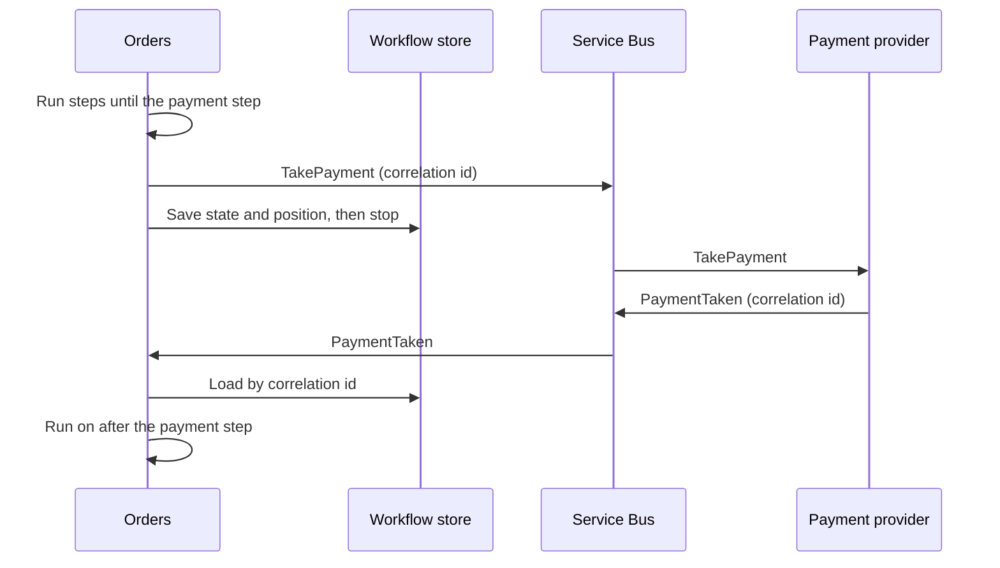

<!-- region start: Header-->
<!-- Header template: @.claude\skills\cat-internal-create-header\header.template.md, RootPath: .. -->
<link href="../resources/styles/style.css" rel="stylesheet" />
<table>
    <tr>
        <td colspan='6' style='text-align: center; font-weight: bold; border: none; border-top: 1px dashed #494949; border-bottom: 1px dashed #494949;'>
             Clean Architecture Toolkit for .NET
        </td>
    </tr>
    <tr>
        <td colspan='5' style='padding: 0; vertical-align: middle; border: none;'>
            Clean Architecture Toolkit is a clean, modular architecture foundation for .NET applications. 
            It embraces SOLID principles and focuses on maintainability, testability, and scalability through clear boundaries and pluggable design.</td>
        <td style='padding: 0; border: none;' width='220'>
            
        </td>
    </tr>
    <tr>
        <td colspan='6' markdown='1' style='padding-left: 0; padding-right: 0; padding-top: 15px; padding-bottom: 0; border: none; border-top: 1px dashed #494949; border-bottom: 1px dashed #494949;'>

&#124;&nbsp;&nbsp;&nbsp;[HOME](../README.md)&nbsp;&nbsp;&nbsp;&#124;&nbsp;&nbsp;&nbsp;[MODULE OVERVIEW](../README.md#module-overview)&nbsp;&nbsp;&nbsp;&#124;&nbsp;&nbsp;&nbsp;[DEMO](../demo/README.md)&nbsp;&nbsp;&nbsp;&#124;

</td>
</tr>
</table>
<!-- region end: Header-->

<!-- region start: TemplateSkill-->
<!-- Use the cat-internal-create-plan skill to update this plan.-->
<!-- region end: TemplateSkill-->

# Plans for `Cat.Sagas` <!-- omit in toc -->  

<!-- region start: StatusBadge-->

<!-- region end: StatusBadge-->

## Table of contents <!-- omit in toc -->  
<!-- region start: Phases-->
- [Phase 1](#phase-1)
<!-- region end: Phases-->

<!-- region start: Phase 1-->
## Phase 1

### Description
<!-- region start: PhaseDescription-->
#### Goal
Long running workflows. A workflow sends a message, waits for the answer and goes on when the answer arrives, maybe hours later.

The plan answers one question: what do we add to `Cat.FluentWorkflows`, and what goes in a new module around it? The proposals below are not decided until the questions are answered.

#### The idea
The place order workflow of the demo takes a payment. The idea:

1. The workflow sends a `TakePayment` message over the Service Bus.
2. The workflow stops and its state goes to the database. Nothing stays in memory.
3. The payment provider answers with a `PaymentTaken` or `PaymentDeclined` message.
4. The message finds the stored workflow, loads it and runs it on from the step after the wait.

The workflow then works as an orchestrator, also called a saga.

#### Findings
Claude read the engine in `modules/Cat.FluentWorkflows`.

##### How it runs today
- `CatWorkflowProcessor.RunAsync` creates the workflow, calls `Build` on a fresh builder and hands the steps to `CatStepProcessor`.
- `CatStepProcessor.RunStepsAsync` is a loop over the steps of one list. It stops on `BreakCascade`, `BreakFromCurrentFlowOnly` or `BreakFromLoop`.
- `If`, `Switch`, `While`, `Foreach` and the sub-workflow step run their inner steps by calling `RunStepsAsync` again. The position in the workflow is therefore the **call stack** of the process, plus local variables such as the foreach enumerator and the foreach loop state.
- The builder is rebuilt on every run. `Build` takes nothing but the builder, so it gives the same steps every time.
- Step bodies are transient classes from the service provider. `Input` copies values from the state into the step before it runs, and `Output` copies them back after.
- The workflow state is a plain class. Nothing requires it to be serializable, and nothing saves it.
- Errors collect in a local list during the run.
- The result type `CatStepExecutionResult` has no way to say "stop here and come back later".
- A run has no identity. There is no instance id and no correlation key.

##### What this means
- **The data is easy to save.** The state is a class and it is the single place where steps keep their data.
- **The position is not.** It lives in the call stack, so it cannot be saved or restored without a change inside the engine.
- **The workflow is rebuilt anyway.** That helps. On resume we can rebuild the same step tree and walk to the saved position.
- **Nothing outside the engine can do this.** A new module cannot add a "wait" step on its own, because the step cannot stop the recursion of its parents in a way that can be resumed.

#### What is missing
| Gap | Where it has to live |
|---|---|
| A way for a step to stop the workflow and say "resume later" | Core engine |
| An address for every step, stable between rebuilds | Core engine |
| A checkpoint that holds the position, including the open `If`, `While`, `Foreach`, `Switch` and sub-workflow frames | Core engine |
| A way to start a workflow at a checkpoint | Core engine |
| A workflow instance id and a correlation key | New module |
| Saving and loading the state and the checkpoint | New module |
| Turning the state into JSON and back | New module |
| A step that sends a message and waits for the answer | New module |
| Matching an incoming message to a stored instance | New module |
| Timeouts, such as cancel after 24 hours without payment | New module, with Scheduling |
| Safe handling of two messages for the same instance | New module |
| Sending a message and saving the state as one unit | New module, with Messaging and the transactions of `Cat.EFCore` |
| Handling a workflow that changed while instances were stored | Both |

#### What exists today
- The module does not exist yet. It is listed under the future modules in the readme.
- The engine in `Cat.FluentWorkflows` is as described in the findings. It has no suspend, no checkpoint and no `ResumeAsync`.
- Orders already works as phase 0 of the build order below:
  - The place order workflow has a `TakePaymentStep` that calls `IPaymentProvider`.
  - The state lives in the order status. The statuses are `Pending`, `Confirmed` and `Cancelled`.
  - `IPaymentProvider` is answered by the separate payment service, `Cat.Demo.PaymentService`, through `PaymentServiceProvider`. Without an address in the configuration the `FakePaymentProvider` answers.
  - The comment on `IPaymentProvider` points to this plan for a later flow over the Service Bus.
- `Cat.Messaging`, `Cat.EventProcessor` and `Cat.Scheduling` do not exist yet.

#### What goes where
This is the proposal for option C, see Question 1.

##### In `Cat.FluentWorkflows`
All of it is generic and has no storage or messaging.

1. **`CatStepExecutionResult.Suspend`**, added at the end of the enum so nothing breaks. Every container treats it like `BreakCascade`: stop at once and pass it up. The workflow processor reports it as a suspended workflow, with no error.
2. **Step addresses.** The builder gives every step a position, for example `3`, `3/then/1` or `4/item/2`. A step can also get an explicit name, which is safer when a workflow changes.
3. **A workflow checkpoint.** A small serializable object that holds:
   - the address of the step that suspended,
   - one frame per open container: the chosen branch of an `If`, the case of a `Switch`, the iteration of a `While`, the index of a `Foreach` and the sub-workflow,
   - the foreach loop state.
4. **Resume entry.** `ResumeAsync` on `ICatWorkflowProcessor`. It takes the state and a checkpoint, rebuilds the workflow, skips to the address and goes on.
5. **A resumable step body.** A second interface for steps that run in two phases: start (and suspend), and resume with the data of the answer. `Output` copies the answer into the state after the resume.
6. **Container support.** `If`, `Switch`, `While`, `Foreach` and the sub-workflow step learn to write their frame when a child suspends, and to restore it on resume.
7. **A run context.** Gives a step the instance id, so the new module can correlate. The engine only carries the id and does nothing with it.
8. **Rules in the readme.** `Build` must be deterministic, and the state must be serializable to save it.

##### In the new module
Following the usual module layout, with an abstractions project and implementations:
- **`Cat.Sagas.Abstractions`:** the instance store interface, the correlation interfaces, the serializer interface and the wait step contracts.
- **`Cat.Sagas`:** the dispatcher that finds an instance, locks it, resumes it and saves it. The `SendMessageAndWait` step. The timeout handling. The JSON serializer.
- **`Cat.Sagas.EFCore`:** the store on EF Core, with an entity for the instance.

The instance record holds: instance id, workflow type name, workflow version, status, state as JSON, checkpoint as JSON, correlation key, the message type it waits for, the timeout moment and a row version for concurrency.

##### What the module depends on
| Module | Why |
|---|---|
| `Cat.FluentWorkflows` | The engine to suspend and resume. |
| `Cat.Messaging` (future) | The wait step sends the request message through it. |
| `Cat.EventProcessor` (future) | Incoming answers come in through it. |
| `Cat.Scheduling` (future) | Looks for instances whose wait timed out. |
| `Cat.EFCore` (new transaction project) | Saves the state and the outgoing message together. |
| `Cat.EFCore` | The store. |

##### A note on EventAggregators
The wait step must not go through `Cat.EventAggregators`. That module is in-process and holds its subscribers with weak references. It cannot carry a message to another service, and it cannot be trusted to still be alive when an answer comes hours later.

The wait step depends on the messaging abstractions. The event aggregator stays what the demo plan says: it announces facts inside one service, and a subscriber bridges them to the Service Bus.

#### Hard problems
These must be solved in the design, not afterwards.
- **A workflow that changes while instances are stored.** If a step is added before the saved address, the address points to the wrong step. Mitigations: explicit step names, a version number on every instance, and a rule that a step is never removed or reordered while instances exist. Maybe a check that fails loudly on resume when the name at the address does not match.
- **Two messages at the same moment.** Lock the instance with a row version. The loser retries and sees the new state.
- **A message that arrives twice.** Service Bus delivers at least once. Keep the ids of handled messages per instance and ignore repeats.
- **An answer that arrives before the instance is saved.** Send the request message only after the save, or in one outbox transaction with it.
- **A crash between the save and the send.** The outbox pattern in the transactions of `Cat.EFCore` solves it. Without it the saga can hang, and the timeout is the safety net.
- **Timeouts.** Save the moment next to the instance. The Scheduler looks for instances past it and resumes them with a timeout result. See Question 11.
- **Compensation.** When payment fails after stock was reserved, the reservation must be released. First version: the failure branch of the workflow has explicit steps for it. A dedicated compensation feature can come later.
- **State that cannot be serialized.** Interfaces, delegates and services do not belong in the state. Document it and fail on save with a clear error.
- **Foreach after the collection changes.** The collection is read again on resume. The rule is that it must come from the saved state and not change while the workflow waits. Alternatively the checkpoint stores the item count and fails when it differs.
- **Tracing across the gap.** Save the trace context in the instance so the second half of the workflow joins the same trace.
- **Security.** An incoming message must prove which instance it belongs to. The correlation key is not a secret, so the service still validates the message source.

#### Build order
| Step | Work | Needs |
|---|---|---|
| 0 | Orders uses short workflows and the order status as saga state. The payment provider stays an interface. | Nothing. Done in the demo. |
| 1 | Engine: `Suspend`, step addresses, checkpoint, `ResumeAsync` and container support. In memory, fully tested. Update the readme and the namespace pages. | Nothing |
| 2 | `Cat.Sagas.Abstractions` and `Cat.Sagas` with an in-memory store, to prove the model with the wait step. | Step 1 |
| 3 | `Cat.Sagas.EFCore` with the instance entity and concurrency. | Step 2, `Cat.EFCore` |
| 4 | Connect to `Cat.Messaging` and `Cat.EventProcessor`. Add the outbox and the inbox ids. | Those modules |
| 5 | Timeouts with `Cat.Scheduling`. | That module |
| 6 | Demo: the place order workflow waits for the payment answer over the Service Bus. | All above |

Steps 1 to 3 do not depend on the other future modules, so they can start before Messaging exists.

#### Decided
- **Orders now.** Orders keeps its state in the order status. The payment is an interface.
- **Messaging.** The wait step goes through the messaging abstractions, not through `Cat.EventAggregators`.
- **Order of work.** The engine change comes first and needs no other future module. The module itself follows `Cat.Messaging` and `Cat.EventProcessor`.
<!-- region end: PhaseDescription-->

### Open Questions
<!-- region start: PhaseOpenQuestions-->
<!-- region start: Question 1-->
#### Question 1
Which approach do we take? Option C is recommended, with Option A as the first step. The owner has not confirmed it yet. The options:

**Option A: split into short workflows, no engine change.** Each wait becomes the end of a workflow. The answer starts a second workflow. The saga state is a status on an entity, for example `Order.OrderStatus = AwaitingPayment`. This is how many message based state machines work.
- For: works today. No engine risk.
- Against: the process is no longer one recipe to read from top to bottom. The flow is spread over several workflows and a status. Foreach and If frames cannot stay open across a wait.

**Option B: put everything in `Cat.FluentWorkflows`.** Add suspend, storage, serializers and messaging to the existing module.
- For: one package.
- Against: the module gets a database, a serializer and a messaging dependency. Many developers only want a simple in-memory recipe. It breaks the rule that a developer takes only what they need.

**Option C: small engine change plus a new module (recommended).** The engine learns to suspend and resume, in memory and with no storage. A new module adds the storage, the correlation and the messaging.
- For: the engine stays free of technology. Only the part that cannot live outside the engine goes into it. The new module follows the usual split into abstractions and implementations.
- Against: the engine change touches every step that holds inner steps. It needs careful tests.

**Option D: replay from the start.** Record the result of every step and run the whole workflow again on every resume, skipping steps that already have a result, as Durable Task does.
- For: needs no frame bookkeeping.
- Against: steps must be fully deterministic, side effects need a result log, and the log grows. It is a bigger leap than the current design needs.

Recommendation: **Option C, with Option A as the first step.**
- Orders can be built today with Option A, so nothing waits for this plan. The order row is the saga state.
- The engine change comes next. It is generic and has value without a saga, because it also allows a pause and resume in tests.
- The new module is built after `Cat.Messaging` and `Cat.EventProcessor`, because it needs both.
<!-- region end: Question 1-->

<!-- region start: Question 2-->
#### Question 2
What is the name of the module: `Cat.Sagas` or `Cat.WorkflowPersistence`? The saga name says what it is for, but the module also covers any long running workflow. The owner decides.
<!-- region end: Question 2-->

<!-- region start: Question 3-->
#### Question 3
Do we accept an engine change in `Cat.FluentWorkflows` that touches every container step? Do suspend and resume ship before the saga module? See [Cat.FluentWorkflows.md](Cat.FluentWorkflows.md).
<!-- region end: Question 3-->

<!-- region start: Question 4-->
#### Question 4
Which step addresses do we use: index paths only, explicit step names, or both? Explicit names are safer but more typing.
<!-- region end: Question 4-->

<!-- region start: Question 5-->
#### Question 5
What is the version policy? Do we support more than one version of a workflow at the same time, or only fail clearly on a mismatch? May we fail on a workflow version mismatch, or must two versions run side by side?
<!-- region end: Question 5-->

<!-- region start: Question 6-->
#### Question 6
Which serializer: `System.Text.Json` only, or pluggable from day one? The messaging plan has the same question, see [Cat.Messaging.md](Cat.Messaging.md).
<!-- region end: Question 6-->

<!-- region start: Question 7-->
#### Question 7
Do we need to wait for more than one answer at the same time in the first version? The engine has no parallel branches today. A saga waiting for two answers at once (payment and stock) needs either a wait for several messages or parallel branches. Is it out of scope for the first version?
<!-- region end: Question 7-->

<!-- region start: Question 8-->
#### Question 8
Is it fine that Orders works with Option A until the saga work is ready? Orders already works this way: the state lives in the order status and the payment is an interface. Does it stay like this until the saga work arrives, or must it wait for it?
<!-- region end: Question 8-->

<!-- region start: Question 9-->
#### Question 9
Who owns the outbox: this module, `Cat.EFCore` or `Cat.Messaging`? The messaging plan proposes outbox projects in `Cat.Messaging`, see [Cat.Messaging.md](Cat.Messaging.md).
<!-- region end: Question 9-->

<!-- region start: Question 10-->
#### Question 10
How do we handle compensation? Explicit steps in the failure branch for now, and a dedicated feature later?
<!-- region end: Question 10-->

<!-- region start: Question 11-->
#### Question 11
Do timeouts wait for `Cat.Scheduling`, or does the first version go without them? The scheduling plan recommends that one-off timeouts go through scheduled messages of the bus, not through the scheduler, see [Cat.Scheduling.md](Cat.Scheduling.md). That changes the assumption in the hard problems above that the Scheduler looks for instances past their timeout.
<!-- region end: Question 11-->
<!-- region end: PhaseOpenQuestions-->
<!-- region end: Phase 1-->