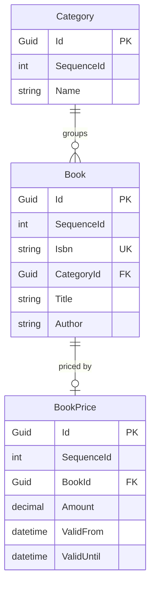
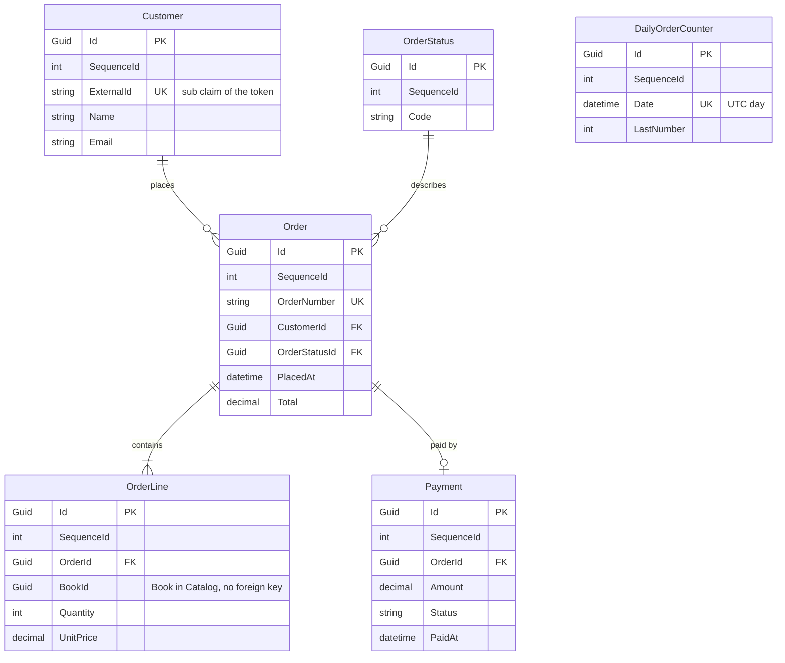
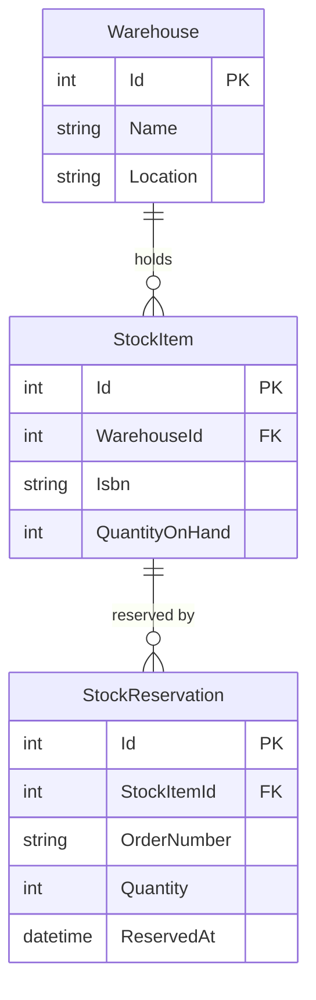

# Demo plan

This is the working plan for the demo application.  
It replaces the todo demo with a small bookshop.

## Contents

- [The idea](#the-idea)
- [Decisions and open questions](#decisions-and-open-questions)
- [Services](#services)
- [Architecture](#architecture)
- [Where each module fits](#where-each-module-fits)
- [Technology](#technology)
- [Data models](#data-models)
  - [Order number counter](#order-number-counter)
  - [Counter cleanup](#counter-cleanup)
- [Next steps](#next-steps)
- [Interesting documentation](#interesting-documentation)

## The idea

A todo app is too limited to show every module.  
A bookshop is easy to understand, and it gives every current and future module a natural place.

Start small. Catalog plus a basic Orders service already covers most of the current modules.

## Decisions and open questions

### Decided

| Topic | Decision |
|---|---|
| Client | React with TypeScript, built with Vite. |
| Hosting | Aspire runs everything: the services, the React app, SQL Server in a container and later the Service Bus emulator. |
| Database | SQL Server in a container, started by the Aspire AppHost. One database per service. |
| Messaging | The Azure Service Bus emulator, started by the AppHost. |
| ServiceDefaults | The demo uses the Aspire ServiceDefaults project. |
| Code first or database first | Catalog and Orders are code first. Inventory is database first. |
| Inventory schema | A folder with SQL scripts, applied by the AppHost. |
| Book and order references | Orders owns its database, so `OrderLine` uses `BookId`. Inventory does not own its database, so it identifies a book by `Isbn` and an order by `OrderNumber`. |
| Order number | Unique, created when the order is placed, in the format `YYYYMMDD-0000`. The counter restarts at `0001` every day. The date is the UTC date. |
| Order number counter | A `DailyOrderCounter` table with one row per UTC day. The service increases the row in one atomic SQL statement, in the same transaction that saves the order. See [Order number counter](#order-number-counter). |
| Authentication | OpenID Connect with Keycloak, started by the AppHost with an imported realm and seeded users. See [Authentication and authorization](#authentication-and-authorization). |
| Authorization | The gateway and the services validate the same JWT. Services authorize on the claims. Catalog reads are public, Orders needs a login. |
| Customers | `Customer` stays in Orders, with an `ExternalId` that holds the `sub` claim of the token. No customer endpoints. `PlaceOrder` finds or creates the customer from the token. |
| Current user | The business logic only knows `ICurrentUser`. Orders is built against it first, with a development stub. Keycloak and the real implementation come with the gateway. The interface moves to `Cat.Authorization.Abstractions` and is renamed `ICatUser` when that project exists. Until then the demo keeps `ICurrentUser`. See [Cat.Authorization.md](Cat.Authorization.md). |
| Scope of the first Orders build | Core plus FluentWorkflows and EventAggregators. The place order workflow runs with `IStockReservation` and `IPaymentProvider`, both with a fake behind them. Orders keeps its state in the order status. A saga style payment over messages comes later, see [Cat.Sagas.md](Cat.Sagas.md). |
| Unit price | The client sends only `BookId` and `Quantity`. Orders asks `IPriceProvider` for the current price of each book and stores it in `OrderLine.UnitPrice`. A fake sits behind the interface now. Once Aspire runs the services, a plain `HttpClient` implementation calls the price endpoint of Catalog. The `Cat.Api.Client` module replaces it in the future. See [DemoAspire.md](DemoAspire.md). |
| SQL Server mode | The AppHost supports two modes, switched by a setting: a SQL Server container, or an existing instance through connection strings. Docker is not required to run the demo. The `Existing` mode is built first. See [DemoAspire.md](DemoAspire.md). |
| Counter cleanup | The `CleanUpOrderCounters` service request deletes the rows of earlier days and creates the row of today. The Scheduler will run it nightly. Until the Scheduler exists, a development only endpoint triggers it. |
| Currency | One currency, euro, to keep the demo simple. |
| Sharing contracts | A choice per connection, as the root readme describes. React client to gateway: not shared. Orders to Catalog: not shared. A later service to service call: shared, so the demo shows both. See [Sharing contracts](#sharing-contracts). |
| API gateway | It is the API gateway from the Application Architecture chapter of the root readme. How it looks is clear once it is built. It could become a new module. |
| Notifications storage | Decided once the Scheduling module is designed. |
| Todo demo | `Cat.Demo.TodoService` is removed. Catalog is the first service of this plan. |
| First service | Catalog is built first, then Orders. |

### Open

None at the moment.

## Services

| Service | Job | Built |
|---|---|---|
| Catalog | Books, categories and prices. Mostly reads, with a bit of admin. | Code first |
| Orders | Customers place and track orders. This is the main service. | Code first |
| Inventory | Tracks stock and reserves it when an order comes in. | Database first |
| Notifications | Sends the order confirmed and order shipped messages. Runs the scheduled jobs. | Not decided yet |

## Architecture

- Clients only talk to the API gateway. The gateway is planned for later.
- Services call each other through the gateway, and publish messages on the Service Bus.
- Every service has its own database in the SQL Server container.
- Aspire ServiceDefaults gives every service telemetry, health checks and resilience.
- Hatched boxes in the drawing are planned for later or are optional.

## Where each module fits

### Current modules

| Module | Demonstrated by |
|---|---|
| Commands, Queries, ServiceRequests | `PlaceOrder`, `CancelOrder`, `GetOrder`, `BookSearch` |
| Responses, Validators | Validating an order. Stock and payment failures come back as error responses. |
| Decorators | Logging, validation and tracing on every request. |
| Minimal.Api | The endpoints of each service. |
| FluentWorkflows | The place order process: validate, reserve stock, take payment, confirm. It has an `if` for out of stock and a `foreach` over the order lines. |
| EventAggregators | In-process events inside Orders, such as `OrderConfirmed` triggering a status update. See [Events and interfaces](#events-and-interfaces). |
| EFCore | Books, categories and orders as regular entities, price history as temporal data in Catalog. Every service has its own database, so the reference entity for tables of another service is not demonstrated. |
| Localizations | Categories, order statuses and email texts in a few languages. Catalog does not use it yet, so category names are plain text. |
| Expressions, Extensions | Used inside the services. |

### Future modules

| Module | Demonstrated by |
|---|---|
| Messaging, EventProcessor | Orders publishes `OrderPlaced`. Inventory and Notifications consume it. |
| Scheduling | Clean up the daily order counters every night. Cancel unpaid orders after 24 hours. A nightly low stock report. |
| Api.Client | Orders asks Catalog for current prices through the gateway. It starts as a plain `HttpClient` in Orders, and the module replaces that once the shape is clear. |
| Dapper | Fast read-only order overview queries, next to EF Core for writes. |
| Caching | Cached catalog queries. |
| EFCore transactions | Saving an order and its lines in one go. |
| Auditing | Who changed a price or cancelled an order. |
| Authorization | Customers see their own orders. Admins edit the catalog. Until the module exists, the demo uses `ICurrentUser` and an owner filter in the queries. |
| Resilience | Retry and circuit breaker on the payment call, which uses a fake provider. |
| Telemetry, UnitTesting | Tracing one order across all services. The unit tests. |

## Technology

### Client

React with TypeScript, built with Vite.

- Keeps the demo client-agnostic. The services expose a normal HTTP API.
- Most widely known option.
- No shared contracts with the services, by choice. The client comes from the OpenAPI documentation that `Cat.Minimal.Api` produces. See [Sharing contracts](#sharing-contracts).
- Keep it thin: a book list, a basket and an order overview.

Blazor WebAssembly was the alternative. It would share the `Contracts` projects, but it makes the demo look .NET only.

### Sharing contracts

The root readme says that sharing the `Contracts` project of a service is a choice of the developer. The demo makes a choice per connection, and shows both options.

| Connection | Choice | Why |
|---|---|---|
| React client to gateway | Not shared | The client is TypeScript, so there is nothing to reference. It also keeps the demo client-agnostic. The client comes from the OpenAPI documents. |
| Orders to Catalog (prices) | Not shared | Orders needs a price per book and nothing else. It reads the response into a small model of its own, so it does not depend on the rest of the Catalog contract. That also makes the call easy to replace by `Cat.Api.Client` later. |
| A later service to service call | Shared | To show the other option. The service that calls references the `Contracts` project of the other one and reuses its types. The call is chosen when it is built. A candidate is a service that reads a whole order from Orders. |

What it costs:

- Not shared: duplicate types, and a change in the other service only shows up at runtime.
- Shared: coupling to the types and the release rhythm of the other service.

The choice is made per connection. Another application can choose differently.

### Aspire and the database

SQL Server runs in a container, started by the Aspire AppHost. Every service still reads its database from a connection string, so LocalDB or an existing instance also work.

`Cat.EFCore` configures temporal tables, and only SQL Server supports them. So SQLite and PostgreSQL are out.

Aspire and Docker are also a good way for the owner to learn both.

#### What the AppHost does

One `AppHost` project in `demo/` describes the whole system. [DemoAspire.md](DemoAspire.md) has the build order.

- A SQL Server container with a volume, so data survives restarts.
- One database per service: `catalog`, `orders` and `inventory`.
- The .NET services.
- The React app.
- Later, the gateway, Keycloak and the Service Bus emulator.

Aspire passes connection strings and service URLs to each project. Nobody edits config files.

#### What a user does after cloning

1. Install the .NET SDK, Node and Docker Desktop. Without Docker, set the AppHost to the `Existing` mode and point it at your own SQL Server.
2. Run `dotnet run --project demo/Cat.Demo.AppHost/Cat.Demo.AppHost`.
3. Open the Aspire dashboard, which links to the React app.

#### Schema and seed data

- Each code first service applies its EF Core migrations at startup, in `Development` only.
- Inventory gets its schema from the SQL scripts, which the AppHost runs on startup.
- A small seeder fills in books, categories and stock when the tables are empty.
- Reset is `docker volume rm`, or a reset command on the AppHost.

#### Keeping the memory under control

Docker Desktop on Windows runs on WSL2. The VM can take up to half of the RAM by default and keeps it while it is running.

- Limit the VM in `C:\Users\<you>\.wslconfig`, for example `memory=4GB`. The limit covers the whole VM, including all containers.
- Limit SQL Server itself with `MSSQL_MEMORY_LIMIT_MB`.
- Keycloak needs roughly 0.5 to 1 GB as well. Plan the VM limit with that in mind.
- Only start Docker Desktop when running the demo. Afterwards quit it and run `wsl --shutdown`. That gives all the memory back to Windows.
- The readme of the demo explains these steps.

#### Lighter alternatives

- Point the connection strings to LocalDB or an existing SQL Server instance. LocalDB is the real SQL Server engine, so temporal tables work. It needs no VM and stops by itself when idle. The services and the React app then start with `dotnet run` and `npm run dev`.
- A plain `docker-compose.yml` with only SQL Server is for people who want a container but no Aspire.

### Authentication and authorization

A clone must start with one command, and the demo must still show the proper way.

**Identity provider.** Keycloak runs as a container, started by the AppHost with an imported realm. The realm holds a client for the React app, a client for the gateway and the users `alice` and `bob` (customers) and `admin`. The passwords are in the demo readme. No signup and no external account are needed.

Rejected: Entra ID or Auth0 (every cloner needs a tenant), an own token service (a lot of code that is not about CAT) and `dotnet user-jwts` (no login flow for the client).

**Flow**

1. The React app logs in with authorization code and PKCE (`oidc-client-ts`) and gets an access token.
2. It calls the gateway with `Authorization: Bearer <token>`. Catalog reads need no token. Orders endpoints do.
3. The gateway validates the token and forwards it unchanged.
4. The inner service validates the JWT itself. It does not trust the network.
5. The service authorizes on the claims. Alice only loads her own orders, and Bob's orders come back as not found. Admins edit the catalog through a role claim.

Service to service calls forward the same token. Work without a user, such as the Scheduler, uses a client credentials token.

**In the code**

- `ICurrentUser` lives in `CoreService` and exposes `UserId`, `Name`, `Email` and `IsAdmin`. The business logic never sees `HttpContext`.
- The Api project implements it from the claims.
- Ownership is a filter in the query. The queries get the external id of the customer, or none for an admin, so the orders of others come back as not found and nothing leaks. The future `Cat.Authorization` module will take this over.

**Staging**

1. Now: Orders is built with `ICurrentUser` and the owner filter in the queries. In `Development` the Api uses a stub that knows three demo users (`alice`, `bob` and `admin`) and picks one with the `X-Demo-User` header. The unit tests fake `ICurrentUser`.
2. With the gateway: add Keycloak to the AppHost, JWT validation in the services, the real `ICurrentUser` and the login in the React app. Orders does not change.

### Events and interfaces

Orders uses two ways to stay loosely coupled. They are for different jobs.

| Kind of interaction | Decoupled by | Needs an answer? |
|---|---|---|
| Reserve stock, take payment | An interface (`IStockReservation`, `IPaymentProvider`), called from a workflow step | Yes |
| Order confirmed, order cancelled | An event on `ICatEventAggregator` | No |
| Telling other services | A subscriber that bridges the event to the Service Bus | No |

- The workflow publishes `OrderConfirmed` and `OrderCancelled`. It knows only the aggregator, not the subscribers.
- Subscribers: a status updater, an audit logger and later the message bridge for `OrderPlaced`.
- Events cannot drive the process. `PublishAsync` returns no answer and rethrows the exception of a failing handler.
- Calls whose answer decides the next step go through an interface. A fake sits behind it now. `Api.Client` and a resilient payment client replace the fakes later.
- Subscribers are long lived singletons, because the aggregator holds them with weak references. A subscriber that needs a scoped service such as the `DbContext` opens its own scope.
- Later the payment may move to a message flow, where the workflow sends a message and waits for the answer. That needs a saga capability. See [Cat.Sagas.md](Cat.Sagas.md). Until then the payment is an interface with a fake, and Orders keeps its state in the order status.

### Messaging

The Azure Service Bus emulator runs in Docker, so it fits the Aspire setup.  
When `Cat.Messaging` arrives, the AppHost starts the emulator next to SQL Server.

### Aspire ServiceDefaults

The demo uses the Aspire ServiceDefaults project.

It sets up telemetry, health checks and resilience. The demo uses Aspire, so ServiceDefaults covers the basics and the demo does not use `Cat.Telemetry` or `Cat.Resilience`.

- The CAT modules add what ServiceDefaults does not cover, such as the decorators on service requests.
- The modules must not depend on Aspire or on ServiceDefaults.

## Data models

First sketches of the three databases. Names and columns are not final.

Rules that hold for all of them:

- Services own their data. A reference to another service has no foreign key.
- All amounts are in euro.
- Code first entities inherit `CatEntityBase`, so each has a `Guid` `Id` and an `int` `SequenceId`. The `Id` is a non-clustered primary key. The database generates `SequenceId` as an identity column, and it holds the clustered index.

### Catalog

`Category` and `Book` are regular entities. `BookPrice` inherits `CatTemporalEntityBase`, so SQL Server keeps every old price in a history table. `ValidFrom` and `ValidUntil` are the period columns of the temporal table. The class gets properties for them after the release of EF Core 11.

### Orders

All tables are regular entities. `OrderNumber` is unique. The service creates it when the order is placed, in the format `YYYYMMDD-0000`: the UTC year, month and day, then a four digit counter. The counter restarts at `0001` every day, so there is room for 9999 orders a day. Two orders placed at the same moment must never get the same number, and the unique key on `OrderNumber` is the safety net.

`DailyOrderCounter` holds the counter. It has no relationship with the other tables.

Orders owns its database, so `OrderLine` refers to a book with `BookId`. There is no foreign key, because the book lives in the Catalog database.

#### Order number counter

`DailyOrderCounter` has one row per UTC day. `LastNumber` is the last counter handed out that day.

When an order is placed, one database transaction does this:

1. Increase today's row in a single SQL statement and read the new value back: `UPDATE DailyOrderCounter SET LastNumber = LastNumber + 1 OUTPUT INSERTED.LastNumber WHERE Date = @today`.
2. If no row was updated, insert today's row with `LastNumber = 1`.
3. Build the number: the date as `yyyyMMdd`, a dash and the counter padded to four digits.
4. Save the order, its lines and the payment.
5. Commit.

Why it never hands out a duplicate:

- The `UPDATE` locks the row. A second order at the same moment waits for the first commit, then reads the increased value.
- Increase and read are one statement, so nothing can slip in between.
- The increase is in the same transaction as the order. If saving fails, the counter rolls back too.
- It needs raw SQL through EF Core. A normal tracked update would read, add one and write back, which is the race we want to avoid.

Edge cases:

- **First order of the day.** Two first orders can both try the insert. The unique key on `Date` stops one of them, and that one retries the `UPDATE`. The cleanup below creates the row of today ahead of time, which makes this rare.
- **Past 9999.** The request fails with an error response. It never produces `10000`.
- **Cancelled orders.** They keep their number. Numbers are never reused.
- **Safety net.** The unique key on `OrderNumber` rejects a duplicate that a bug could produce.

#### Counter cleanup

The table would grow by one row per day, and only today's row matters. A scheduled job keeps it small.

- The `CleanUpOrderCounters` service request deletes every row before today (UTC) and creates today's row with `LastNumber = 0` when it is missing.
- It lives in `Orders.Contracts` and `Orders.CoreService`, like every other request. It is built together with Orders.
- The future `Orders.Scheduler` project runs it every night, shortly after midnight UTC. See Scheduling in [Future modules](#future-modules).
- Until the Scheduler exists, a development endpoint triggers it. It is part of the development endpoints of the Api project, in the group for the Scheduler, as described in the Service Project structure chapter of the root readme. It is only available in debug mode.
- The request can run at any time and more than once. A second run changes nothing.

### Inventory

Inventory is the database first service. A stock database often already exists, owned by a warehouse team or a DBA, with its own tables, views and maybe stored procedures. That makes it a natural fit.

The entities do not inherit `CatEntityBase` and have no `SequenceId`. Keys and column names come from the existing database. Inventory does not own the database, so it identifies a book by `Isbn` and an order by `OrderNumber`. There is no foreign key between services.

#### How the database first approach works

- **The database is the source of truth.** A folder with SQL scripts defines the schema and the seed data. People change the database, not C# classes.
- **Aspire applies it.** The AppHost creates the `inventory` database in the SQL Server container and runs the scripts on startup.
- **The model is scaffolded.** `dotnet ef dbcontext scaffold` generates the entities and the `DbContext` into `Inventory.Infrastructure`. Nobody edits the generated files. They are regenerated after a database change. Custom behavior goes in partial classes.
- **The rest of the service stays the same.** Api, CoreService and Contracts follow the normal service structure. Only the data access differs. The business logic does not care how the model was made.
- **Dapper fits well.** Views and stored procedures suit the future `Cat.Dapper` module, so Inventory can read through Dapper next to the scaffolded EF Core model.

#### How it fits with the toolkit

`Cat.EFCore` is built for code first entities, with base classes for regular, temporal and reference data. Scaffolded entities do not inherit from those, and that is fine.  
Inventory uses commands, queries, responses and decorators, but not the entity base classes. It shows that you use only the modules you need.

#### Cost

- A small SQL scripts folder and one extra step in the AppHost.
- A readme section on how to scaffold again after a database change.

## Next steps

Done:

- Catalog service built, with tests for the core service.
- `Cat.Demo.TodoService` removed.
- Readme of the demo added.
- Orders service built, with the place order workflow, events, the counter cleanup and tests for the core service. Tried against a local SQL Server with every request of `OrderRequests.http`, and all responses matched.
- Price endpoint for Orders in Catalog: `GET /catalog/books/prices?bookIds=...` (`BookPriceListRequest`), with tests for the core service. Tried against a local SQL Server: valid ids, an unknown book and a missing id list all gave the expected status. Orders still uses the fake `IPriceProvider` until the Aspire phase, when an Api.Client implementation calls it through the gateway.
- Order lines capped at 50 per order (`MaximumCount`). The first order of the day was tried with 20 parallel requests on a local SQL Server: 20 orders, numbers 0001 to 0020, none missing or doubled. There is no automated test for it on purpose, because the unit tests do not use a database.
- Catalog tracing: the `ActivitySource` decorator runs on the Catalog requests.
- Catalog OpenAPI price type: `price` is a plain nullable number, because the JSON options no longer read numbers from strings.
- Catalog duplicate ISBN race: `BookSaveCommandHandler` catches the unique index error and returns the `CAT-CTL-1000` response. Tried with 12 parallel saves of the same new ISBN on a local SQL Server: one saved, eleven bad requests, no 500. There is no automated test for it, because the unit tests do not use a database.

To do:

1. Build the Aspire AppHost in the phases of [DemoAspire.md](DemoAspire.md): ServiceDefaults, the AppHost in `Existing` mode, the `HttpClient` price provider, then the `Container` mode.
2. Handle the known gaps of Orders and Catalog below. The remaining ones wait for the authentication phase, `Cat.Localizations` or the saga work.

### Known gaps in Orders

- **No refund for a cancelled order.** A cancelled order keeps its `Approved` payment, because there is no refund step yet. This shows after a user cancels a confirmed order: the order is `Cancelled` and the `Payment` row still says `Approved`. Add a refund when payment becomes a message flow (see `Cat.Sagas.md`):
  - A `Refunded` payment status, and an `IPaymentProvider` refund call.
  - `OrderCancelledEvent` gets a subscriber that refunds an approved payment.
  - Cancelling a confirmed order is then only done when the refund succeeded or is on its way.

### Known gaps in Catalog

- **Localizations.** Show category names in several languages with `Cat.Localizations`. This waits until the module is stable.
- **Admin only saves.** `POST /catalog/books` (`BookSaveRequest`) is the only write endpoint and has no authorization yet. Do this in the authentication phase, when the services get JWT validation:
  - Add a `CatalogAdmin` policy that checks the admin role claim.
  - Put `RequireAuthorization("CatalogAdmin")` on the save endpoint. The read endpoints stay anonymous.
  - The gateway rejects an unauthenticated save as well, and the service checks the token again.
  - Consider an admin check as a decorator on `BookSaveRequest` over `ICurrentUser`, so the rule lives in `CoreService` and is testable without HTTP.
  - Add a test that a non admin gets a 403 on the save.

## Interesting documentation

- [.NET Aspire for beginners](https://learn.microsoft.com/nl-nl/shows/dotnet-aspire-for-beginners/)
