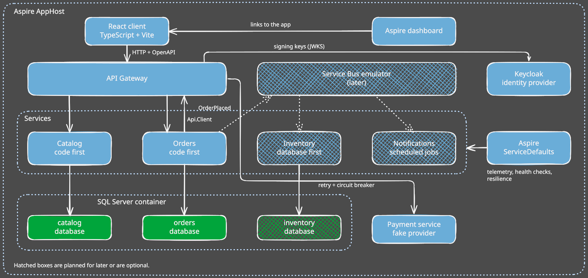
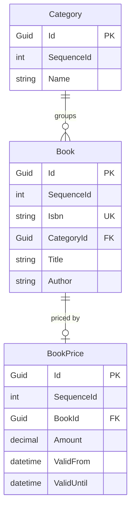
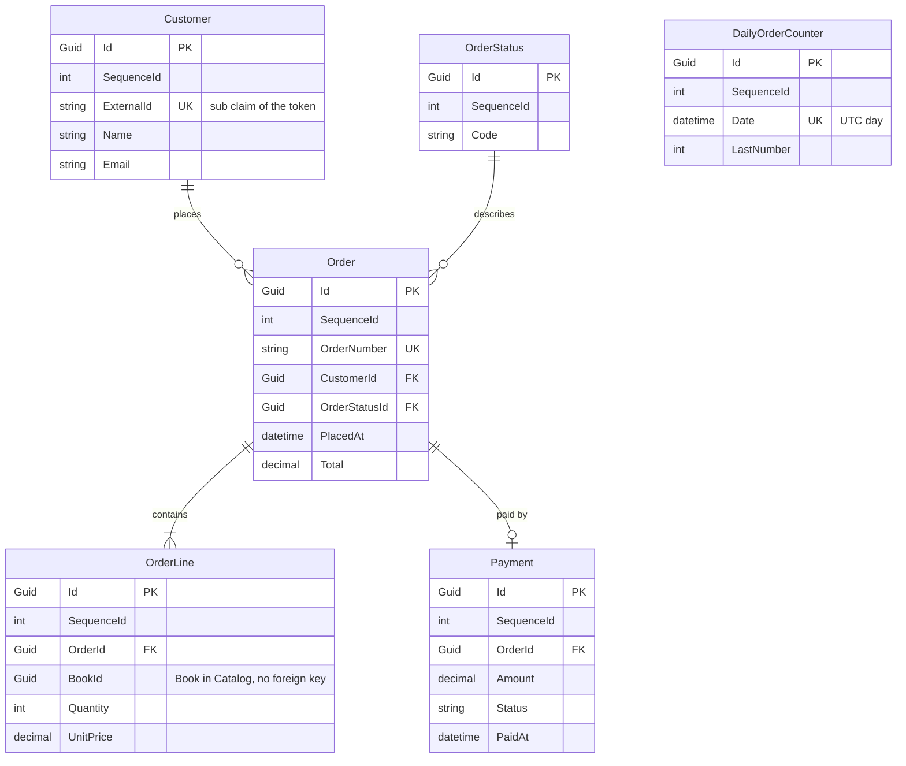
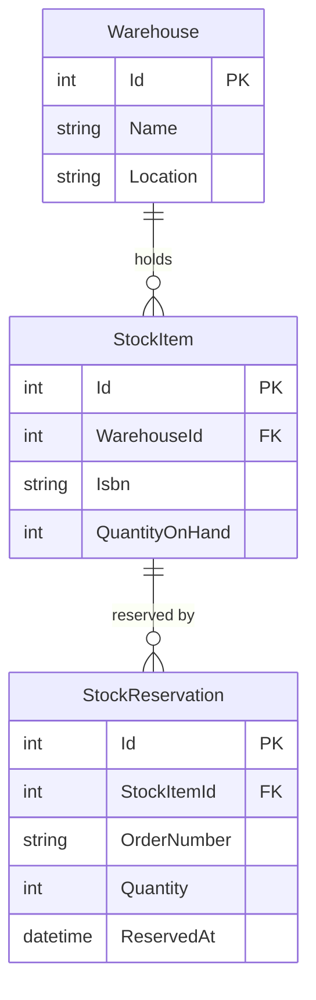

<link href="../resources/styles/style.css" rel="stylesheet" />
<table>
    <tr>
        <td colspan='6' style='text-align: center; font-weight: bold; border: none; border-top: 1px dashed #494949; border-bottom: 1px dashed #494949;'>
             Clean Architecture Toolkit for .NET
        </td>
    </tr>
    <tr>
        <td colspan='5' style='padding: 0; vertical-align: middle; border: none;'>
            Clean Architecture Toolkit is a clean, modular architecture foundation for .NET applications. 
            It embraces SOLID principles and focuses on maintainability, testability, and scalability through clear boundaries and pluggable design.</td>
        <td style='padding: 0; border: none;' width='220'>
            
        </td>
    </tr>
    <tr>
        <td colspan='6' markdown='1' style='padding-left: 0; padding-right: 0; padding-top: 15px; padding-bottom: 0; border: none; border-top: 1px dashed #494949; border-bottom: 1px dashed #494949;'>

&#124;&nbsp;&nbsp;&nbsp;[HOME](../README.md)&nbsp;&nbsp;&nbsp;&#124;&nbsp;&nbsp;&nbsp;[MODULE OVERVIEW](../README.md#module-overview)&nbsp;&nbsp;&nbsp;&#124;&nbsp;&nbsp;&nbsp;[DEMO](../demo/README.md)&nbsp;&nbsp;&nbsp;&#124;

</td>
</tr>
</table>

# Demo plan

This is the working plan for the demo application.  
It replaces the todo demo with a small bookshop.

## Contents

- [The idea](#the-idea)
- [Decisions and open questions](#decisions-and-open-questions)
- [Services](#services)
- [Architecture](#architecture)
- [Where each module fits](#where-each-module-fits)
- [Technology](#technology)
- [Data models](#data-models)
  - [Order number counter](#order-number-counter)
  - [Counter cleanup](#counter-cleanup)
- [React client](#react-client)
- [Roadmap](#roadmap)
- [Next steps](#next-steps)
- [Interesting documentation](#interesting-documentation)

## The idea

A todo app is too limited to show every module.  
A bookshop is easy to understand, and it gives every current and future module a natural place.

Start small. Catalog plus a basic Orders service already covers most of the current modules.

## Decisions and open questions

### Decided

| Topic | Decision |
|---|---|
| Client | React with TypeScript, built with Vite. |
| Hosting | Aspire runs everything: the services, the React app, SQL Server in a container and later the Service Bus emulator. |
| Database | SQL Server in a container, started by the Aspire AppHost. One database per service. |
| Messaging | The Azure Service Bus emulator, started by the AppHost. |
| ServiceDefaults | The demo uses the Aspire ServiceDefaults project. |
| Code first or database first | Catalog and Orders are code first. Inventory is database first. |
| Inventory schema | A folder with SQL scripts, applied by the AppHost. |
| Applying the scripts | In `Container` mode the AppHost runs the scripts in a small init step, once the `inventory` database exists. In `Existing` mode the AppHost does nothing, because the owner of that database, such as a DBA, owns its schema. |
| Inventory seed data | The scripts seed stock for the ISBNs of the Catalog seed books, 50 copies per book. |
| Inventory API | Reserve all lines or none, and release. The order number is the idempotency key, like the payment call. |
| Concurrent reservations | The reserve step is an atomic conditional update, `UPDATE ... SET QuantityOnHand = QuantityOnHand - @n WHERE ... AND QuantityOnHand >= @n`, for all lines inside one transaction. No locks and no version column. |
| Inventory data access | The EF Core scaffold only for now. Dapper waits for the `Cat.Dapper` module. |
| Inventory login | Like payment: a restricted gateway route, and Orders forwards the token of the user. |
| Book and order references | Orders owns its database, so `OrderLine` uses `BookId`. Inventory does not own its database, so it identifies a book by `Isbn` and an order by `OrderNumber`. |
| ISBN for the stock call | The price endpoint of Catalog also returns the `Isbn` of every book. Inventory identifies a book by its ISBN, and Orders only has the `BookId`, so this is how Orders gets the ISBN. |
| Inventory unavailable | When Inventory does not answer (retries used up, timeout, open circuit or a rejected token), Orders cancels the order like it does for payment: `CAT-ORD-1007`, cancel reason `StockUnavailable`, and the customer is told to try again later. A cancel for this reason skips the release, because Inventory is out of reach and the call would only add waiting time. A release that fails for another reason is logged and not retried. A leaked reservation is a known gap. |
| Timeouts for stock and payment | The Orders clients for Inventory and payment replace the standard resilience handler: one retry after 500 ms, 5 seconds per try, 12 seconds in total. Before, a stopped service made the order wait about 50 seconds and the gateway gave a 504 at 30. The calls are safe to repeat, because the order number is the key. |
| Order number | Unique, created when the order is placed, in the format `YYYYMMDD-0000`. The counter restarts at `0001` every day. The date is the UTC date. |
| Order number counter | A `DailyOrderCounter` table with one row per UTC day. The service increases the row in one atomic SQL statement, in the same transaction that saves the order. See [Order number counter](#order-number-counter). |
| Authentication | OpenID Connect with Keycloak, started by the AppHost with an imported realm and seeded users. See [Authentication and authorization](#authentication-and-authorization). |
| Authorization | The gateway and the services validate the same JWT. Services authorize on the claims. Catalog reads are public, Orders needs a login. |
| Customers | `Customer` stays in Orders, with an `ExternalId` that holds the `sub` claim of the token. No customer endpoints. `PlaceOrder` finds or creates the customer from the token. |
| Current user | The business logic only knows `ICurrentUser`. Orders is built against it first, with a development stub. The real implementation reads the claims of the token and is used when `Authentication:Authority` is set, which the AppHost does. A plain `dotnet run` keeps the stub. The interface moves to `Cat.Authorization.Abstractions` and is renamed `ICatUser` when that project exists. Until then the demo keeps `ICurrentUser`. See [Cat.Authorization.md](Cat.Authorization.md). |
| Scope of the first Orders build | Core plus FluentWorkflows and EventAggregators. The place order workflow runs with `IStockReservation` and `IPaymentProvider`, both with a fake behind them. Orders keeps its state in the order status. A saga style payment over messages comes later, see [Cat.Sagas.md](Cat.Sagas.md). |
| Unit price | The client sends only `BookId` and `Quantity`. Orders asks `IPriceProvider` for the current price of each book and stores it in `OrderLine.UnitPrice`. Under the AppHost, `CatalogPriceProvider` calls the price endpoint of Catalog through the gateway with the generated Catalog client and `Cat.Api.Client`. Without the AppHost a fake answers. |
| Payment provider | A separate demo service, `Cat.Demo.PaymentService`, with no database. Orders connects to it over HTTP, so retry and circuit breaker have a real call to protect. The service takes payments by the same rules as `FakePaymentProvider` and can be made to fail on purpose. A setting of the service switches the failures on, not a header or a query value of the call. The in-process `FakePaymentProvider` stays for a plain `dotnet run`, the way `FakePriceProvider` does. The box in the architecture drawing is solid since the service exists. |
| Payment failures | The `PaymentFailures` section of the service holds three settings: `Latency` (a delay before every answer), `ErrorPercentage` (the share of calls from 0 to 100 that fail after the payment is already taken) and `Outage` (every call fails at once and nothing is taken). All are off by default. The service reads them again when they change. The AppHost passes `Payment:Latency`, `Payment:ErrorPercentage` and `Payment:Outage` from its own configuration. |
| Unreachable payment service | When Orders cannot get an answer, after the retries, on a timeout or with an open circuit, it cancels the order with the reason `PaymentUnavailable` and the error `CAT-ORD-1006`, like a declined payment. It answers 400, as every failure of the place order workflow does. No payment is saved, because nothing was decided. The stock reservation is released by the cancelled event. |
| Double charge | The order number is the idempotency key. The payment service remembers the answer per order number in memory and gives the same answer to a retry. A failure from `ErrorPercentage` comes after the charge on purpose, so the retry shows that nothing is charged twice. |
| Payment service stays simple | The payment service is fake, so it stays as it is. Under the AppHost it validates the token like the other services, because every call comes through the gateway. A failure setting is changed in the configuration and needs a restart of the AppHost, with no development endpoint to switch it. Orders uses a generated client, `Cat.Demo.PaymentService.Api.Client`, like the Catalog one, and does not reference the payment service. The call forwards the token of the user. Calls without a user, such as the Scheduler, would need a client credentials token later. |
| Payment port and wiring | Port 5103, path `/payment/payments`. The gateway routes it, restricted, and Orders calls it through the gateway, `services:gateway:*`, like Catalog. Without that setting a plain `dotnet run` uses `FakePaymentProvider`. |
| SQL Server mode | The AppHost supports two modes, switched by a setting: a SQL Server container, or an existing instance through connection strings. Docker is not required to run the demo. Both modes are built, `Existing` first. The AppHost reads `Sql:Mode`, with `Container` as the default. |
| Counter cleanup | The `CleanUpOrderCounters` service request deletes the rows of earlier days and creates the row of today. The Scheduler will run it nightly. Until the Scheduler exists, a development only endpoint triggers it. |
| Currency | One currency, euro, to keep the demo simple. |
| Sharing contracts | A choice per connection, as the root readme describes. React client to gateway: not shared. Orders to Catalog: not shared. Orders to Inventory (stock): shared, so the demo shows both. See [Sharing contracts](#sharing-contracts). |
| API gateway | It is the API gateway from the Application Architecture chapter of the root readme. It is the module `Cat.Api.Gateway`. See its [readme](../modules/Cat.Api.Gateway/README.md). |
| Notifications storage | Decided once the Scheduling module is designed. |
| Todo demo | `Cat.Demo.TodoService` is removed. Catalog is the first service of this plan. |
| First service | Catalog is built first, then Orders. |

### Open

- **Roadmap order.** Do you confirm the order of the [roadmap](#roadmap)? In particular: the gateway and login before the React client, and Inventory before messaging.
- **React client.** The technical choices and the first cut are decided, and nothing is open for the client. See [React client](#react-client).
- **Gateway and the module.** Decided: the gateway is built on YARP and the demo gateway `Cat.Demo.Api.Gateway` uses the module from the start. See the [readme of the module](../modules/Cat.Api.Gateway/README.md).
- **Development certificate.** The dashboard says "No trusted development certificate was found" when the machine has not run `dotnet dev-certs https --trust`. It is harmless now, because the AppHost, the dashboard and the services all run on HTTP. It matters once something uses HTTPS. Do the run steps of the demo readme then tell a developer to trust the certificate, and does the AppHost keep `ASPIRE_ALLOW_UNSECURED_TRANSPORT`?
- **Resilience in the demo.** [Aspire ServiceDefaults](#aspire-servicedefaults) says the demo does not use `Cat.Resilience`, because ServiceDefaults covers it. The roadmap shows the resilience story with the ServiceDefaults handler. When does the demo use `Cat.Resilience`: never, or in a part that runs without Aspire?
- **Payment as an outside service.** What if the demo treats payment as a service we do not control, like a real payment provider? The answers from the code:
  - **`ServiceDefaults`.** It is a project in our own solution. A service we do not control does not use it, and does not have to. What matters is the caller. Orders calls `AddServiceDefaults`, so every `HttpClient` in Orders gets the resilience handler, service discovery and the HTTP client tracing, whoever answers. We are not obliged to implement anything in the outside service.
  - **Tracing.** The call shows as a client span in the trace of Orders, with its duration and status. The outside service joins the trace only when it understands the W3C `traceparent` header. A real provider often does not, so the trace stops at the edge. That is realistic and worth showing.
  - **Resilience and tracing with CAT modules.** Yes, this is a good showcase, because retry, timeout and circuit breaker matter most for a service we cannot fix. `Cat.Resilience` and `Cat.Telemetry` are meant for code that runs without Aspire. The payment service would then run without `ServiceDefaults`, and Orders would swap the `ServiceDefaults` handler for `Cat.Resilience` on that one client. `UseFastFailResilience` in Orders already removes the default handler, so the spot exists. The plans of [Cat.Resilience](Cat.Resilience.md) and [Cat.Telemetry](Cat.Telemetry.md) must be answered first.
  - **`Cat.Api.Client`.** Yes, with limits. `AddCatApiClient` takes any address as a plain string, and the generated client needs only the OpenAPI document of the provider. Three things change. The call would not go through our gateway, so the rule "services never call each other directly" needs an exception for outside services. The error body of an outside service is not `CatErrorResponse`, so the helper keeps the status code but loses the error codes and arguments. The token of the user must not be forwarded to a third party. A provider key or its own token is used instead.
  - **Options.** (A) Keep payment as it is, a service of ours behind the gateway. (B) Make payment outside: no `ServiceDefaults`, no gateway, its own error format, and Orders uses `Cat.Resilience` and `Cat.Telemetry` for that call. (C) Do B later as a second payment provider next to the first, selected by configuration.
  - **Recommendation.** C. The `IPaymentProvider` interface already hides the provider, so a second one costs little. Stage 1 stays as it is and keeps working. The outside variant becomes the showcase for `Cat.Resilience` and `Cat.Telemetry` once those modules exist. It also answers the open question above on when the demo uses `Cat.Resilience`.
- **Sign-in page.** The roadmap has a sign-in page as stage 8. What should it be? (A) A page in the React app with a sign-in button that starts the Keycloak login. Cheap, and the app keeps the look. (B) A themed Keycloak login form, so the form itself looks like the demo. More work in the realm. (C) A form in the React app that takes the password itself. Not recommended, because the password would pass through the app and the authorization code flow with PKCE is lost. Recommendation: A first, B later if the form should match. Also open: does the page show the demo users `alice`, `bob` and `admin`, and where do they come from? The passwords are in the demo readme today.

## Services

| Service | Job | Built |
|---|---|---|
| Catalog | Books, categories and prices. Mostly reads, with a bit of admin. | Code first |
| Orders | Customers place and track orders. This is the main service. | Code first |
| Inventory | Tracks stock and reserves it when an order comes in. | Database first |
| Notifications | Sends the order confirmed and order shipped messages. Runs the scheduled jobs. | Not decided yet |

## Architecture

- Clients only talk to the API gateway. The gateway is built. The React client is not, so the `.http` files call the gateway for now.
- Services call each other through the gateway, and publish messages on the Service Bus.
- Every service has its own database in the SQL Server container.
- Aspire ServiceDefaults gives every service telemetry, health checks and resilience.
- Hatched boxes in the drawing are planned for later or are optional.

## Where each module fits

### Current modules

| Module | Demonstrated by |
|---|---|
| Commands, Queries, ServiceRequests | `PlaceOrder`, `CancelOrder`, `GetOrder`, `BookSearch` |
| Responses, Validators | Validating an order. Stock and payment failures come back as error responses. |
| Decorators | Logging, validation and tracing on every request. |
| Minimal.Api | The endpoints of each service. |
| FluentWorkflows | The place order process: validate, reserve stock, take payment, confirm. It has an `if` for out of stock and a `foreach` over the order lines. |
| EventAggregators | In-process events inside Orders, such as `OrderConfirmed` triggering a status update. See [Events and interfaces](#events-and-interfaces). |
| EFCore | Books, categories and orders as regular entities, price history as temporal data in Catalog. Every service has its own database, so the reference entity for tables of another service is not demonstrated. |
| Localizations | Categories, order statuses and email texts in a few languages. Catalog does not use it yet, so category names are plain text. |
| Expressions, Extensions | Used inside the services. |

### Future modules

| Module | Demonstrated by |
|---|---|
| Messaging, EventProcessor | Orders publishes `OrderPlaced`. Inventory and Notifications consume it. |
| Scheduling | Clean up the daily order counters every night. Cancel unpaid orders after 24 hours. A nightly low stock report. |
| Api.Gateway | The single front door in stage 2 of the [roadmap](#roadmap): routes for Catalog and Orders, and the token check. |
| Api.Client | Orders asks Catalog for current prices and the payment service for payments through the gateway, with generated clients and the `Cat.Api.Client` module. |
| Dapper | Fast read-only order overview queries, next to EF Core for writes. |
| Caching | Cached catalog queries. |
| EFCore transactions | Saving an order and its lines in one go. |
| Auditing | Who changed a price or cancelled an order. |
| Authorization | Customers see their own orders. Admins edit the catalog. Until the module exists, the demo uses `ICurrentUser` and an owner filter in the queries. |
| Resilience | Retry and circuit breaker on the call from Orders to the separate payment service, which can fail on purpose. |
| Telemetry, UnitTesting | Tracing one order across all services. The unit tests. |

## Technology

### Client

React with TypeScript, built with Vite.

- Keeps the demo client-agnostic. The services expose a normal HTTP API.
- Most widely known option.
- No shared contracts with the services, by choice. The client comes from the OpenAPI documentation that `Cat.Minimal.Api` produces. See [Sharing contracts](#sharing-contracts).
- Keep it thin: a book list, a basket and an order overview.

Blazor WebAssembly was the alternative. It would share the `Contracts` projects, but it makes the demo look .NET only.

### Sharing contracts

The root readme says that sharing the `Contracts` project of a service is a choice of the developer. The demo makes a choice per connection, and shows both options.

| Connection | Choice | Why |
|---|---|---|
| React client to gateway | Not shared | The client is TypeScript, so there is nothing to reference. It also keeps the demo client-agnostic. The client comes from the OpenAPI documents. |
| Orders to Catalog (prices) | Not shared | Orders needs a price per book and nothing else. The generated Catalog client has models of its own, so Orders does not depend on the Catalog contract. |
| Orders to Inventory (stock) | Shared | To show the other option. Orders references the `Contracts` project of Inventory and reuses its types. |
| A later service to service call | Open | Chosen when it is built. A candidate is a service that reads a whole order from Orders. |

What it costs:

- Not shared: duplicate types, and a change in the other service only shows up at runtime.
- Shared: coupling to the types and the release rhythm of the other service.

The choice is made per connection. Another application can choose differently.

### Aspire and the database

SQL Server runs in a container, started by the Aspire AppHost. Every service still reads its database from a connection string, so LocalDB or an existing instance also work.

`Cat.EFCore` configures temporal tables, and only SQL Server supports them. So SQLite and PostgreSQL are out.

Aspire and Docker are also a good way for the owner to learn both.

#### What the AppHost does

One `AppHost` project in `demo/` describes the whole system.

- A SQL Server container with a volume, so data survives restarts.
- One database per service: `catalog`, `orders` and `inventory`.
- The .NET services.
- The React app.
- The gateway and Keycloak.
- Later, the Service Bus emulator.

Aspire passes connection strings and service URLs to each project. Nobody edits config files.

#### What a user does after cloning

1. Install the .NET SDK, Node and Docker Desktop. Without Docker, set the AppHost to the `Existing` mode and point it at your own SQL Server.
2. Run `dotnet run --project demo/Cat.Demo.AppHost/Cat.Demo.AppHost`.
3. Open the Aspire dashboard, which links to the React app.

#### Schema and seed data

- Each code first service applies its EF Core migrations at startup, in `Development` only.
- Inventory gets its schema from the SQL scripts, which the AppHost runs in a small init step in `Container` mode.
- A small seeder fills in books, categories and stock when the tables are empty.
- Reset is `docker volume rm`, or a reset command on the AppHost.

#### Keeping the memory under control

Docker Desktop on Windows runs on WSL2. The VM can take up to half of the RAM by default and keeps it while it is running.

- Limit the VM in `C:\Users\<you>\.wslconfig`, for example `memory=4GB`. The limit covers the whole VM, including all containers.
- Limit SQL Server itself with `MSSQL_MEMORY_LIMIT_MB`.
- Keycloak needs roughly 0.5 to 1 GB as well. Plan the VM limit with that in mind.
- Only start Docker Desktop when running the demo. Afterwards quit it and run `wsl --shutdown`. That gives all the memory back to Windows.
- The readme of the demo explains these steps.

#### Lighter alternatives

- Point the connection strings to LocalDB or an existing SQL Server instance. LocalDB is the real SQL Server engine, so temporal tables work. It needs no VM and stops by itself when idle. The services and the React app then start with `dotnet run` and `npm run dev`.
- A plain `docker-compose.yml` with only SQL Server is for people who want a container but no Aspire.

### Authentication and authorization

A clone must start with one command, and the demo must still show the proper way.

**Identity provider.** Keycloak runs as a container, started by the AppHost with an imported realm. The realm holds a client for the React app, a client for the gateway and the users `alice` and `bob` (customers) and `admin`. The passwords are in the demo readme. No signup and no external account are needed.

Rejected: Entra ID or Auth0 (every cloner needs a tenant), an own token service (a lot of code that is not about CAT) and `dotnet user-jwts` (no login flow for the client).

**Flow**

1. The React app logs in with authorization code and PKCE (`oidc-client-ts`) and gets an access token.
2. It calls the gateway with `Authorization: Bearer <token>`. Catalog reads need no token. Orders endpoints do.
3. The gateway validates the token and forwards it unchanged.
4. The inner service validates the JWT itself. It does not trust the network.
5. The service authorizes on the claims. Alice only loads her own orders, and Bob's orders come back as not found. Admins edit the catalog through a role claim.

Service to service calls forward the same token. Work without a user, such as the Scheduler, uses a client credentials token.

**In the code**

- `ICurrentUser` lives in `CoreService` and exposes `UserId`, `Name`, `Email` and `IsAdmin`. The business logic never sees `HttpContext`.
- The Api project implements it from the claims.
- Ownership is a filter in the query. The queries get the external id of the customer, or none for an admin, so the orders of others come back as not found and nothing leaks. The future `Cat.Authorization` module will take this over.

**Staging**

1. Orders is built with `ICurrentUser` and the owner filter in the queries. Without a configured authority, the Api uses a stub that knows three demo users (`alice`, `bob` and `admin`) and picks one with the `X-Demo-User` header. The unit tests fake `ICurrentUser`.
2. With the gateway (done): Keycloak in the AppHost, JWT validation in the services and the real `ICurrentUser`. The user ids in the realm are `alice`, `bob` and `admin`, so the token `sub` matches the seeded data. The login in the React app comes with the client. Orders does not change.

### Events and interfaces

Orders uses two ways to stay loosely coupled. They are for different jobs.

| Kind of interaction | Decoupled by | Needs an answer? |
|---|---|---|
| Reserve stock, take payment | An interface (`IStockReservation`, `IPaymentProvider`), called from a workflow step | Yes |
| Order confirmed, order cancelled | An event on `ICatEventAggregator` | No |
| Telling other services | A subscriber that bridges the event to the Service Bus | No |

- The workflow publishes `OrderConfirmed` and `OrderCancelled`. It knows only the aggregator, not the subscribers.
- Subscribers: a status updater, an audit logger and later the message bridge for `OrderPlaced`.
- Events cannot drive the process. `PublishAsync` returns no answer and rethrows the exception of a failing handler.
- Calls whose answer decides the next step go through an interface. A fake sits behind it when there is no host address. `Api.Client` does the price call. The payment call works the same way, with a generated client for the separate payment service, see the decision on the payment provider.
- Subscribers are long lived singletons, because the aggregator holds them with weak references. A subscriber that needs a scoped service such as the `DbContext` opens its own scope.
- Later the payment may move to a message flow, where the workflow sends a message and waits for the answer. That needs a saga capability. See [Cat.Sagas.md](Cat.Sagas.md). Until then the payment is an interface with a fake, and Orders keeps its state in the order status.

### Messaging

The Azure Service Bus emulator runs in Docker, so it fits the Aspire setup.  
When `Cat.Messaging` arrives, the AppHost starts the emulator next to SQL Server.

### Aspire ServiceDefaults

The demo uses the Aspire ServiceDefaults project.

It sets up telemetry, health checks and resilience. The demo uses Aspire, so ServiceDefaults covers the basics and the demo does not use `Cat.Telemetry` or `Cat.Resilience`.

- The CAT modules add what ServiceDefaults does not cover, such as the decorators on service requests.
- The modules must not depend on Aspire or on ServiceDefaults.

## Data models

First sketches of the three databases. Names and columns are not final.

Rules that hold for all of them:

- Services own their data. A reference to another service has no foreign key.
- All amounts are in euro.
- Code first entities inherit `CatEntityBase`, so each has a `Guid` `Id` and an `int` `SequenceId`. The `Id` is a non-clustered primary key. The database generates `SequenceId` as an identity column, and it holds the clustered index.

### Catalog

`Category` and `Book` are regular entities. `BookPrice` inherits `CatTemporalEntityBase`, so SQL Server keeps every old price in a history table. `ValidFrom` and `ValidUntil` are the period columns of the temporal table. The class gets properties for them after the release of EF Core 11.

### Orders

All tables are regular entities. `OrderNumber` is unique. The service creates it when the order is placed, in the format `YYYYMMDD-0000`: the UTC year, month and day, then a four digit counter. The counter restarts at `0001` every day, so there is room for 9999 orders a day. Two orders placed at the same moment must never get the same number, and the unique key on `OrderNumber` is the safety net.

`DailyOrderCounter` holds the counter. It has no relationship with the other tables.

Orders owns its database, so `OrderLine` refers to a book with `BookId`. There is no foreign key, because the book lives in the Catalog database.

#### Order number counter

`DailyOrderCounter` has one row per UTC day. `LastNumber` is the last counter handed out that day.

When an order is placed, one database transaction does this:

1. Increase today's row in a single SQL statement and read the new value back: `UPDATE DailyOrderCounter SET LastNumber = LastNumber + 1 OUTPUT INSERTED.LastNumber WHERE Date = @today`.
2. If no row was updated, insert today's row with `LastNumber = 1`.
3. Build the number: the date as `yyyyMMdd`, a dash and the counter padded to four digits.
4. Save the order, its lines and the payment.
5. Commit.

Why it never hands out a duplicate:

- The `UPDATE` locks the row. A second order at the same moment waits for the first commit, then reads the increased value.
- Increase and read are one statement, so nothing can slip in between.
- The increase is in the same transaction as the order. If saving fails, the counter rolls back too.
- It needs raw SQL through EF Core. A normal tracked update would read, add one and write back, which is the race we want to avoid.

Edge cases:

- **First order of the day.** Two first orders can both try the insert. The unique key on `Date` stops one of them, and that one retries the `UPDATE`. The cleanup below creates the row of today ahead of time, which makes this rare.
- **Past 9999.** The request fails with an error response. It never produces `10000`.
- **Cancelled orders.** They keep their number. Numbers are never reused.
- **Safety net.** The unique key on `OrderNumber` rejects a duplicate that a bug could produce.

#### Counter cleanup

The table would grow by one row per day, and only today's row matters. A scheduled job keeps it small.

- The `CleanUpOrderCounters` service request deletes every row before today (UTC) and creates today's row with `LastNumber = 0` when it is missing.
- It lives in `Orders.Contracts` and `Orders.CoreService`, like every other request. It is built together with Orders.
- The future `Orders.Scheduler` project runs it every night, shortly after midnight UTC. See Scheduling in [Future modules](#future-modules).
- Until the Scheduler exists, a development endpoint triggers it. It is part of the development endpoints of the Api project, in the group for the Scheduler, as described in the Service Project structure chapter of the root readme. It is only available in debug mode.
- The request can run at any time and more than once. A second run changes nothing.

### Inventory

Inventory is the database first service. A stock database often already exists, owned by a warehouse team or a DBA, with its own tables, views and maybe stored procedures. That makes it a natural fit.

The entities do not inherit `CatEntityBase` and have no `SequenceId`. Keys and column names come from the existing database. Inventory does not own the database, so it identifies a book by `Isbn` and an order by `OrderNumber`. There is no foreign key between services.

#### How the database first approach works

- **The database is the source of truth.** A folder with SQL scripts defines the schema and the seed data. People change the database, not C# classes.
- **Aspire applies it.** The AppHost creates the `inventory` database in the SQL Server container and runs the scripts in a small init step. In `Existing` mode it does nothing, because the owner of that database owns its schema.
- **The model is scaffolded.** `dotnet ef dbcontext scaffold` generates the entities and the `DbContext` into `Inventory.Infrastructure`. Nobody edits the generated files. They are regenerated after a database change. Custom behavior goes in partial classes.
- **The rest of the service stays the same.** Api, CoreService and Contracts follow the normal service structure. Only the data access differs. The business logic does not care how the model was made.
- **Dapper fits well.** Views and stored procedures suit the future `Cat.Dapper` module, so Inventory can read through Dapper next to the scaffolded EF Core model.

#### How it fits with the toolkit

`Cat.EFCore` is built for code first entities, with base classes for regular, temporal and reference data. Scaffolded entities do not inherit from those, and that is fine.  
Inventory uses commands, queries, responses and decorators, but not the entity base classes. It shows that you use only the modules you need.

#### Cost

- A small SQL scripts folder and one extra step in the AppHost.
- A readme section on how to scaffold again after a database change.

## React client

This is the first version of the plan for stage 3 of the [roadmap](#roadmap). It is a proposal to discuss. Nothing in it is decided yet, so every point is also in the open list below. The decisions that already exist are in [Decided](#decided): React with TypeScript and Vite, login with the `cat-demo-web` client, no shared contracts, and the AppHost starts the app.

### Goal

A person opens the shop in the browser, logs in as `alice`, picks books, places an order and sees it in the overview. The client stays thin. It has no business rules. It shows what the services answer, and it shows their error messages as they are.

### What the services give the client

Everything goes through the gateway on port 5100.

| Call | Login | Used by |
|---|---|---|
| `GET /catalog/books?text=&categoryId=` | No | Book list, search |
| `GET /catalog/books/{bookId}` | No | Book detail |
| `GET /catalog/categories` | No | Category filter |
| `POST /catalog/books` | Admin | Admin book form |
| `POST /orders` with `Lines` of `BookId` and `Quantity` | Yes | Checkout |
| `GET /orders` | Yes | Order overview |
| `GET /orders/{orderId}` | Yes | Order detail |
| `POST /orders/{orderId}/cancel` | Yes | Order detail |

What is not there: a call for several books by id, a stock count, and a call for the customer.

### Screens

The first version has five screens and one bar on top. The numbers in the first column are the order to build them in.

| # | Screen | Route | What is on it |
|---|---|---|---|
| 1 | Book list | `/` | Search box and category filter. A card or row per book with title, author, category and price. An "Add to basket" button. |
| 2 | Book detail | `/books/:id` | All fields of the book, a quantity and an "Add to basket" button. A book without a price cannot be added. |
| 3 | Basket | `/basket` | The lines with title, quantity (1 to 50) and line total, a remove button and the basket total. A "Place order" button. A person who is not logged in is sent to the login first. |
| 4 | Order overview | `/orders` | A table of the orders of the person: number, date, status, total. A row opens the detail. |
| 5 | Order detail | `/orders/:id` | Number, status, date, the lines with title, quantity, unit price and total. A "Cancel order" button when the status allows it. |
| 6 | Admin book form | `/admin/books/new` and `/admin/books/:id` | A form for the fields of `BookModel`. Only an admin sees the link. Shows the 403 for everybody else. |

The bar on top has the shop name, a search shortcut, the basket with its count, and the login. After login it shows the name of the person and a logout button, and a link to the order overview.

Not in the first version: signup, payment screens, an address, a stock count, languages, and a "my profile" page.

The screens that show what the demo is about:

- **Checkout result.** After "Place order" the client shows the order number and the status. A decline, an out of stock line or an unavailable payment service comes back as an error and shows its message and code, such as `CAT-ORD-1006`. This is where a person sees the payment failure setting at work.
- **Own orders only.** Log in as Bob and the overview does not contain the orders of Alice. Opening her order by its id shows "not found".

### Flow of a purchase

1. The person browses. No login is needed.
2. The basket lives in the browser. The person clicks "Place order", the client logs in when needed and comes back to the basket.
3. The client posts the lines. The server decides the price, the stock and the payment.
4. The client shows the answer and empties the basket when the order was created.

### Decisions and open questions of the client

#### Decided

| Topic | Decision |
|---|---|
| Scope | Six screens: book list, book detail, basket, order overview, order detail and the admin book form. Stage 3 is done when all six work. |
| Login library | `react-oidc-context`, the React layer on top of `oidc-client-ts`. |
| Token storage | In memory only. A page refresh does a silent login again. |
| Calls | The browser calls the gateway on its own address. CORS is set in the gateway, and the `cat-demo-web` client of the realm lists the web origin. There is no Vite proxy, so the demo shows the CORS options of the module. |
| Start | The AppHost starts the app with Aspire's JavaScript or Vite support and gives it the gateway and Keycloak addresses. The page reads them at startup. |
| Types | Generated from the OpenAPI documents of Catalog and Orders with `openapi-typescript`, and called with `openapi-fetch`. The documents are complete enough, checked live. A script in `package.json` runs the generation before `dev`, `build` and `test`, and the generated types are not committed, so they always match the saved document. |
| Server state | TanStack Query. |
| Routing and look | React Router and plain CSS with CSS modules. No component library. |
| Titles in the order detail | The client asks `GET /catalog/books/{id}` for each line, and TanStack Query caches the answers. No change to the contracts. |
| Errors | One small component shows the message and the code of every failed call. |
| Cancel button | Always shown. The client does not copy the list of statuses that allow a cancel, so it holds no rule of the service. A 409 answer shows its message through the error component. |
| Tests | Vitest with React Testing Library for the basket and the error component. A Playwright run of the whole flow comes later if the owner wants it. Only the developer runs Vitest with `npm test`. The Cake build does not. |
| Price in the basket | The basket shows the price of the book list and no warning. The server price wins, and the answer of the order shows the real total. A warning can come later. |
| Login details | `react-oidc-context` with authorization code and PKCE against `cat-demo-web`. The user and its tokens live in memory. Only the state of a login in progress uses session storage, because it has to survive the trip to Keycloak. After a page refresh the app signs in again silently with `prompt=none`, if a tab flag in session storage says the person was logged in. After a login the person returns to the page they came from. The realm sets `post.logout.redirect.uris` so the logout comes back to the shop. |
| OpenAPI copy | The client keeps a saved copy of each service document in `api/`, so a fresh clone builds without a running service. `npm run api:refresh` downloads it again from a running AppHost, and the change is committed. The services only publish the document in Development, which the AppHost uses. |
| TypeScript version | 5.x, not 7. The generator `openapi-typescript` accepts TypeScript 5 only, also in its latest release, and forcing it needs an `.npmrc` workaround in every clone. Go back to 7 when the generator supports it. |
| Basket | The basket lives in the local storage of the browser, so it survives a refresh and the trip to the login. A line holds the book, its title, the price of the list and the quantity, 1 to 50, and the basket holds 50 lines at most, as Orders does. Place order sends only the book and the quantity. The failed order is not retried by the client. |
| Error messages | A failed call shows the CAT errors: the code, and the message template with its named placeholders filled from the arguments in the order they first appear. The headline is the message only when there are no CAT errors. The trace id is shown too. |
| Port | 5104, the next one after the payment service on 5103. The AppHost sets it, so the page and the CORS list of the gateway agree. The realm accepts any `http://localhost:*` redirect, but the web origin of the `cat-demo-web` client is set to `http://localhost:5104` itself. The value `+` does not work with a wildcard redirect, because Keycloak then sends no CORS header on the token call, which was found when the login was tried. |
| Build | Cake does not build the client. It is not a package. The AppHost runs it, and Node is a prerequisite in the demo readme. |
| Location | `demo/Cat.Demo.WebClient/`. |

#### Open

- **Admin role in the client (my proposal, to confirm).** The realm adds the `roles` claim to the ID token of `cat-demo-web`, and the client reads `profile.roles` to show the admin links. The services still check the role on every call. The alternative is to decode the access token in the browser, which needs no realm change but reads a token the client should treat as opaque.

The other points are checked, see below.

#### Checked

- **Not a .NET project.** The `demo-structure` skill has a `client` kind and says each client gets its own folder, with every project in its own subfolder. It says nothing about a client that is not .NET, and the solution file lists .NET projects only. So the unit is `demo/Cat.Demo.WebClient/` with the app in a subfolder, such as `Cat.Demo.WebClient/Cat.Demo.WebClient.App/`, and no entry in `CleanArchitectureToolkit.slnx`. The skill needs one sentence for this when the unit is built. Cake finds only `*.Tests.csproj`, so it ignores the folder.
- **Aspire support.** The package `Aspire.Hosting.JavaScript` exists on NuGet, up to the version 13.6.4 that the AppHost uses. It has the `AddViteApp` and `AddJavaScriptApp` calls. The AppHost references only `Aspire.Hosting.AppHost` and `Aspire.Hosting.SqlServer` now, so the package is added to `Directory.Packages.props`. Node is on this machine (v26), `npm` too. Which version of Node the demo asks for is a small open point.
- **CORS.** The gateway answers a preflight and a public call from `http://localhost:5104` with `Access-Control-Allow-Origin` for that origin only. The AppHost sets it with `CatGateway__Cors__AllowedOrigins__0`. Another origin gets no allow header. The login itself is not tried yet.`n- **Error body.** A failed call answers `application/problem+json`, the `CatProblemDetails` type: the standard `type`, `title`, `status`, `detail` and `instance`, plus `catErrors` and `catTraceId`. Each entry of `catErrors` has `code`, `message` and `arguments`. The `message` is a template, so the client either fills the arguments in or shows `detail`. A call that is not allowed, a missing token and so on, may answer with an empty body, so the error component must cope with that.
- **OpenAPI completeness.** Fetched from the running AppHost. `/openapi/v1.json` of Catalog and of Orders answer 200, but only in Development, which is what the AppHost runs. Every endpoint lists its success type and `CatProblemDetails` for its failures, and the bodies point at `PlaceOrderModel` and `BookModel`. The book search lists `Text` and `CategoryId` as query parameters, with a capital letter, and the binding ignores the case. The schema list holds the models and `CatProblemDetails`. That is enough to generate the types. The development endpoint `/development/scheduler/clean-up-order-counters` is in the Orders document too, and the client does not use it. The gateway has no document, so the client generates from the two service documents, which need the services running or a saved copy.
### Build order

1. Done: the project with Vite, TypeScript and the AppHost start. The page shows the shop name.
2. Done: book list and book detail, from Catalog without a login. Tried in a browser against the running AppHost: search, category filter, detail and not found.
3. Done: login with Keycloak, the top bar, and the token on the calls. Tried in a browser against the running AppHost as `alice`: the login and the return to the same page, the token on the calls, Orders answering 200 with the token and 401 without, the silent sign-in after a refresh and the logout.
4. Done: basket and checkout, with the error component. Tried in a browser against the running AppHost as `alice`: books in the basket, a changed quantity, a reload that keeps the basket, the login from the checkout and the return to the basket, a confirmed order, a declined order above 500 euro (`CAT-ORD-1003`) and, with `Payment:Outage` on, `CAT-ORD-1006` for every order with the basket kept. The orders in the service matched the screen.
5. Done: order overview and order detail with the cancel button. Tried in a browser against the running AppHost as `alice` and `bob`: an order placed and opened from the confirmation, the lines with their titles, a cancel, a second cancel that shows `CAT-ORD-1004`, and the order of Alice opened as Bob, which is not found.
6. Done: the admin book form. Tried as `admin`: a new book, an edit, and a duplicate ISBN that shows `CAT-CTL-1000`. Alice sees no admin links and gets the note on the form.
7. Done: the demo readme chapter, the drawing box and the run steps.

## Roadmap

The order for the rest of the demo build. **This order is a proposal.** It becomes a decision when the owner confirms it, see the open questions. Every stage ends in a working demo: the stage is done when the "Done when" column is true, the demo readme and the drawing are current (the `demo-readme` skill) and the tests pass.

Built so far: Catalog, Orders with a fake for stock, ServiceDefaults, the AppHost with both SQL Server modes, the gateway with Keycloak and the token checks (stage 2), and the payment service (stage 1). The price call and the payment call from Orders are real, and both go through the gateway.

| Stage | What | Needs | Done when |
|---|---|---|---|
| 1. Payment service (done) | `Cat.Demo.PaymentService` and a client for it in Orders, with the failure setting. The AppHost starts it. | Nothing new. ServiceDefaults already gives retries and a circuit breaker. | Placing an order calls the payment service. With a failure switched on, the retries and the open circuit show in the dashboard trace. The box in the drawing is solid. |
| 2. Gateway and login (done) | The API gateway, Keycloak with the imported realm, JWT validation in the services and the real `ICurrentUser`. | The module [Cat.Api.Gateway](../modules/Cat.Api.Gateway/README.md) built, with the demo gateway as its first host. | A request without a token gets 401 on Orders. Alice sees her orders, Bob does not. Catalog reads stay public. `.http` files get a token. Tried against the running AppHost, and all of it held. The login screen of the React app waits for stage 3. |
| 3. React client (done) | The thin client, planned in [React client](#react-client): book list, basket, order overview and the admin book form, with login against the `cat-demo-web` client of the realm. The AppHost starts it. | Stage 2, which is done. | A person logs in as `alice`, places an order and sees it in the overview. Tried against the running AppHost, and all of it held. |
| 3b. Api.Client | The module [Cat.Api.Client](Cat.Api.Client.md), with a generated Catalog client. Orders asks Catalog for prices through the gateway. | The decisions in the module plan. | Orders no longer calls Catalog directly. Placing an order still works, and an unknown book still gives `PriceUnavailable`. |
| 4. Inventory (done) | The database first service with its SQL scripts, and a client in Orders that replaces `FakeStockReservation`. | No new module. The AppHost runs the SQL scripts. | An order reserves real stock. A 51st copy is still refused. The `inventory` box is solid. Tried against the running AppHost, and all of it held. |
| 5. Messaging | `Cat.Messaging` and `Cat.EventProcessor`, the Service Bus emulator in the AppHost, and the `OrderPlaced` bridge in Orders. | The module plans [Cat.Messaging.md](Cat.Messaging.md) and [Cat.EventProcessor.md](Cat.EventProcessor.md) answered and built. | Orders publishes `OrderPlaced` and Inventory consumes it. The emulator box is solid. |
| 6. Notifications and scheduling | The Notifications service, `Cat.Scheduling` and `Cat.Localizations` for the texts. The nightly clean up of the order counters and the cancel of unpaid orders. | Stage 5. [Cat.Scheduling.md](Cat.Scheduling.md). A storage decision for Notifications. | An order confirmed mail is written in the language of the customer. The nightly jobs run from the Scheduler, and the development endpoint can go. |
| 7. The other modules | One showcase at a time, each with its own plan: `Cat.Caching` for catalog queries, `Cat.Dapper` for the order overview, `Cat.Auditing`, `Cat.Authorization` and `Cat.Sagas` for a payment over messages. | The module plan of each, built first. | Per module: the demo uses it and the readme says where. |
| 8. Sign-in page | A sign-in page for the React client, so a person lands on a page of the demo before the login, instead of going straight to the Keycloak form. | Stage 3, which is done. The open question on what the page holds. | A visitor who is not signed in sees the sign-in page. The button starts the login against `cat-demo-web`, and the return goes back to the page the person came from. |

Notes on the order:

- **Payment first.** It needs no new module and it is the case the resilience story is built on.
- **Gateway before the client.** The client only talks to the gateway, and the login comes with it. A client built earlier would need rework. The gateway came first, so stage 3 can start.
- **Inventory before messaging.** Reserving stock needs an answer, and a message gives none. So Orders calls Inventory over HTTP first, as the interface already allows. Messages then tell Inventory about the order afterwards.
- **Modules come from working code.** For stages 5 to 7 the module is designed from what the demo shows, the way `CatalogPriceProvider` comes before `Cat.Api.Client`.
- **Stages 3 and 4 are independent.** Their order can be swapped.

## Next steps

Done:

- Catalog service built, with tests for the core service.
- `Cat.Demo.TodoService` removed.
- Readme of the demo added.
- Orders service built, with the place order workflow, events, the counter cleanup and tests for the core service. Tried against a local SQL Server with every request of `OrderRequests.http`, and all responses matched.
- Price endpoint for Orders in Catalog: `GET /catalog/books/prices?bookIds=...` (`BookPriceListRequest`), with tests for the core service. Tried against a local SQL Server: valid ids, an unknown book and a missing id list all gave the expected status. Under the AppHost, Orders calls it with `CatalogPriceProvider`, a plain `HttpClient` class. The `Cat.Api.Client` module replaces that in the future. Without the AppHost, Orders uses the fake `IPriceProvider`.
- Order lines capped at 50 per order (`MaximumCount`). The first order of the day was tried with 20 parallel requests on a local SQL Server: 20 orders, numbers 0001 to 0020, none missing or doubled. There is no automated test for it on purpose, because the unit tests do not use a database.
- Catalog tracing: the `ActivitySource` decorator runs on the Catalog requests.
- Catalog OpenAPI price type: `price` is a plain nullable number, because the JSON options no longer read numbers from strings.
- Catalog duplicate ISBN race: `BookSaveCommandHandler` catches the unique index error and returns the `CAT-CTL-1000` response. Tried with 12 parallel saves of the same new ISBN on a local SQL Server: one saved, eleven bad requests, no 500. There is no automated test for it, because the unit tests do not use a database.
- Aspire AppHost built in phases: ServiceDefaults, the AppHost in `Existing` mode, the `HttpClient` price provider and the `Container` mode. A fresh start from an empty volume and a restart that keeps the data were tried. The readme of the demo has the run steps for both modes and the Docker memory notes.

- Gateway and login (stage 2): `Cat.Demo.Api.Gateway` on the `Cat.Api.Gateway` module, Keycloak in the AppHost with an imported realm, JWT validation in Catalog and Orders, and `TokenCurrentUser` for Orders. Tried against the running AppHost: 401 without a token, Bob does not see the orders of Alice, an admin sees them, catalog reads are public and only an admin saves a book. The `.http` files log in and call the gateway.

- Payment service (stage 1): `Cat.Demo.PaymentService` with the failure settings and the idempotency key, `PaymentServiceProvider` in Orders, the new error `CAT-ORD-1006` for an unavailable service, and the AppHost start on port 5103. Unit tests for the service rules and the client. The failures were tried against the service on its own: outage, error after the charge, latency, the same answer for a retried order number. Then tried under the AppHost: a normal order is confirmed, a total above 500 euro is declined, with `Payment:Outage` every order ends with `CAT-ORD-1006`, and with `Payment:ErrorPercentage` at 50 percent 18 of 20 orders were confirmed through the retries, with the same payment reference on every retry. A burst of 50 orders with the outage on opened the circuit, and the next orders ended in about 45 ms. The test found that the standard resilience handler shared one circuit between all `HttpClient` instances, so the payment outage also broke the price call to Catalog. `ServiceDefaults` now selects the pipeline by the address of the request.

To do:

1. Add the next block of the demo architecture. The order is in the sections above.
2. Handle the known gaps of Orders and Catalog below. The remaining ones wait for the authentication phase, `Cat.Localizations` or the saga work.

### Known gaps in Orders

- **Number or string in the OpenAPI document.** The document of Orders types `total` and `quantity` as a number or a string, because the JSON options read numbers from strings. Catalog had the same and was fixed, see the note on the Catalog OpenAPI price type. The React client converts with `Number()` for now. Make the options of Orders strict as well, and refresh the saved document with `npm run api:refresh`.

- **No refund for a cancelled order.** A cancelled order keeps its `Approved` payment, because there is no refund step yet. This shows after a user cancels a confirmed order: the order is `Cancelled` and the `Payment` row still says `Approved`. Add a refund when payment becomes a message flow (see `Cat.Sagas.md`):
  - A `Refunded` payment status, and an `IPaymentProvider` refund call.
  - `OrderCancelledEvent` gets a subscriber that refunds an approved payment.
  - Cancelling a confirmed order is then only done when the refund succeeded or is on its way.

### Known gaps in Catalog

- **Localizations.** Show category names in several languages with `Cat.Localizations`. This waits until the module is stable.
- **Admin only saves.** `POST /catalog/books` (`BookSaveRequest`) needs the `admin` role when the service has a login. The endpoint uses the `admin` policy of `AuthenticationExtensions`, the read endpoints stay anonymous, and the gateway rejects an unauthenticated save as well. Tried: 401 without a token, 403 for Alice, passes for the admin. What is left:
  - Consider an admin check as a decorator on `BookSaveRequest` over `ICurrentUser`, so the rule lives in `CoreService` and is testable without HTTP.
  - Add a test that a non admin gets a 403 on the save.

## Interesting documentation

- [.NET Aspire for beginners](https://learn.microsoft.com/nl-nl/shows/dotnet-aspire-for-beginners/)
